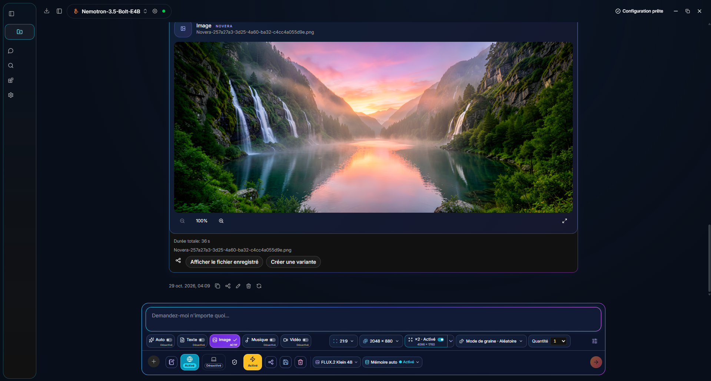

  
  
<strong>Vous décrivez. Novera prépare, exécute et organise.</strong>

  
Un assistant IA indépendant de TRON-ABS, du premier démarrage aux résultats : texte, images, musique et vidéo dans la même discussion.

  
<strong>En développement</strong> · 80 langues d’interface · 42 fournisseurs cloud · 49 préréglages média · Apache 2.0

  
<a href="#du-démarrage-au-résultat">Automatisation</a> · <a href="#un-tableau-de-bord-pour-tout-créer">Tableau de bord</a> · <a href="#modèles-locaux-utilisés">Modèles locaux</a> · <a href="#fournisseurs-cloud">Cloud</a> · <a href="README.md">English</a> · <a href="CONTRIBUTING.md">Contribuer</a>

  
Contact officiel : <a href="mailto:contact.novera.tronabs@gmail.com">contact.novera.tronabs@gmail.com</a>

---

## Un tableau de bord pour tout créer

*Capture réelle de l’application Windows fournie par le mainteneur le 29 octobre 2026. Elle montre une image et le panneau utilisé pour la créer ; ce n’est pas une maquette.*

Un seul panneau, cinq modes : **Auto, Texte, Image, Musique et Vidéo**. Les réglages suivent le mode choisi : format, résolution, durée, cadence, qualité, instrumental, paroles, graine et quantité. La largeur du panneau et les boutons s’adaptent à la fenêtre et aux libellés traduits.

- **1 à 10 générations successives**, avec 1 par défaut et une quantité indépendante pour l’image, la musique et la vidéo. Arrêter interrompt la tâche active et la suite.
- **Graines aléatoires, fixes, +1 ou −1**, formats prédéfinis ou personnalisés et agrandissement optionnel **Real-ESRGAN ×2/×4**, avec dimensions finales affichées.
- Modèle sélectionné, mémoire automatique, pièces jointes, consignes, recherche web et outils restent accessibles dans la même barre. Les outils dépendent des capacités du modèle et des autorisations accordées.

## Du démarrage au résultat

**Notre système automatisé relie la préparation à l’exécution complète du parcours.** Il prend en charge les étapes techniques disponibles pour la configuration choisie, avec des réglages avancés accessibles lorsque vous en avez besoin.

| Étape | Ce que Novera prend en charge |
| --- | --- |
| **1. Démarrer** | Choisit une langue système prise en charge au premier lancement, puis conserve votre préférence. Présente les modèles de départ et les informations utiles sur le matériel. |
| **2. Préparer** | L’installation guidée propose texte, embeddings, image, musique, vidéo et agrandissement. Elle affiche composants, tailles et espace disponible avant votre validation, puis suit les téléchargements avec progression, pause/reprise et vérification SHA-256. |
| **3. Configurer** | Enregistre les modèles et leurs composants, prépare les profils adaptés et signale les dépendances à installer. L’embedding de recherche démarre sur CPU ; son placement CPU/GPU reste configurable. Le mode instrumental est activé par défaut pour les nouveaux profils musicaux. |
| **4. Comprendre la demande** | Le mode Auto oriente les demandes de création reconnues vers le texte, l’image, la musique ou la vidéo. Vous pouvez aussi choisir explicitement le mode et le modèle, local ou cloud. |
| **5. Exécuter** | La mémoire automatique attend les travaux actifs, libère les modèles inutiles et recharge les ressources nécessaires. Une série de 1 à 10 tâches s’exécute dans l’ordre, avec libération des ressources avant la suivante. Les fournisseurs cloud utilisent le compte et la configuration sélectionnés. |
| **6. Retrouver et réutiliser** | Enregistre les médias dans les dossiers système Novera, affiche les résultats et les durées disponibles, puis propose variantes, bibliothèque, copie, export ou partage système. L’envoi vers une autre application reste votre action. |

L’automatisation couvre les moteurs et parcours intégrés ; elle ne rend pas exécutable n’importe quel modèle du Hub. Matériel, composants installés et accès fournisseur déterminent les possibilités. Les dossiers, modifications de fichiers et commandes shell suivent les autorisations de la conversation.

[Guide d’utilisation](docs/USER_GUIDE.md) · [Moteurs et validations](docs/SUIVI_MOTEURS.md) · [Architecture](docs/DEVELOPMENT.md)

## Capacités disponibles dans les sources

| Domaine | Fonctions |
| --- | --- |
| **Texte et vision** | Conversation, documents joints, réponses progressives et modèles locaux ou cloud. La vision dépend du modèle ; comprendre une image et en générer une sont deux capacités distinctes. |
| **Image** | Création dans la discussion, graines, ratios, résolution, composants GGUF/Safetensors, dossiers Diffusers configurés et chemin NVFP4 CUDA pour le profil pris en charge. |
| **Musique** | Création locale ou cloud, durée, qualité, instrumental ou chant selon le moteur, paroles structurées et lecteur audio. Les fournisseurs n’exposent pas tous les mêmes options. |
| **Vidéo** | Création locale ou cloud, durée, nombre d’images/cadence pour les profils locaux, ratios, résolution et lecteur vidéo. |
| **Recherche et outils** | Recherche web, recherche documentaire avec embeddings, MCP, espaces de travail et outils locaux selon le modèle et les accès accordés. |
| **Résultats et partage** | Bibliothèque média, variantes, export de réponses ou discussions, documents et médias d’origine, impression/PDF et partage système selon la plateforme. |
| **Maîtrise des ressources** | Mémoire automatique activée par défaut, réglages CPU/GPU des composants pris en charge et profils manuels lorsque les ressources le permettent. |

## Modèles locaux utilisés

Ces modèles constituent la configuration guidée actuelle. Vous pouvez importer d’autres modèles compatibles ou modifier les profils.

| Usage | Modèle / composants de la configuration |
| --- | --- |
| **Texte — modèle de départ** | **Nemotron-3.5-Bolt-E4B**, fichier `Nemotron-3.5-Bolt-E4B-Q4_K_M.gguf`. |
| **Recherche documentaire** | **Qwen3-Embedding-0.6B Q8_0**, placement **CPU par défaut**, choix CPU/GPU enregistré. |
| **Image** | **FLUX.2 Klein 4B Q4_K_M**, encodeur **Qwen3-4B Q4_K_M** et VAE FLUX.2 officiel. |
| **Image — option matérielle** | **FLUX.2 Klein 4B NVFP4**, via le chemin CUDA natif lorsque le GPU et l’environnement sont compatibles. |
| **Musique** | **ACE-Step 1.5 Turbo 2B Q4_K_M**, planificateur `acestep-5Hz-lm-1.7B-Q8_0.gguf`, encodeur musical Qwen3 et VAE associés. |
| **Vidéo** | **Wan2.1 T2V 1.3B Q4_K_M**, encodeur **UMT5-XXL Q4_K_M** et VAE Wan 2.1. |
| **Agrandissement** | **Real-ESRGAN ×2 et ×4**, optionnel, avec vérification des dépendances. |

L’encodeur Qwen du profil musical et le modèle Qwen de recherche sont **deux fichiers différents**, conservés dans leurs dossiers respectifs. Les licences des modèles restent celles de leurs éditeurs.

[Manifestes texte](web-app/src/constants/text-manifest.json) · [Embeddings](web-app/src/constants/embedding-manifest.json) · [Musique](web-app/src/constants/music-manifest.json) · [Composants image/vidéo](src-tauri/src/core/creation_bundle.rs)

## Fournisseurs cloud

**42 profils fournisseurs** sont intégrés. **ElevenLabs** complète désormais la vitrine, aux côtés des routes musicales de Stability AI, fal et Replicate.

| | | |
| --- | --- | --- |
|  [OpenAI](https://platform.openai.com/docs/models) |  [Microsoft Azure](https://oai.azure.com/deployments) |  [Anthropic](https://platform.claude.com/docs/en/models/overview) |
|  [OpenRouter](https://openrouter.ai/models) |  [Mistral](https://docs.mistral.ai/models) |  [Groq](https://console.groq.com/docs/models) |
|  [xAI](https://docs.x.ai/developers/models) |  [Google Gemini](https://ai.google.dev/gemini-api/docs/models) |  [MiniMax](https://platform.minimax.io/docs/api-reference/text-openai-api) |
|  [Hugging Face](https://huggingface.co/models?pipeline_tag=text-generation&inference_provider=all) |  [NVIDIA NIM](https://build.nvidia.com/models) |  [DeepSeek](https://api-docs.deepseek.com/) |
|  [Kimi · Moonshot AI](https://platform.kimi.ai/docs/models) |  [Alibaba Cloud · Qwen](https://www.alibabacloud.com/help/en/model-studio/models) |  [Cerebras](https://inference-docs.cerebras.ai/models/overview) |
|  [Together AI](https://docs.together.ai/docs/serverless/models) |  [Fireworks AI](https://docs.fireworks.ai/getting-started/models) |  [Perplexity](https://docs.perplexity.ai/docs/agent-api/models) |
|  [Meta AI](https://dev.meta.ai/docs/models) |  [Cohere](https://docs.cohere.com/docs/models) |  [Z.ai](https://docs.z.ai/guides/llm/glm-5.3) |
|  [AI21 Labs](https://docs.ai21.com/docs/jamba-foundation-models) |  [BytePlus · ByteDance](https://docs.byteplus.com/en/docs/modelark/model-parameter-support) |  [Baidu Qianfan](https://cloud.baidu.com/doc/qianfan/s/rmh4stp0j) |
|  [Tencent TokenHub](https://cloud.tencent.com/document/product/1823/130078) |  [Amazon Bedrock](https://docs.aws.amazon.com/bedrock/latest/userguide/inference-chat-completions.html) |  [IBM watsonx](https://www.ibm.com/docs/en/watsonx/saas?topic=preview-inferencing-gateway-models) |
|  [ElevenLabs](https://elevenlabs.io/docs/api-reference/music/compose) |  [Black Forest Labs](https://docs.bfl.ai/quick_start/generating_images) |  [Stability AI](https://docs.stability.ai/api-reference) |
|  [Recraft](https://www.recraft.ai/docs/api-reference/agents.md) |  [Ideogram](https://developer.ideogram.ai/ideogram-api/api-overview) |  [Adobe Firefly](https://developer.adobe.com/firefly-services/docs/firefly-api/) |
|  [Runway](https://docs.dev.runwayml.com/api/) |  [Luma](https://docs.agents.lumalabs.ai/guides/model/) |  [LTX (Lightricks)](https://docs.ltx.io/models) |
|  [fal](https://fal.ai/docs/documentation/model-apis/inference/queue) |  [Replicate](https://replicate.com/docs/reference/http) |  [Leonardo.Ai](https://docs.leonardo.ai/reference/creategeneration) |
|  [Krea](https://www.krea.ai/docs/developers/krea-3/overview) |  [Vidu](https://platform.vidu.com/docs/model-map) |  [PixVerse](https://docs.platform.pixverse.ai/changelog-2394996m0) |

### Image, musique et vidéo

**20 fournisseurs exposent des routes de génération**, avec **49 préréglages : 25 image, 20 vidéo et 4 musique**. Les routes musicales sont **ElevenMusic v2.5**, **Stable Audio 3**, **ACE-Step via fal** et **Stable Audio 2.5 via Replicate**.

| Fournisseur | Sorties dans Novera | Modèles du catalogue |
| --- | --- | --- |
|  [ElevenLabs](https://elevenlabs.io/docs/api-reference/music/compose) | Musique | `ElevenMusic v2.5` |
|  [Stability AI](https://docs.stability.ai/api-reference/stable-audio/text-to-audio) | Image / Musique | `Stable Audio 3` · `Stable Image Ultra` · `Stable Image Core` |
|  [fal](https://fal.ai/models/fal-ai/ace-step/api) | Image / Musique / Vidéo | `ACE-Step · cloud` · `Pika 2.2 · fal` · `Qwen Image 2512 · fal` · `FLUX.2 Max · fal` · `Kling 3 Pro · fal` · `Kling 3 Standard · fal` |
|  [Replicate](https://replicate.com/stability-ai/stable-audio-2.5/api/schema) | Image / Musique | `Stable Audio 2.5 · Replicate` · `FLUX.2 Max · Replicate` |
|  [BytePlus · ByteDance](https://docs.byteplus.com/en/docs/ModelArk/image-generation-api) | Image / Vidéo | `Dola Seedream 5 Pro` · `Dreamina Seedance 2.5` |
|  [Adobe Firefly](https://developer.adobe.com/firefly-services/docs/firefly-api/api/) | Image / Vidéo | `Adobe Firefly Image 5` · `Adobe Firefly Video` |
|  [Google Gemini](https://ai.google.dev/gemini-api/docs/omni) | Image / Vidéo | `Gemini Omni 1.1 Flash` · `Gemini Nano Banana 2.1` |
|  [Krea](https://www.krea.ai/docs/developers/krea-3/overview.md) | Image | `Krea 3` |
|  [Leonardo.Ai](https://docs.leonardo.ai/docs/lucid-origin) | Image | `Lucid Origin` · `Krea 2 Turbo · Leonardo` · `Ideogram 3 · Leonardo` |
|  [Vidu](https://platform.vidu.com/docs/api-reference/video-models/vidu-q4-preview/image-to-video) | Vidéo | `Vidu Q4 Preview` · `Vidu Q3 Pro` · `Vidu Q3 Turbo` |
|  [OpenAI](https://developers.openai.com/api/docs/guides/image-generation) | Image | `GPT Image 2.5 Sunburst` · `GPT Image 2.5 Flare` |
|  [xAI](https://docs.x.ai/developers/model-capabilities/imagine) | Image / Vidéo | `Grok Imagine Image 2.0` · `Grok Imagine Video 1.5` · `Grok Imagine Video 1.5 Lite` |
|  [Black Forest Labs](https://docs.bfl.ai/quick_start/generating_images) | Image | `FLUX.2 [max]` · `FLUX.2 [pro]` · `FLUX.2 [klein] 9B` |
|  [Recraft](https://www.recraft.ai/docs/api-reference/agents.md) | Image | `Recraft V4.1` · `Recraft V4.1 Flash` · `Recraft V4.1 Pro` |
|  [Ideogram](https://developer.ideogram.ai/ideogram-api/api-overview) | Image | `Ideogram 4.5` |
|  [Runway](https://docs.dev.runwayml.com/api/) | Vidéo | `Runway Gen-4.5` |
|  [Luma](https://docs.agents.lumalabs.ai/guides/model/) | Image / Vidéo | `Luma Uni-1 Max` · `Luma Uni-1` · `Luma Ray 3.2` |
|  [LTX (Lightricks)](https://docs.ltx.io/models) | Vidéo | `LTX-2.5 Pro` · `LTX-2.5 Fast` |
|  [MiniMax](https://platform.minimax.io/docs/api-reference/video-generation-v2-create) | Image / Vidéo | `MiniMax H3 Max` · `MiniMax H3` · `MiniMax H3 Highspeed` · `MiniMax Image-01` |
|  [PixVerse](https://docs.platform.pixverse.ai/changelog-2394996m0) | Vidéo | `PixVerse V6 Max` · `PixVerse V6` |

<strong>Voir les modèles texte et vision proposés par fournisseur</strong>

| Fournisseur | Identifiants proposés dans les sources |
| --- | --- |
| [OpenAI](https://platform.openai.com/docs/models) | `gpt-6.1-sol` · `gpt-6-astra` · `gpt-6-luna` · `gpt-6-sol` |
| [Microsoft Azure](https://oai.azure.com/deployments) | Déploiement ou passerelle propre au compte |
| [Anthropic](https://platform.claude.com/docs/en/models/overview) | `claude-sonnet-5-5` · `claude-opus-5-5` · `claude-fable-5-1` · `claude-haiku-5-5` |
| [OpenRouter](https://openrouter.ai/models) | `moonshotai/kimi-k3.1-pro` · `minimax/minimax-m3.1-flash` · `deepseek/deepseek-v4.1-flash-1017` · `nvidia/nemotron-3.5-super-vl:free` |
| [Mistral](https://docs.mistral.ai/models) | `mistral-large-4` · `mistral-medium-3-5` · `mistral-small-2603` · `ministral-3b-2512` |
| [Groq](https://console.groq.com/docs/models) | `openai/gpt-oss-120b` · `openai/gpt-oss-20b` · `llama-3.3-70b-versatile` · `llama-3.1-8b-instant` |
| [xAI](https://docs.x.ai/developers/models) | `grok-4.7` |
| [Google Gemini](https://ai.google.dev/gemini-api/docs/models) | `gemini-4-argon` · `gemini-3.8-flash` · `gemini-3.6-flash` · `gemini-3.5-flash-lite` |
| [MiniMax](https://platform.minimax.io/docs/api-reference/text-openai-api) | `MiniMax-M3.1-Flash` · `MiniMax-M3` |
| [Hugging Face](https://huggingface.co/models?pipeline_tag=text-generation&inference_provider=all) | `deepseek-ai/DeepSeek-V4.1-Flash-1017` · `Qwen/Qwen3.8-27B` · `moonshotai/Kimi-K3` · `zai-org/GLM-5.3` |
| [NVIDIA NIM](https://build.nvidia.com/models) | `minimaxai/minimax-m3.1-flash` · `deepseek-ai/deepseek-v4.1-flash` · `nvidia/nemotron-3.5-super-vl-120b-a12b` · `nvidia/nemotron-3.5-lightning-30b-a3b` · `z-ai/glm-5.3` |
| [DeepSeek](https://api-docs.deepseek.com/) | `deepseek-flash` · `deepseek-v4-pro` |
| [Kimi · Moonshot AI](https://platform.kimi.ai/docs/models) | `kimi-k3.1-pro` · `kimi-k3.1-pro-highspeed` · `kimi-k3` |
| [Alibaba Cloud · Qwen](https://www.alibabacloud.com/help/en/model-studio/models) | `qwen3.8-max` · `qwen3.7-plus` · `qwen3.8-flash` |
| [Cerebras](https://inference-docs.cerebras.ai/models/overview) | `qwen-3.8-27b` · `gpt-oss-120b` |
| [Together AI](https://docs.together.ai/docs/serverless/models) | `deepseek-ai/DeepSeek-V4.1-Flash-1017` · `moonshotai/Kimi-K3` · `Qwen/Qwen3.8-Flash` · `Qwen/Qwen3.8-2.4T-A95B` |
| [Fireworks AI](https://docs.fireworks.ai/getting-started/models) | `accounts/fireworks/models/deepseek-v4p1-flash-1017` · `accounts/fireworks/models/kimi-k3` · `accounts/fireworks/models/minimax-m3` |
| [Perplexity](https://docs.perplexity.ai/docs/agent-api/models) | `perplexity/sonar` · `openai/gpt-6.1-sol` · `google/gemini-4-argon` · `perplexity/kimi-k3` |
| [Meta AI](https://dev.meta.ai/docs/models) | `muse-wonder-1.0` · `muse-spark-1.3` |
| [Cohere](https://docs.cohere.com/docs/models) | `command-a-plus-05-2026` |
| [Z.ai](https://docs.z.ai/guides/llm/glm-5.3) | `glm-5.3` · `glm-5.3-flash` · `glm-5.3-flashx` |
| [AI21 Labs](https://docs.ai21.com/docs/jamba-foundation-models) | `jamba-large` · `jamba-mini-2` |
| [BytePlus · ByteDance](https://docs.byteplus.com/en/docs/modelark/model-parameter-support) | `dola-seed-2-1-turbo-260628` |
| [Baidu Qianfan](https://cloud.baidu.com/doc/qianfan/s/rmh4stp0j) | `ernie-5.1` |
| [Tencent TokenHub](https://cloud.tencent.com/document/product/1823/130078) | `hy4-preview` |
| [Amazon Bedrock](https://docs.aws.amazon.com/bedrock/latest/userguide/inference-chat-completions.html) | `openai.gpt-6.1-sol` |
| [IBM watsonx](https://www.ibm.com/docs/en/watsonx/saas?topic=preview-inferencing-gateway-models) | Déploiement ou passerelle propre au compte |

Inventaire relu dans les sources le **29 octobre 2026**. Ces noms décrivent les préréglages de Novera, pas une garantie d’accès pour chaque compte. Catalogue distant, région, licences, quotas et facturation restent propres au fournisseur. Les profils compatibles peuvent actualiser leur catalogue ; Azure et certaines passerelles utilisent les déploiements du compte. Les contrats cloud ont des tests simulés ; aucune génération payante n’a été lancée pour cette mise à jour de la vitrine.

[Catalogue média](web-app/src/constants/mediaProviders.ts) · [Modèles texte/vision](web-app/src/constants/cloudModels.ts) · [Configuration cloud](docs/USER_GUIDE.md#cloud) · [Provenance des logos](docs/DEVELOPMENT.md#logos)

## Hub et modèles compatibles

Explorez les catégories du Hub Hugging Face, les formats **GGUF, MLX et Safetensors**, les rôles des modèles et les conseils matériels avant de télécharger. Les résultats se chargent progressivement au défilement. Les moteurs comprennent llama.cpp, MLX sur les plateformes prises en charge et Transformers pour les architectures textuelles reconnues ; l’image et la vidéo utilisent leurs moteurs et composants dédiés.

La présence d’un modèle dans le catalogue ne garantit ni sa compatibilité ni son exécution sur votre machine. Le guide présente les parcours réellement testés : [suivi des moteurs](docs/SUIVI_MOTEURS.md).

## 80 langues et variantes d’interface

Les **80 catalogues couvrent les 2 400 clés anglaises actuelles**, dans 15 espaces de noms : menus, configurations, réglages, aides et contrôles média. Les formes plurielles et la direction de l’interface suivent la langue choisie. La langue des réponses et des voix dépend séparément du modèle.

Cette couverture technique ne certifie pas la qualité linguistique : **relecture native et adaptation régionale restent nécessaires**. Consultez les langues, leurs noms et les limites connues dans le [guide des langues](docs/LANGUAGES.md) et le [rapport d’audit](deliverables/interface-audit-2026-10-29/RAPPORT.md).

## Aider les personnes, dans tous les secteurs

Au-delà de l’école et de l’éducation, notre ambition est d’aider chacun à apprendre, résoudre des problèmes, créer et développer des projets utiles, partout dans le monde. Novera veut rendre les avancées récentes de l’IA plus simples à comprendre et à utiliser, quelles que soient la langue, l’expérience et les ressources matérielles.

| Secteurs que nous souhaitons aider à développer | Exemples de contributions utiles |
| --- | --- |
| Écoles, éducation et formation tout au long de la vie | Expliquer, adapter les supports et accompagner enseignants, élèves et familles. |
| Recherche, sciences et espace | Explorer les connaissances, expliquer les méthodes, analyser des données et partager le savoir. |
| Santé, soins et accompagnement social | Rendre l’information compréhensible et soutenir la recherche et le travail des professionnels. |
| Agriculture, alimentation et territoires ruraux | Partager les connaissances pratiques, aider à planifier et développer des outils adaptés au terrain. |
| Environnement, climat, eau et biodiversité | Expliquer les données, soutenir l’observation et accompagner les projets des communautés. |
| Énergie, industrie, construction et artisanat | Aider à documenter, concevoir, entretenir, apprendre et améliorer les pratiques. |
| Entreprises, commerce, finance et emploi | Organiser le travail, comprendre l’information, développer des projets et acquérir des compétences. |
| Services publics, droit et participation citoyenne | Rendre les documents, démarches et connaissances plus accessibles. |
| Informatique, cybersécurité, robotique et télécommunications | Développer des logiciels, comprendre les systèmes et créer des outils utiles. |
| Arts, culture, médias, langues et patrimoine | Accompagner l’écriture, la traduction, l’image, la vidéo, la création et le partage culturel. |
| Transport, logistique, tourisme, sport et vie associative | Aider à planifier, communiquer, apprendre et soutenir les initiatives locales. |
| Accessibilité, action humanitaire et vie quotidienne | Réduire les barrières de langue et de connaissance et apporter une aide pratique aux personnes. |

Ces domaines constituent une direction de contribution et de développement, pas l’annonce que tous les usages spécialisés sont déjà livrés ou validés. Nous voulons des parcours simples au quotidien, des options avancées compréhensibles lorsque nécessaires, des besoins matériels et cloud transparents, et une collaboration avec les personnes qui connaissent chaque métier et chaque contexte local.

## État du projet

**Novera 1.0.0 est en développement.** La capture montre une application Windows compilée localement par le mainteneur. Les sources, les essais ciblés et les validations matérielles sont documentés séparément ; cela ne vaut pas validation de tous les modèles, plateformes ou comptes cloud.

La vitrine est actualisée sans nouvelle compilation. Les canaux de distribution et leurs conditions figurent dans la [politique de versions officielles](OFFICIAL_RELEASES.md) et sur la [page des versions](https://github.com/TRON-ABS/Novera/releases). GitHub Actions et mises à jour automatiques restent désactivés conformément à la configuration du projet.

## Documentation et contribution

- [Guide utilisateur](docs/USER_GUIDE.md), [modèles et moteurs](docs/SUIVI_MOTEURS.md).
- [Développement](docs/DEVELOPMENT.md), [construction et distribution](docs/BUILD_AND_RELEASE.md).
- [Tableau de bord du projet](TABLEAU_DE_BORD_NOVERA.md), [feuille de route](ROADMAP.md), [historique](docs/CHANGELOG.md).
- [Contribuer](CONTRIBUTING.md) : code, tests, relecture des 80 langues et retours sur les parcours réels.

## Identité et licence

Novera est maintenu par **TRON-ABS** dans [ce dépôt](https://github.com/TRON-ABS/Novera). [Politique d’identité](BRANDING.md), [versions officielles](OFFICIAL_RELEASES.md).

Novera s’appuie sur [Jan](https://github.com/janhq/jan), créé par Menlo Research et ses contributeurs. Les attributions d’origine, celles des projets tiers et la [licence Apache 2.0](LICENSE) sont conservées. Les téléchargements Jan ne sont pas des versions Novera.
