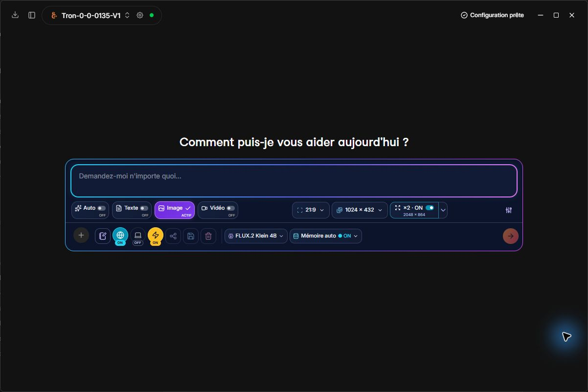

  
  
<strong>Le savoir pour tous. Une IA qui avance avec son temps.</strong>

  
Un assistant IA indépendant porté par TRON-ABS, réunissant modèles locaux, fournisseurs cloud et outils évolutifs.

  
<strong>En développement</strong> · 80 langues et variantes d’interface · 41 fournisseurs cloud · Apache 2.0

  
Contact officiel : <a href="mailto:contact.novera.tronabs@gmail.com">contact.novera.tronabs@gmail.com</a>

  
<a href="#panneau-compact-et-consignes-ciblées">Panneau compact</a> ·
    <a href="#fournisseurs-cloud">Fournisseurs cloud</a> · <a href="#catalogue-de-modèles-hugging-face">Modèles locaux</a> · <a href="README.md">English</a> · <a href="docs/LANGUAGES.md">Langues</a> · <a href="ROADMAP.md">Feuille de route</a> · <a href="CONTRIBUTING.md">Contribuer</a>

---

## Fenêtre commune et accès explicites

Sources du 27 octobre 2026 : le compositeur existant reste en bas d’une seule fenêtre, avec navigation repliable cyan/violet et **Nouveau projet** sur dossier. Avant l’ouverture, choisir lecture seule (par défaut), confirmation avant modification/suppression, ou autorisation explicite de ces changements. Le shell demande son propre premier accord : une commande, ou cette conversation jusqu’au redémarrage. Le bouton bouclier permet de revoir l’accès au dossier et de réinitialiser les accords. Les accords MCP ne donnent aucun accord implicite au shell natif.

Les commandes vidéo de la discussion ajoutent nombre d’images et cadence au format et à la résolution des profils locaux. Les projets sur dossier gardent leur parcours d’outils texte dans la même fenêtre. Les nouveaux textes couvrent toutes les langues déjà disponibles : 80 catalogues × 1 742 clés. Relecture native toujours nécessaire.

Validation locale : 768 tests web dans 51 fichiers, TypeScript, sept tests d’architecture et contrôle des catalogues. Le contrôle visuel complet dans une application recompilée, les commandes réelles sur chaque plateforme et les nouveaux rendus vidéo restent à réaliser. **Sources uniquement ; aucun nouveau binaire ni validation CI.** Voir le [guide](docs/USER_GUIDE.md#nouveau-projet-et-choix-daccès--sources-du-27-octobre-2026).

## Panneau compact et consignes ciblées

*Capture du build Windows local, interface française. Le panneau vide est présenté sans historique de conversation.*

- Distinguer les choix actifs : fond coloré, coche et mentions ON/OFF explicites.
- Régler directement ratio et résolution ; activer ou désactiver l’agrandissement ×2/×4 en voyant la taille finale.
- Modifier uniquement les trois consignes Texte, Image et Vidéo depuis le bouton de carnet. Aucun paramètre du modèle dans cet éditeur. Réinitialiser, sauvegarder ou annuler.
- Utiliser 240 consignes par défaut traduites dans les 80 locales ; les personnalisations résistent aux changements de langue. Auto reconnaît davantage de demandes françaises/anglaises ; la rédaction et les explications restent du texte.

**Validation locale :** 420 tests, TypeScript, builds interface et Release Windows, et contrôle visuel du panneau et du dialogue. Build local, sans publication de binaire ni validation de tous les modèles, langues et matériels. [Utilisation et limites](docs/USER_GUIDE.md#real-esrgan--chemins-windows-python-et-taille-finale--26-octobre-2026).

## Aider les personnes, dans tous les secteurs

Au-delà de l’école et de l’éducation, notre ambition est d’aider chacun à apprendre, résoudre des problèmes, créer et développer des projets utiles, partout dans le monde. Novera veut rendre les avancées récentes de l’IA plus simples à comprendre et à utiliser, quelles que soient la langue, l’expérience et les ressources matérielles.

| Secteurs que nous souhaitons aider à développer | Exemples de contributions utiles |
| --- | --- |
| Écoles, éducation et formation tout au long de la vie | Expliquer, adapter les supports et accompagner enseignants, élèves et familles. |
| Recherche, sciences et espace | Explorer les connaissances, expliquer les méthodes, analyser des données et partager le savoir. |
| Santé, soins et accompagnement social | Rendre l’information compréhensible et soutenir la recherche et le travail des professionnels. |
| Agriculture, alimentation et territoires ruraux | Partager les connaissances pratiques, aider à planifier et développer des outils adaptés au terrain. |
| Environnement, climat, eau et biodiversité | Expliquer les données, soutenir l’observation et accompagner les projets des communautés. |
| Énergie, industrie, construction et artisanat | Aider à documenter, concevoir, entretenir, apprendre et améliorer les pratiques. |
| Entreprises, commerce, finance et emploi | Organiser le travail, comprendre l’information, développer des projets et acquérir des compétences. |
| Services publics, droit et participation citoyenne | Rendre les documents, démarches et connaissances plus accessibles. |
| Informatique, cybersécurité, robotique et télécommunications | Développer des logiciels, comprendre les systèmes et créer des outils utiles. |
| Arts, culture, médias, langues et patrimoine | Accompagner l’écriture, la traduction, l’image, la vidéo, la création et le partage culturel. |
| Transport, logistique, tourisme, sport et vie associative | Aider à planifier, communiquer, apprendre et soutenir les initiatives locales. |
| Accessibilité, action humanitaire et vie quotidienne | Réduire les barrières de langue et de connaissance et apporter une aide pratique aux personnes. |

Ces domaines constituent une direction de contribution et de développement, pas l’annonce que tous les usages spécialisés sont déjà livrés ou validés. Nous voulons des parcours simples au quotidien, des options avancées compréhensibles lorsque nécessaires, des besoins matériels et cloud transparents, et une collaboration avec les personnes qui connaissent chaque métier et chaque contexte local.

## Les fondations

| Domaine | Présent dans les sources |
| --- | --- |
| IA locale et cloud | Un Hub relié directement à Hugging Face et 41 fournisseurs cloud prédéfinis. Les formats et modèles utilisables dépendent du moteur, du compte et du matériel. |
| Outils et documents | Des intégrations MCP, la recherche dans les documents et des fonctions d’assistant héritées du code existant. |
| Interface multilingue | 80 locales sélectionnables couvrant chacune les 1 742 clés anglaises actuelles. Relecture native encore nécessaire. |
| Application extensible | Une application de bureau avec des points d’extension pour les moteurs, les outils et les futures capacités. |

Ces éléments décrivent les sources. Le dernier build 1.0.0 Windows x64 a été compilé et démarré localement le 26 octobre 2026, avec le panneau compact et les consignes par catégorie. La distribution publique et la validation sur davantage de matériels restent à préparer.

## Texte, images et vidéo dans la même discussion

Les sources ajoutent les graines aléatoire/fixe/+1/−1, la limite de génération 2048 × 2048 et l’agrandissement Real-ESRGAN optionnel ×2/×4, désactivé initialement. Modèles officiels installables avec vérification ou fichier local ; Python/PyTorch requis pour l’agrandissement. [Utilisation et limites](docs/USER_GUIDE.md#graines-résolution-et-agrandissement--sources-du-26-octobre-2026). Inclus dans le dernier build Windows local ; aucun binaire public publié.

- Choisir Texte, Image, Vidéo ou Multimodal, en Local ou Cloud, sans quitter la discussion. Un modèle qui comprend une image ne sait pas forcément en créer.
- Sauvegarder automatiquement les créations terminées dans les dossiers système Images/**Novera image** et Vidéos/**Novera vidéo**. Afficher la durée totale sous les images/vidéos, ainsi que le temps de génération lorsque le moteur le fournit.
- Utiliser des dossiers Diffusers complets, des composants GGUF/Safetensors compatibles avec stable-diffusion.cpp, ou le parcours **NVFP4 CUDA natif** reconnu pour Comfy FLUX.2 Klein 4B. Les moteurs à composants permettent de choisir séparément le matériel de l’encodeur et du générateur.
- Recevoir les conseils du Hub avant téléchargement : rôle des modèles, matériel/mémoire, conditions NVFP4 et compromis GGUF. Q6_K minimum conseillé pour privilégier la fidélité ; Q4_K_M pour l’équilibre qualité/mémoire. Ces repères dépendent du modèle.

Une vraie image NVFP4 512 × 512 sur RTX 5070 Laptop a exécuté **400 GEMM FP4 matérielles**, avec Qwen3 GGUF et un VAE FLUX.2 Safetensors. Les choix CPU/GPU/Auto de l’encodeur ont été essayés. Le chemin C++ de compatibilité a aussi produit des images réelles CPU/Vulkan ; il utilise un cache plus volumineux et ne calcule pas en FP4 natif. Des fixtures PNG/MP4 minuscules ont validé la création locale et les durées. Les contrats HTTP cloud sont testés avec des réponses simulées, sans génération payante ni accès de compte validé. Le binaire Windows compilé par le mainteneur a maintenant généré et affiché une vraie image 512 × 512 avec le trio conseillé FLUX.2 Klein Q4_K_M + Qwen3 Q4_K_M CPU + VAE officiel, enregistrée dans Images/Novera image, avec une durée totale affichée de 25,5 s lors de l’essai initial documenté. Le mainteneur signale désormais **11,3 secondes sans agrandissement Real-ESRGAN**. Cela valide ce parcours graphique GGUF/C++/Vulkan sur un PC ; les autres parcours restent à tester. Voir le [diagnostic graphique](docs/SUIVI_MOTEURS.md#diagnostic-graphique-et-trio-gguf-réel--26-octobre-2026). Voir [les preuves et limites](docs/SUIVI_MOTEURS.md#nvfp4-cuda-natif-placement-et-durées--26-octobre-2026).

## Partager les résultats vers les documents et messageries

La petite icône Partager sous une réponse, image ou vidéo propose le résultat seul, la branche active complète — messages hors écran compris — ou une sélection. Aperçu avant copie, enregistrement, impression/PDF et partage système. Markdown/TXT/HTML/DOCX/ODT/RTF/EPUB/JSON/CSV/ZIP, original préservé, onze formats matriciels dont AVIF et SVG avec image incorporée. Les profils locaux image/vidéo proposent **19 ratios plus un rapport personnalisé** et des résolutions ajustées au grand côté actuel. Quand Real-ESRGAN est activé, un bouton coloré à droite indique le facteur et les dimensions finales ; Python est contrôlé avant génération et les anciens chemins Windows sont réparés.

Les applications de chat et messageries utilisent les possibilités du système, avec **Copier le fichier** et Enregistrer comme autres parcours. Le mainteneur a ensuite confirmé le bon fonctionnement sur son PC. Ce retour utilisateur ne constitue pas une validation de toutes les messageries ou des autres plateformes. Le partage système Windows est réactivé après reproduction du problème hors Novera ; Copier le fichier/Enregistrer restent disponibles, avec copie de fichier hors du fil d’interface. Adaptateurs dans les sources pour macOS, Android, iOS et Linux ; Linux ouvre un courriel XDG et copie le fichier pour les applications compatibles. Les destinations dépendent des logiciels installés et formats acceptés. Aucun envoi automatique ni lien public hébergé. **145 tests web, trois tests Rust isolés, contrôle natif Windows, TypeScript et Vite réussis** ; autres plateformes et passage réel aux applications encore à essayer après recompilation de Novera. [Guide, formats et limites](docs/USER_GUIDE.md#partage-des-résultats-et-ratios--sources-du-26-octobre-2026).

Les pièces jointes transmises au partage système, au partage navigateur et à **Copier le fichier** utilisent désormais un nom ASCII compatible : accents simplifiés, espaces et caractères spéciaux remplacés, nom de secours `Novera` si nécessaire. L’extension réelle, le titre et le contenu multilingue sont conservés ; l’enregistrement local garde le nom proposé en langue d’origine. Cette protection commune vise les applications destinataires au-delà de WhatsApp. Elle nécessite une nouvelle compilation de Novera.

## Automatisation avancée, simplicité par défaut

Novera vise à prendre en charge les étapes techniques pour que chacun, partout dans le monde, puisse se concentrer sur l’apprentissage, la discussion et la création. Les sources réunissent déjà conseils matériels, téléchargements guidés et vérifiés, configurations média par catégorie, moteur image Windows embarqué et sauvegarde dans les dossiers système.

**La gestion automatique de la mémoire est activée par défaut.** Les demandes locales texte/image/vidéo attendent le travail actif, libèrent les modèles inutiles et rechargent le modèle sélectionné au besoin. Fichiers, conversations et sélections sont conservés. Le **mode Manuel** permet texte, image et vidéo ensemble dans des discussions distinctes selon la RAM/VRAM et les moteurs. Les workers média actuels se terminent après la génération ; aucun cache média permanent n’est ajouté. Les deux modes et leurs limites sont expliqués dans les 80 locales, avec état d’attente visible et réglage commun dans Général.

369 tests web ciblés, trois tests natifs de politique, types et langues valident les sources d’orchestration. Le test complet de trois modèles lourds dans l’application dépend encore du matériel. Aucun nouveau binaire publié. [Guide mémoire](docs/USER_GUIDE.md#mémoire-automatique-ou-modèles-en-parallèle--26-octobre-2026) · [Direction produit](NOVERA.md#direction-produit--automatisation-avancée-simplicité-mondiale).

## Installation guidée des modèles média locaux

Les compilations Windows embarquent désormais le moteur privé stable-diffusion.cpp **CUDA 13.4.3 / Vulkan / CPU**. Le champ exécutable est masqué sous Windows : Novera résout son lanceur intégré et ignore les anciens remplacements enregistrés. Les NVIDIA Maxwell/Pascal/Volta passent par Vulkan si leur pilote l’expose, sinon par CPU ; cette politique ne constitue pas une certification matérielle.

**Installer cette configuration** présente la configuration complète FLUX.2 Klein 4B, les tailles, l’espace libre, les licences et le dossier Documents du système ou un emplacement choisi avant confirmation. Les téléchargements continuent pendant les discussions et les créations, avec progression par fichier, pause/reprise et vérification SHA-256. Une icône de la barre principale conserve l’état prêt jusqu’au clic, sans audio ni notification système. La configuration apparaît ensuite dans **Image**, sur la page d’import llama.cpp, avec import manuel Image/Vidéo, modification et retrait. Retirer une entrée importée conserve ses fichiers sur disque.

Le choix initial utilise FLUX GGUF, **Qwen3-4B GGUF sur CPU** et le VAE officiel. La variante [FLUX NVFP4 officielle](https://huggingface.co/black-forest-labs/FLUX.2-klein-4b-nvfp4) est proposée après vérification du moteur PyTorch configuré, d’un vrai calcul FP4 natif et de la mémoire GPU libre ; elle conserve le même encodeur GGUF CPU. Son environnement CUDA PyTorch reste séparé du moteur C++ embarqué. Cela ne certifie pas les autres checkpoints.

Capacités des sources : **98 tests web ciblés, six tests natifs isolés, TypeScript et 70 × 1 734 clés de langue validés**. Ces résultats concernent le lot installation/bibliothèque à 1 734 clés. Le dernier build Windows local contient ces sources ; les parcours complets de téléchargement et de bibliothèque restent à tester par le mainteneur. Aucun binaire public publié ici. [Utilisation](docs/USER_GUIDE.md#installation-conseillée-et-bibliothèque-média--sources-du-26-octobre-2026) · [Preuves et limites](docs/SUIVI_MOTEURS.md#installation-groupée-bibliothèque-et-moteur-embarqué--26-octobre-2026).

## Fournisseurs cloud

**41 fournisseurs cloud prédéfinis** dans les sources Novera, avec leurs icônes officielles embarquées. Les modèles disponibles dépendent du compte et de la région.

| | | |
| --- | --- | --- |
|  [OpenAI](https://platform.openai.com/docs/models) |  [Azure](https://oai.azure.com/deployments) |  [Anthropic](https://platform.claude.com/docs/en/models/overview) |
|  [OpenRouter](https://openrouter.ai/models) |  [Mistral](https://docs.mistral.ai/models) |  [Groq](https://console.groq.com/docs/models) |
|  [xAI](https://docs.x.ai/developers/models) |  [Gemini](https://ai.google.dev/gemini-api/docs/models) |  [MiniMax](https://platform.minimax.io/docs/api-reference/text-openai-api) |
|  [Hugging Face](https://huggingface.co/models?pipeline_tag=text-generation&inference_provider=all) |  [NVIDIA NIM](https://build.nvidia.com/models) |  [DeepSeek](https://api-docs.deepseek.com/) |
|  [Kimi (Moonshot AI)](https://platform.kimi.ai/docs/models) |  [Alibaba Cloud (Qwen)](https://www.alibabacloud.com/help/en/model-studio/models) |  [Cerebras](https://inference-docs.cerebras.ai/models/overview) |
|  [Together AI](https://docs.together.ai/docs/serverless/models) |  [Fireworks AI](https://docs.fireworks.ai/getting-started/models) |  [Perplexity](https://docs.perplexity.ai/docs/agent-api/models) |
|  [Meta AI](https://dev.meta.ai/docs/models) |  [Cohere](https://docs.cohere.com/docs/models) |  [Z.ai](https://docs.z.ai/guides/llm/glm-5.3) |
|  [AI21 Labs](https://docs.ai21.com/docs/jamba-foundation-models) |  [BytePlus (ByteDance)](https://docs.byteplus.com/en/docs/modelark/model-parameter-support) |  [Baidu Qianfan](https://cloud.baidu.com/doc/qianfan/s/rmh4stp0j) |
|  [Tencent TokenHub](https://cloud.tencent.com/document/product/1823/130078) |  [Amazon Bedrock](https://docs.aws.amazon.com/bedrock/latest/userguide/inference-chat-completions.html) |  [IBM watsonx](https://www.ibm.com/docs/en/watsonx/saas?topic=preview-inferencing-gateway-models) |

[Modèles récents et configuration](docs/USER_GUIDE.md#cloud) · [Provenance des icônes et marques](docs/DEVELOPMENT.md#logos)

| | | |
| --- | --- | --- |
|  [Black Forest Labs](https://blackforestlabs.ai) |  [Stability AI](https://stability.ai) |  [Recraft](https://www.recraft.ai) |
|  [Ideogram](https://ideogram.ai) |  [Adobe Firefly](https://firefly.adobe.com) |  [Runway](https://runwayml.com) |
|  [Luma](https://lumalabs.ai) |  [LTX (Lightricks)](https://ltx.io) |  [fal](https://fal.ai) |
|  [Replicate](https://replicate.com) |  [Leonardo.Ai](https://docs.leonardo.ai/docs/getting-started) |  [Krea](https://www.krea.ai) |
|  [Vidu](https://www.vidu.com) |  [PixVerse](https://pixverse.ai) |  |

**19 profils fournisseurs proposent des routes de génération**, avec **45 préréglages média : 25 image et 20 vidéo**. Quatorze profils dédiés à la génération complètent le catalogue cloud existant. Le tableau ci-dessous décrit les routes implémentées dans Novera, pas toutes les fonctions de chaque fournisseur. Compte, région, quota et facturation restent déterminants. Catalogue contrôlé le **26 octobre 2026**, sans génération payante pour la validation.

| Fournisseur | Sorties proposées dans Novera | Modèles du catalogue sélectionnés |
| --- | --- | --- |
| [OpenAI](https://developers.openai.com/api/docs/guides/image-generation) | Image | GPT Image 2.5 Sunburst · GPT Image 2.5 Flare |
| [Google Gemini](https://ai.google.dev/gemini-api/docs/omni) | Image / Vidéo | Gemini Omni 1.1 Flash · Gemini Nano Banana 2.1 |
| [xAI](https://docs.x.ai/developers/model-capabilities/imagine) | Image / Vidéo | Grok Imagine Image 2.0 · Grok Imagine Video 1.5 · Grok Imagine Video 1.5 Lite |
| [MiniMax](https://platform.minimax.io/docs/api-reference/video-generation-v2-create) | Image / Vidéo | MiniMax H3 Max · MiniMax H3 · MiniMax H3 Highspeed |
| [BytePlus](https://docs.byteplus.com/en/docs/ModelArk/image-generation-api) | Image / Vidéo | Dola Seedream 5 Pro · Dreamina Seedance 2.5 |
| [Black Forest Labs](https://docs.bfl.ai/quick_start/generating_images) | Image | FLUX.2 [max] · FLUX.2 [pro] · FLUX.2 [klein] 9B |
| [Stability AI](https://docs.stability.ai/api-reference) | Image | Stable Image Ultra · Stable Image Core |
| [Recraft](https://www.recraft.ai/docs/api-reference/agents.md) | Image | Recraft V4.1 · Recraft V4.1 Flash · Recraft V4.1 Pro |
| [Ideogram](https://developer.ideogram.ai/ideogram-api/api-overview) | Image | Ideogram 4.5 |
| [Adobe Firefly](https://developer.adobe.com/firefly-services/docs/firefly-api/api/) | Image / Vidéo | Adobe Firefly Image 5 · Adobe Firefly Video |
| [Runway](https://docs.dev.runwayml.com/api/) | Vidéo | Runway Gen-4.5 |
| [Luma AI](https://docs.agents.lumalabs.ai/guides/model/) | Image / Vidéo | Luma Uni-1 Max · Luma Uni-1 · Luma Ray 3.2 |
| [LTX](https://docs.ltx.io/models) | Vidéo | LTX-2.5 Pro · LTX-2.5 Fast |
| [fal.ai](https://fal.ai/models/fal-ai/pika/v2.2/text-to-video) | Image / Vidéo | Pika 2.2 · fal · Qwen Image 2512 · fal · FLUX.2 Max · fal |
| [Replicate](https://replicate.com/black-forest-labs/flux-2-max/api) | Image | FLUX.2 Max · Replicate |
| [Leonardo.Ai](https://docs.leonardo.ai/docs/lucid-origin) | Image | Lucid Origin · Krea 2 Turbo · Leonardo · Ideogram 3 · Leonardo |
| [Krea](https://www.krea.ai/docs/developers/krea-3/overview.md) | Image | Krea 3 |
| [Vidu](https://platform.vidu.com/docs/api-reference/video-models/vidu-q4-preview/image-to-video) | Vidéo | Vidu Q4 Preview · Vidu Q3 Pro · Vidu Q3 Turbo |
| [PixVerse](https://docs.platform.pixverse.ai/changelog-2394996m0) | Vidéo | PixVerse V6 Max · PixVerse V6 |

## Catalogue de modèles Hugging Face

**Hugging Face : 3 187 159 dépôts de modèles, soit environ 3,19 millions**, relevés le **26 octobre 2026** ([catalogue global](https://huggingface.co/models)). Relevés par format : **214 900 dépôts GGUF**, **27 295 dépôts MLX** et **1 440 138 dépôts Safetensors** ([GGUF](https://huggingface.co/models?library=gguf), [MLX](https://huggingface.co/models?library=mlx), [Safetensors](https://huggingface.co/models?library=safetensors)), observés le **26 octobre 2026**. Ces comptes par format peuvent se recouper. Ces nombres incluent variantes et conversions ; ils ne mesurent ni les modèles distincts ni une compatibilité garantie avec Novera. Le moteur Safetensors de Novera exécute actuellement les architectures textuelles causales reconnues, depuis un dossier local complet ; le catalogue Safetensors contient aussi des modèles image, audio, des adaptateurs et des quantifications que ce moteur ne prend pas en charge.

Le Hub explore 23 entrées de navigation à partir des métadonnées Hugging Face, avec conseils matériels locaux et vérification avant téléchargement. Les modèles de la catégorie sélectionnée se chargent progressivement au défilement, avec ajout des résultats sous les lignes existantes. Les six présélections restent disponibles. Image et vidéo nécessitent un environnement Diffusers configuré et un dossier local reconnu ; les autres tâches nécessitent encore leurs moteurs. Découvrir un modèle ne garantit pas son exécution. Les modèles textuels Safetensors utilisent le moteur Transformers ; un adaptateur distinct permet les dossiers Diffusers image/vidéo depuis la discussion, dans les sources dont la nouvelle intégration desktop reste à valider après compilation : voir les [capacités et limites testées](docs/SUIVI_MOTEURS.md). Ces correctifs sont inclus dans le dernier build Windows local ; le parcours complet du Hub reste à tester par le mainteneur.

## 80 langues et variantes d’interface

Nos 19 contributions linguistiques sont intégrées aux 17 locales héritées et à 44 nouveaux catalogues Novera. Les dix derniers catalogues sources sont cebuano, kazakh, cingalais, xhosa, khmer, afrikaans, maïthili, wolof, kurmandji et kinyarwanda. **Les 80 catalogues couvrent chacun les 1 742 clés anglaises actuelles (100 %)**, y compris le wu / shanghaïen. Les dernières 9 219 entrées des locales héritées et 757 entrées wu ont été complétées le 25 octobre 2026. Ce chiffre mesure la présence des clés ; une relecture par des locuteurs natifs reste nécessaire. Les anciens builds locaux incluent les catalogues dans leur état d’alors ; le dernier build local inclut les textes de consignes, d’installation et de bibliothèque ; aucun binaire public n’est publié. Certains catalogues sont des variantes éditoriales fondées en partie sur des textes techniques écrits communs ; leur adaptation vernaculaire intégrale reste ouverte. Le guide des langues précise leur périmètre.

L’arabe standard, l’arabe égyptien, l’arabe levantin, l’arabe soudanais, l’arabe algérien, l’arabe marocain, l’arabe saïdi, le pachto du Nord, le saraiki, le sindhi, le dari, l’ourdou, le pendjabi occidental et le persan iranien bénéficient du support de l’écriture de droite à gauche. Les capacités linguistiques des modèles dépendent du modèle choisi et sont distinctes de la traduction de l’interface.

**[Consulter toutes les langues, leurs noms et leur couverture →](docs/LANGUAGES.md)**

## État du projet

**Novera 1.0.0 est en développement ; aucun binaire public n’est encore publié.** Les sources intègrent 35 corrections Windows, 80 catalogues complets en clés (1 742 chacun), le Hub adaptatif, le moteur textuel local Safetensors/Transformers et les fournisseurs cloud actualisés. La relecture native des traductions reste nécessaire.

Le premier démarrage sauvegarde la langue système, propose LFM2.5-2.6B Q6_K sur desktop avec DSpark facultatif, et demande séparément le suivi des erreurs, désactivé par défaut. Les sources et les binaires sont suivis séparément ; le dernier build local inclut les correctifs du Hub, dont le parcours complet reste à tester par le mainteneur. Voir [le tableau de bord](TABLEAU_DE_BORD_NOVERA.md) pour les validations et limites exactes. GitHub Actions et mises à jour automatiques restent désactivés.

## Documentation et contribution

- [Guide utilisateur](docs/USER_GUIDE.md) : démarrage, modèles, discussions et confidentialité.
- [Développement](docs/DEVELOPMENT.md) et [construction/distribution](docs/BUILD_AND_RELEASE.md).
- [Langues](docs/LANGUAGES.md), [feuille de route](ROADMAP.md), [historique](docs/CHANGELOG.md) et [contribuer](CONTRIBUTING.md).

## Identité et licence

Novera est maintenu par **TRON-ABS** dans [ce dépôt](https://github.com/TRON-ABS/Novera). [Politique d’identité](BRANDING.md), [versions officielles](OFFICIAL_RELEASES.md).

Novera s’appuie sur [Jan](https://github.com/janhq/jan), créé par Menlo Research et ses contributeurs. Les attributions d’origine, celles des projets tiers et la [licence Apache 2.0](LICENSE) sont conservées. Les téléchargements Jan ne sont pas des versions Novera.

Ajout aux sources du 27 octobre 2026 : dix catalogues Google/Microsoft supplémentaires portent le total à **80 locales × 1 738 clés**. Relecture native requise. Le précédent build Windows reste à 70 locales ; ce lot ne recompile ni ne publie de binaire. Voir [le suivi des langues](docs/LANGUAGES.md).
