

  
  
<strong>Knowledge for everyone. AI that keeps moving forward.</strong>

  
An independent AI assistant by TRON-ABS, bringing local models, cloud providers and evolving tools into one project.

  
<strong>In development</strong> · 70 interface language options · 41 cloud providers · Apache 2.0

  
Official contact: <a href="mailto:contact.novera.tronabs@gmail.com">contact.novera.tronabs@gmail.com</a>

  

    <a href="#cloud-providers">Cloud providers</a> ·
    <a href="#hugging-face-model-catalog">Local models</a> ·
    <a href="README.fr.md">Français</a> ·
    <a href="docs/LANGUAGES.md">Languages</a> ·
    <a href="ROADMAP.md">Roadmap</a> ·
    <a href="CONTRIBUTING.md">Contribute</a>
  

---

## Helping people, in every sector

Beyond school and education, our ambition is to help people learn, solve problems, create and develop useful projects worldwide. Novera aims to make current AI advances easier to understand and use, across languages, levels of experience and available hardware.

| Sectors we want to help develop | Examples of useful contributions |
| --- | --- |
| Schools, education and lifelong learning | Explain concepts, adapt learning materials and support teachers, students and families. |
| Research, science and space | Explore literature, explain methods, analyse data and share knowledge. |
| Health, care and social support | Make information easier to understand and support research and professional workflows. |
| Agriculture, food and rural communities | Share practical knowledge, support planning and develop locally useful tools. |
| Environment, climate, water and biodiversity | Explain evidence, support observation and help communities plan projects. |
| Energy, industry, construction and crafts | Support documentation, design, maintenance, technical learning and process improvement. |
| Businesses, commerce, finance and employment | Help organise work, understand information, develop projects and learn professional skills. |
| Public services, law and civic participation | Make documents and procedures easier to understand and information easier to access. |
| Computing, cybersecurity, robotics and telecommunications | Help develop software, understand systems and build useful tools. |
| Arts, culture, media, languages and heritage | Support writing, translation, images, video, creative projects and cultural sharing. |
| Transport, logistics, tourism, sport and community life | Help with planning, communication, learning and local initiatives. |
| Accessibility, humanitarian work and everyday life | Reduce language and knowledge barriers and support people with practical assistance. |

These are directions for contribution and development, not a claim that every sector-specific application is already delivered or validated. We want simple guidance for everyday use, clear advanced options when needed, transparent hardware and cloud requirements, and collaboration with the people who know each field and local context.

## The foundation

| Area | What the source includes |
| --- | --- |
| Local and cloud AI | Local model engines alongside connections to remote model providers. Compatibility depends on the model, provider and hardware. |
| Tools and documents | MCP integrations, document retrieval and assistant workflows inherited from the existing codebase. |
| Multilingual interface | 70 selectable locales, each covering all 1,704 current English keys. Native-speaker review remains pending. |
| An extensible application | A desktop application with extension points for model engines, tools and future capabilities. |

These describe the source foundation. Earlier 1.0.0 builds were compiled and launched locally on Windows x64. The latest source changes await a new maintainer build; public packaging and broader runtime validation remain in preparation.

## Text, images and video in one conversation

Sources add random/fixed/+1/−1 image seeds, the 2048 × 2048 generation limit, and optional Real-ESRGAN ×2/×4 upscaling, initially disabled. Install the verified official weights or browse for a local file; upscaling requires the configured media Python/PyTorch environment. [Usage and limits](docs/USER_GUIDE.md#graines-résolution-et-agrandissement--sources-du-26-octobre-2026). Available after the next application rebuild.

- Choose Text, Image, Video or Multimodal, and Local or Cloud, while keeping the conversation in one place. A model that understands an image does not automatically generate images.
- Save completed creations automatically to the operating system’s Pictures/**Novera image** and Videos/**Novera vidéo** folders. Display total time below images/videos and measured generation time when the engine supplies it.
- Use complete local Diffusers folders, compatible GGUF/Safetensors components with stable-diffusion.cpp, or the supported **native NVFP4 CUDA** path for Comfy FLUX.2 Klein 4B. Encoder and generator placement can be selected independently in component engines.
- Get Hub advice before downloading: model roles, hardware/memory, NVFP4 eligibility and GGUF fidelity/balance choices. Q6_K or higher is Novera’s suggested fidelity starting point; Q4_K_M balances quality and memory. These are model-dependent guidelines.

A real NVFP4 512 × 512 image on RTX 5070 Laptop executed **400 hardware FP4 GEMMs**, with Qwen3 GGUF and a FLUX.2 Safetensors VAE. CPU/GPU/Auto encoder placement was exercised. The C++ compatibility path also produced real CPU/Vulkan images; it uses a larger cache and does not execute native FP4. Tiny local PNG/MP4 fixtures validated media creation and timing. Cloud HTTP contracts are tested with simulated responses, without paid generation or account entitlement validation. The maintainer-built Windows application has now generated and displayed a real 512 × 512 image with the suggested FLUX.2 Klein Q4_K_M + Qwen3 Q4_K_M CPU + official VAE combination, saved in Pictures/Novera image, with 25.5 seconds total time shown. This validates that GGUF/C++/Vulkan desktop path on one PC; other desktop paths remain to be tested. See the [desktop diagnosis](docs/SUIVI_MOTEURS.md#diagnostic-graphique-et-trio-gguf-réel--26-octobre-2026). See [engine evidence and limits](docs/SUIVI_MOTEURS.md#nvfp4-cuda-natif-placement-et-durées--26-octobre-2026).

## Advanced automation, simple defaults

Novera aims to handle the technical steps so people worldwide can focus on learning, talking and creating. The source already combines hardware advice, guided verified downloads, categorized media configurations, a bundled Windows image engine and system-folder saving.

**Automatic memory management is enabled by default.** Local text/image/video requests wait for active work, release unneeded models and reload the selected model when needed. Files, conversations and selections are retained. **Manual mode** permits text, image and video together in separate conversations when RAM/VRAM and engine support allow it. The current media workers naturally exit after generation; this does not add a permanent media cache. Both modes and their limits are explained in all 70 interface locales, with a visible waiting state and a shared General setting.

369 targeted web tests, three native policy tests, types and locale checks validate the orchestration sources. Full application testing with three heavy models remains hardware-dependent. No new application binary is published. [Memory guide](docs/USER_GUIDE.md#mémoire-automatique-ou-modèles-en-parallèle--26-octobre-2026) · [Product direction](NOVERA.md#direction-produit--automatisation-avancée-simplicité-mondiale).

## Guided local media installation

Windows builds now include the private stable-diffusion.cpp **CUDA 13.4.3 / Vulkan / CPU** runtime. Leaving the image executable field empty uses the bundled launcher. Legacy NVIDIA Maxwell/Pascal/Volta GPUs use Vulkan when their driver exposes it, otherwise CPU; this is a routing policy, not a hardware certification.

**Install this configuration** previews the complete FLUX.2 Klein 4B image setup, download sizes, free space, provider licences and the system Documents/custom folder before approval. Downloads continue while you chat or create images/videos, with per-file progress, pause/resume and SHA-256 verification. A main-bar icon stays ready until acknowledged, without sound or OS notification. Completed configurations appear under **Image** in the llama.cpp import page, alongside categorized manual Image/Video imports, editing and removal. Imported files stay on disk when an entry is removed.

The default uses FLUX GGUF, **Qwen3-4B GGUF on CPU**, and the official VAE. An optional [official FLUX NVFP4 model](https://huggingface.co/black-forest-labs/FLUX.2-klein-4b-nvfp4) is offered after checking the configured PyTorch runtime, real native FP4 execution and free GPU memory; it keeps the same GGUF CPU encoder. Its native PyTorch CUDA runtime remains separate from the bundled C++ CUDA runtime. Other checkpoints are not automatically certified.

These are source capabilities: **98 targeted web tests, six isolated native download tests, TypeScript and 70 × 1,704 locale keys validated**. The new installer/library still needs testing in the maintainer’s next application build; no new application binary or public release is provided here. [Usage](docs/USER_GUIDE.md#installation-conseillée-et-bibliothèque-média--sources-du-26-octobre-2026) · [Engine evidence and limits](docs/SUIVI_MOTEURS.md#installation-groupée-bibliothèque-et-moteur-embarqué--26-octobre-2026).

## Cloud providers

**41 predefined cloud providers** in the Novera source, with their official bundled icons. Available models depend on your account and region.

| | | |
| --- | --- | --- |
|  [OpenAI](https://platform.openai.com/docs/models) | 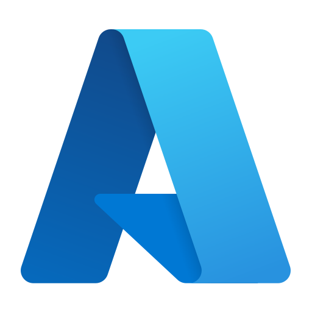 [Azure](https://oai.azure.com/deployments) |  [Anthropic](https://platform.claude.com/docs/en/models/overview) |
|  [OpenRouter](https://openrouter.ai/models) | 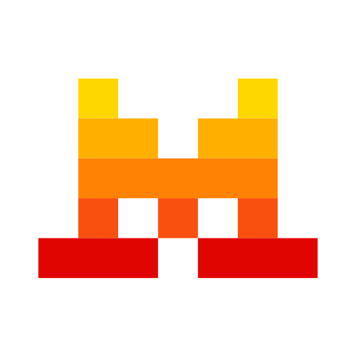 [Mistral](https://docs.mistral.ai/models) |  [Groq](https://console.groq.com/docs/models) |
|  [xAI](https://docs.x.ai/developers/models) | 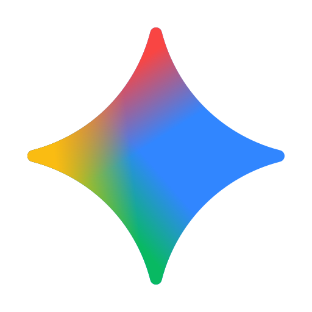 [Gemini](https://ai.google.dev/gemini-api/docs/models) |  [MiniMax](https://platform.minimax.io/docs/api-reference/text-openai-api) |
|  [Hugging Face](https://huggingface.co/models?pipeline_tag=text-generation&inference_provider=all) | 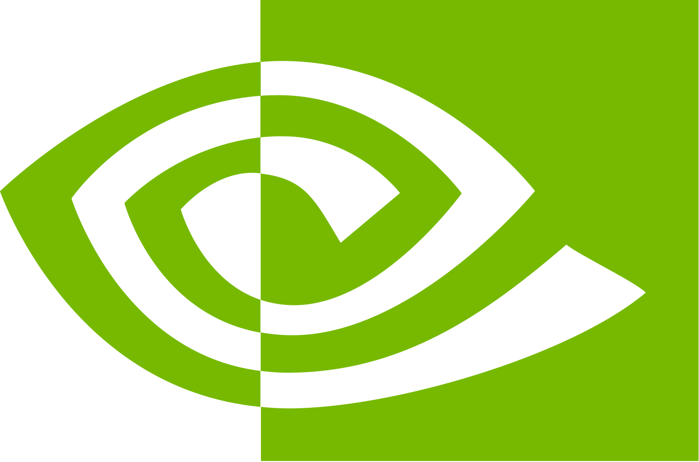 [NVIDIA NIM](https://build.nvidia.com/models) | 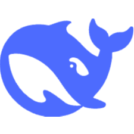 [DeepSeek](https://api-docs.deepseek.com/) |
| 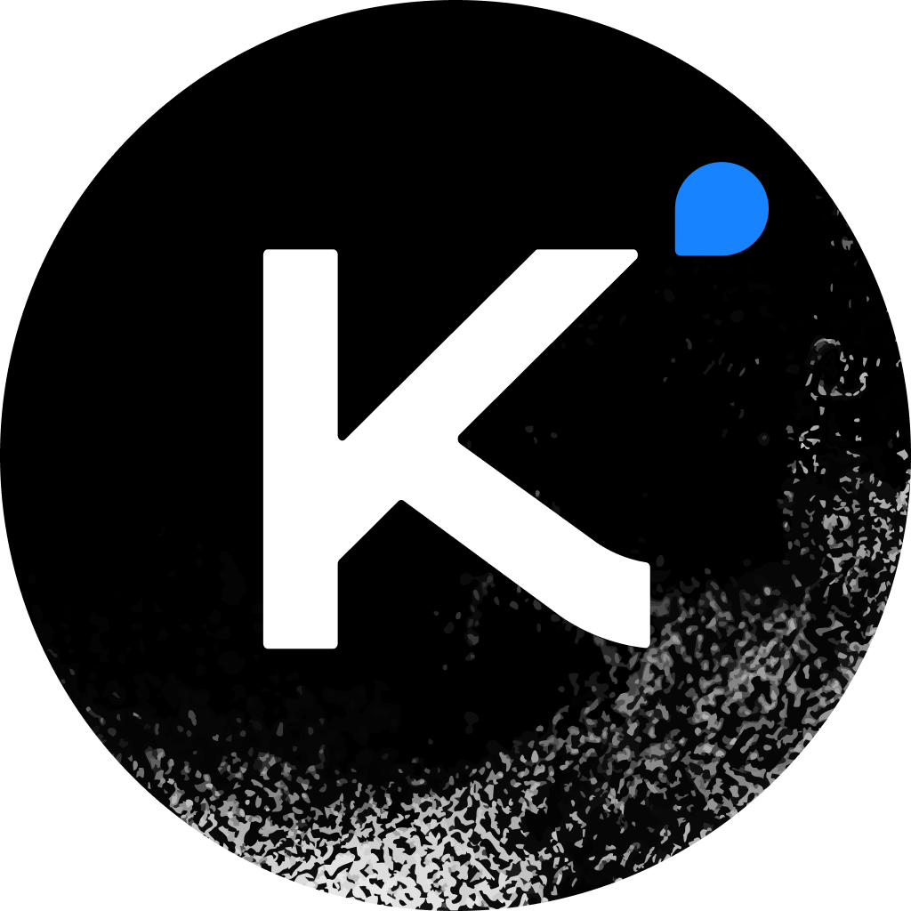 [Kimi (Moonshot AI)](https://platform.kimi.ai/docs/models) |  [Alibaba Cloud (Qwen)](https://www.alibabacloud.com/help/en/model-studio/models) |  [Cerebras](https://inference-docs.cerebras.ai/models/overview) |
| 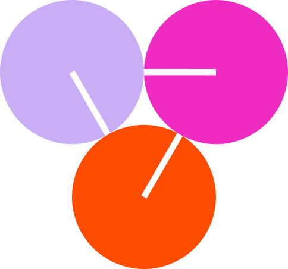 [Together AI](https://docs.together.ai/docs/serverless/models) |  [Fireworks AI](https://docs.fireworks.ai/getting-started/models) | 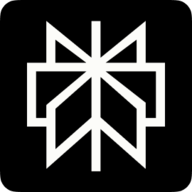 [Perplexity](https://docs.perplexity.ai/docs/agent-api/models) |
|  [Meta AI](https://dev.meta.ai/docs/models) | 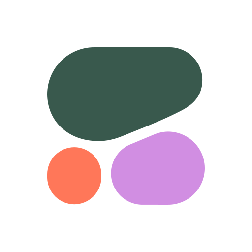 [Cohere](https://docs.cohere.com/docs/models) |  [Z.ai](https://docs.z.ai/guides/llm/glm-5.3) |
|  [AI21 Labs](https://docs.ai21.com/docs/jamba-foundation-models) |  [BytePlus (ByteDance)](https://docs.byteplus.com/en/docs/modelark/model-parameter-support) |  [Baidu Qianfan](https://cloud.baidu.com/doc/qianfan/s/rmh4stp0j) |
|  [Tencent TokenHub](https://cloud.tencent.com/document/product/1823/130078) |  [Amazon Bedrock](https://docs.aws.amazon.com/bedrock/latest/userguide/inference-chat-completions.html) |  [IBM watsonx](https://www.ibm.com/docs/en/watsonx/saas?topic=preview-inferencing-gateway-models) |

[Current models and setup](docs/USER_GUIDE.md#cloud) · [Icon provenance and trademarks](docs/DEVELOPMENT.md#logos)

| | | |
| --- | --- | --- |
|  [Black Forest Labs](https://blackforestlabs.ai) |  [Stability AI](https://stability.ai) |  [Recraft](https://www.recraft.ai) |
|  [Ideogram](https://ideogram.ai) |  [Adobe Firefly](https://firefly.adobe.com) |  [Runway](https://runwayml.com) |
|  [Luma](https://lumalabs.ai) |  [LTX (Lightricks)](https://ltx.io) |  [fal](https://fal.ai) |
|  [Replicate](https://replicate.com) | 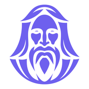 [Leonardo.Ai](https://docs.leonardo.ai/docs/getting-started) |  [Krea](https://www.krea.ai) |
|  [Vidu](https://www.vidu.com) | 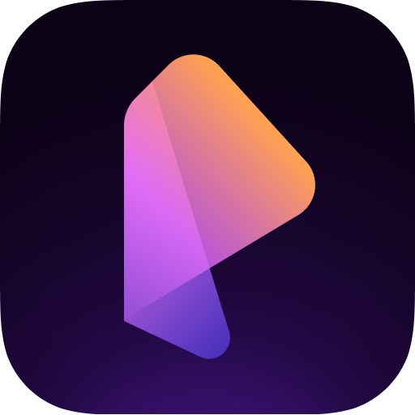 [PixVerse](https://pixverse.ai) |  |

**19 provider profiles expose generation routes**, with **45 media presets: 25 image and 20 video**. Fourteen dedicated generation-provider profiles join the existing cloud catalog. The table below describes the routes implemented in Novera, not every capability offered by each provider. Account, region, quota and billing still apply. Catalog checked on **26 October 2026**; no paid generation was used for validation.

| Provider | Novera output routes | Selected catalog models |
| --- | --- | --- |
| [OpenAI](https://developers.openai.com/api/docs/guides/image-generation) | Image | GPT Image 2.5 Sunburst · GPT Image 2.5 Flare |
| [Google Gemini](https://ai.google.dev/gemini-api/docs/omni) | Image / Video | Gemini Omni 1.1 Flash · Gemini Nano Banana 2.1 |
| [xAI](https://docs.x.ai/developers/model-capabilities/imagine) | Image / Video | Grok Imagine Image 2.0 · Grok Imagine Video 1.5 · Grok Imagine Video 1.5 Lite |
| [MiniMax](https://platform.minimax.io/docs/api-reference/video-generation-v2-create) | Image / Video | MiniMax H3 Max · MiniMax H3 · MiniMax H3 Highspeed |
| [BytePlus](https://docs.byteplus.com/en/docs/ModelArk/image-generation-api) | Image / Video | Dola Seedream 5 Pro · Dreamina Seedance 2.5 |
| [Black Forest Labs](https://docs.bfl.ai/quick_start/generating_images) | Image | FLUX.2 [max] · FLUX.2 [pro] · FLUX.2 [klein] 9B |
| [Stability AI](https://docs.stability.ai/api-reference) | Image | Stable Image Ultra · Stable Image Core |
| [Recraft](https://www.recraft.ai/docs/api-reference/agents.md) | Image | Recraft V4.1 · Recraft V4.1 Flash · Recraft V4.1 Pro |
| [Ideogram](https://developer.ideogram.ai/ideogram-api/api-overview) | Image | Ideogram 4.5 |
| [Adobe Firefly](https://developer.adobe.com/firefly-services/docs/firefly-api/api/) | Image / Video | Adobe Firefly Image 5 · Adobe Firefly Video |
| [Runway](https://docs.dev.runwayml.com/api/) | Video | Runway Gen-4.5 |
| [Luma AI](https://docs.agents.lumalabs.ai/guides/model/) | Image / Video | Luma Uni-1 Max · Luma Uni-1 · Luma Ray 3.2 |
| [LTX](https://docs.ltx.io/models) | Video | LTX-2.5 Pro · LTX-2.5 Fast |
| [fal.ai](https://fal.ai/models/fal-ai/pika/v2.2/text-to-video) | Image / Video | Pika 2.2 · fal · Qwen Image 2512 · fal · FLUX.2 Max · fal |
| [Replicate](https://replicate.com/black-forest-labs/flux-2-max/api) | Image | FLUX.2 Max · Replicate |
| [Leonardo.Ai](https://docs.leonardo.ai/docs/lucid-origin) | Image | Lucid Origin · Krea 2 Turbo · Leonardo · Ideogram 3 · Leonardo |
| [Krea](https://www.krea.ai/docs/developers/krea-3/overview.md) | Image | Krea 3 |
| [Vidu](https://platform.vidu.com/docs/api-reference/video-models/vidu-q4-preview/image-to-video) | Video | Vidu Q4 Preview · Vidu Q3 Pro · Vidu Q3 Turbo |
| [PixVerse](https://docs.platform.pixverse.ai/changelog-2394996m0) | Video | PixVerse V6 Max · PixVerse V6 |

## Hugging Face model catalog

**Hugging Face: 3,187,159 model repositories, about 3.19 million**, observed on **26 October 2026** ([global catalog](https://huggingface.co/models)). Format snapshots include **214,900 GGUF repositories**, **27,295 MLX repositories** and **1,440,138 Safetensors repositories** ([GGUF](https://huggingface.co/models?library=gguf), [MLX](https://huggingface.co/models?library=mlx), [Safetensors](https://huggingface.co/models?library=safetensors)), observed on **26 October 2026**. These format counts can overlap. Counts include versions and conversions; they do not represent distinct models or guaranteed Novera compatibility. Novera’s Safetensors engine currently runs supported causal text architectures from complete local folders; the Safetensors catalog also includes image, audio, adapters and quantized models that this engine cannot run.

The Hub explores 23 navigation categories using Hugging Face metadata, with local hardware advice and a review before downloading. Models in the selected category load progressively as you scroll, with new results appended below existing rows. The six Novera presets remain available. Discovery does not imply execution support: media needs a configured supported engine and its required local components, or a cloud account; other tasks still need their own engines. Safetensors text models use the local Transformers engine; local Diffusers image/video folders can now run from the conversation through a separate adapter, with the latest desktop integration still awaiting maintainer build validation; see [tested capabilities and limitations](docs/SUIVI_MOTEURS.md). The latest progressive-scrolling and compatibility-label fixes require a new build, which the maintainer will perform.

## 70 interface language options

All 19 of our language contributions are integrated alongside the 17 inherited locales and 34 new Novera catalogs. The latest ten are Northern Uzbek, Zulu, Saidi Arabic, Northern Pashto, West Central Oromo, Saraiki, Dutch, Somali, Romanian and Assamese. **All 70 catalogs cover 1,704 / 1,704 current English keys (100%)**, including Wu / Shanghainese. The last 9,219 inherited-locale entries and 757 Wu entries were completed on 25 October 2026. This measures key coverage; native-speaker review remains outstanding. Earlier local Windows builds include the catalogs at their then-current state; the new installer and library texts await validation in the maintainer’s next build; no public binary has been released. Some catalogs are editorial variants partly based on shared written technical text; full vernacular adaptation remains open. See the language guide for their exact scope.

Arabic, Egyptian Arabic, Levantine Arabic, Sudanese Arabic, Algerian Arabic, Moroccan Arabic, Saidi Arabic, Northern Pashto, Saraiki, Sindhi, Dari, Urdu, Western Punjabi and Iranian Persian include right-to-left interface support. Model language capabilities depend on the selected model and are separate from interface localization.

**[Explore every language, native label and coverage level →](docs/LANGUAGES.md)**

## Project status

**Novera 1.0.0 is in development; no public binary is available yet.** The source includes 35 Windows fixes, 70 interface catalogs with complete key coverage (1,704 keys each), the adaptive model Hub, the local Safetensors/Transformers text engine and updated cloud-provider presets. Native-language review is still needed.

First launch saves the system language, recommends LFM2.5-2.6B Q6_K on desktop with optional DSpark, and asks separately about error reporting, off by default. Source changes and compiled artifacts are tracked separately; the latest Hub fixes await the maintainer’s build. See the [dashboard](TABLEAU_DE_BORD_NOVERA.md) for exact validation and limitations. GitHub Actions and automatic updates remain disabled.

## Documentation and contributions

- [User guide](docs/USER_GUIDE.md): setup, models, conversations and privacy.
- [Development](docs/DEVELOPMENT.md) and [build/release guide](docs/BUILD_AND_RELEASE.md).
- [Languages](docs/LANGUAGES.md), [roadmap](ROADMAP.md), [changelog](docs/CHANGELOG.md) and [contribution guide](CONTRIBUTING.md).

## Identity and license

Novera is maintained by **TRON-ABS** in [this repository](https://github.com/TRON-ABS/Novera). See the [identity policy](BRANDING.md) and [official release policy](OFFICIAL_RELEASES.md).

Novera builds on [Jan](https://github.com/janhq/jan), created by Menlo Research and its contributors. Original and third-party attributions and the [Apache 2.0 license](LICENSE) are retained. Jan downloads are not Novera releases.
