
<a href="README.md">English</a> · <a href="README.fr.md">Français</a> · <a href="README.es.md">Español</a> · <a href="README.de.md">Deutsch</a> · <a href="README.it.md">Italiano</a> · <a href="README.pt-BR.md">Português (Brasil)</a> · <a href="README.ru.md">Русский</a> · <a href="README.zh-CN.md">简体中文</a> · <a href="README.ja.md">日本語</a> · <a href="README.ar.md">العربية</a> · <a href="README.hi.md">हिंदी</a> · <a href="README.bn.md">বাংলা</a> · <a href="README.ur.md">اردو</a> · <a href="README.mr.md">मराठी</a> · <a href="README.te.md">తెలుగు</a> · <a href="README.ta.md">தமிழ்</a> · <a href="README.sw.md">Kiswahili</a> · <a href="README.ha.md">Hausa</a> · <a href="README.tl.md">Tagalog</a> · <a href="README.fa-IR.md">فارسی (ایران)</a> · <a href="README.am.md">አማርኛ</a> · <a href="README.th.md">ไทย</a> · <a href="README.jv.md">Basa Jawa</a> · <a href="README.id.md">Bahasa Indonesia</a> · <a href="README.pl.md">Polski</a> · <a href="README.vn.md">Tiếng Việt</a> · <a href="README.zh-TW.md">繁體中文</a> · <a href="README.cs.md">Čeština</a> · <a href="README.ko.md">한국어</a> · <a href="README.ca.md">Català</a> · <a href="README.gu.md">ગુજરાતી</a> · <a href="README.kn.md">ಕನ್ನಡ</a> · <a href="README.yo.md">Yorùbá</a> · <a href="README.my.md">မြန်မာ</a> · <a href="README.ln.md">Lingála</a> · <a href="README.or.md">ଓଡ଼ିଆ</a> · <a href="README.uk.md">Українська</a> · <a href="README.ml.md">മലയാളം</a> · <a href="README.pa.md">ਪੰਜਾਬੀ (ਗੁਰਮੁਖੀ)</a> · <a href="README.nl.md">Nederlands</a> · <a href="README.pcm.md">Naijíriá Píjin</a> · <a href="README.arz.md">مصري</a> · <a href="README.pnb.md">پنجابی (شاہ مکھی)</a> · <a href="README.pt-PT.md">Português (Portugal)</a> · <a href="README.yue.md">粵語</a> · <a href="README.wuu.md">吴语（上海话）</a> · <a href="README.apc.md">عربي شامي</a> · <a href="README.apd.md">عربي سوداني</a> · <a href="README.bho.md">भोजपुरी</a> · <a href="README.cjy.md">晋语</a> · <a href="README.nan.md">閩南語</a> · <a href="README.arq.md">دارجة جزائرية</a> · <a href="README.hak.md">客家話</a> · <a href="README.ary.md">الدارجة المغربية</a> · <a href="README.hsn.md">湘语</a> · <a href="README.sd.md">سنڌي</a> · <a href="README.su.md">Basa Sunda</a> · <a href="README.ig.md">Ìgbò</a> · <a href="README.prs.md">دری</a> · <a href="README.ne.md">नेपाली</a> · <a href="README.ms.md">Bahasa Melayu</a> · <a href="README.uzn.md">O‘zbekcha (shimoliy)</a> · <a href="README.zu.md">isiZulu</a> · <a href="README.aec.md">عربي صعيدي</a> · <a href="README.pbu.md">پښتو (شمالي)</a> · <a href="README.gaz.md">Oromoo (Giddugaleessa-Lixaa)</a> · <a href="README.skr.md">سرائیکی</a> · <a href="README.so.md">Soomaali</a> · <a href="README.ro.md">Română</a> · <a href="README.as.md">অসমীয়া</a> · <a href="README.ceb.md">Sinugbuanon</a> · <a href="README.kk.md">Қазақша</a> · <a href="README.si.md">සිංහල</a> · <a href="README.xh.md">isiXhosa</a> · <a href="README.km.md">ខ្មែរ</a> · <a href="README.af.md">Afrikaans</a> · <a href="README.mai.md">मैथिली</a> · <a href="README.wo.md">Wolof</a> · <a href="README.kmr.md">Kurmancî</a> · <a href="README.rw.md">Ikinyarwanda</a> · <a href="README.ny.md">Chichewa</a> · <a href="README.bm.md">Bamanankan</a> · <a href="README.sn.md">ChiShona</a> · <a href="README.tn.md">Setswana</a> · <a href="README.nso.md">Sesotho sa Leboa</a> · <a href="README.ht.md">Kreyòl ayisyen</a> · <a href="README.st.md">Sesotho</a> · <a href="README.el.md">Ελληνικά</a> · <a href="README.rn.md">Ikirundi</a> · <a href="README.dyu.md">Julakan</a> · <a href="README.tr.md">Türkçe</a> · <a href="README.sv.md">Svenska</a> · <a href="README.gan.md">贛語</a> · <a href="README.pbt.md">پښتو (سوېلي)</a> · <a href="README.mag.md">मगही</a> · <a href="README.ars.md">عربي نجدي</a> · <a href="README.acm.md">عراقي</a> · <a href="README.fuv.md">Fulfulde (Naajeeriya)</a> · <a href="README.hne.md">छत्तीसगढ़ी</a> · <a href="README.tts.md">อีสาน</a> · <a href="README.azb.md">تۆرکجه</a> · <a href="README.bar.md">Boarisch</a> · <a href="README.ug.md">ئۇيغۇرچە</a> · <a href="README.ctg.md">চাটগাঁইয়া</a>

  
  
<strong>Je beschrijft je doel. Novera bereidt de middelen voor, voert de taak uit en organiseert de resultaten.</strong>

  
Een onafhankelijke AI-assistent van TRON-ABS, van de eerste lancering tot de resultaten: tekst, afbeeldingen, muziek en video in één gesprek.

  
<strong>Beschikbaar voor Windows, Linux, macOS en Android</strong> · 104 interfacetalen · 42 cloudproviders · 58 mediavoorinstellingen · Apache 2.0

  
<a href="#from-first-launch-to-results">Automatisering</a> · <a href="#one-dashboard-for-every-creation">Dashboard</a> · <a href="#local-models-in-use">AI-modellen die lokaal op uw apparaat draaien</a> · <a href="#hub-and-compatible-models">Formaten en hub</a> · <a href="#cloud-providers">Clouddiensten</a> · <a href="README.fr.md">Français</a> · <a href="CONTRIBUTING.md">Draag bij</a>

  
Officieel contact: <a href="mailto:contact.novera.tronabs@gmail.com" dir="ltr">contact.novera.tronabs@gmail.com</a>

  
Officiële sociale Novera-profielen: <a href="https://www.facebook.com/profile.php?id=61596114515071">Facebook</a> · <a href="https://www.instagram.com/noveratronabs/">Instagram</a> · <a href="https://www.tiktok.com/@tronabs0">TikTok</a> · <a href="https://www.youtube.com/@noveratronabs">YouTube</a> · <a href="https://x.com/noveratronabs">X</a> · <a href="https://bsky.app/profile/noveratronabs.bsky.social">Bluesky</a>

  
Deel uw creaties, modellen, instellingen, vragen, feedback en ideeën.

> Vertaling ondersteund door vertaalhulpmiddelen, gebaseerd op de Engelse README gedateerd 2026-11-03. Een recensie in de moedertaal is welkom. Gekoppelde documenten behouden hun oorspronkelijke taal.

---

<!-- novera-release-1.0.1:start -->

## Novera 1.0.1

Novera 1.0.1 is beschikbaar voor de onderstaande platforms. Download het pakket voor uw systeem of gebruik het ondertekende updatekanaal. Bestaande installaties worden bijgewerkt wanneer u het nieuwe pakket installeert of de update accepteert.

- Beveiliging: strengere native machtigingen voor externe pagina's, authenticatie voor netwerk-API's en servertools, beschermde geheime opslag en migratie, veiligere toegang tot bestanden/media, parseren van spreadsheets en build-scripts. Blootgestelde afhankelijkheden zijn bijgewerkt; overige adviezen worden openlijk gevolgd.
- Privacy: statistieken en foutrapporten vereisen afzonderlijke toestemming en blijven standaard uitgeschakeld. Builds omvatten de gedocumenteerde bestemmingsconfiguratie. Technische diagnostiek wordt gefilterd; gebruikers houden de controle over de activering.
- Lokale engine: `llama.cpp v0.9.0` (`b12110`, `cd959bae99ff4bed22bef2604f45241c09bbb8c8`). De motorversie en applicatieversie zijn gescheiden. Initiële modelinstellingen en model-/projectorregistratie zijn gecorrigeerd, inclusief de opstartfout met betrekking tot `kv_unified`. Bestaande persoonlijke instellingen blijven behouden.
- Talen: 24 extra talen en varianten brengen de interface en de vertaalde README-verzameling naar 104, met 2,435 interfacesleutels per catalogus. Deze berichtgeving garandeert niet de native redactionele kwaliteit of spraakondersteuning in elke taal.
- **LFM3-Omni-2B Q4_K_M** — Standaard op desktop en mobiel. Een compact model voor tekst, afbeeldingen en audio, met behulp van het vereiste `mmproj` bestand. Downloaden: ongeveer 1.39 GB voor beide bestanden. Kies hem voor een lichtere multimodale opstelling. Spraakfuncties zijn afhankelijk van het platform en de engine. Een langere context gebruikt meer geheugen.
- **NVIDIA Nemotron-3.5-Bolt-E4B Q4_K_M** — Alleen tekstalternatief voor conversatie, schrijven, hulpmiddelen en gestructureerde antwoorden. Downloaden: ongeveer 6.18 GB. Het vereist meer geheugen dan LFM3-Omni en verwerkt zelf geen afbeeldingen of audio. Gesproken antwoorden gebruiken de systeemstem. Kies hem voor teksttaken als je voldoende geheugen hebt. Controleer feitelijke antwoorden met bronnen.
- Voor 1.0.1 is LFM3-Omni-2B Q4_K_M met de vereiste `mmproj-LFM3-Omni-2B-Q4_K_M.gguf` de standaardaanbeveling op desktop en mobiel; NVIDIA Nemotron-3.5-Bolt-E4B Q4_K_M blijft een alternatief met alleen tekst. De initiële context is 32,768 tokens op desktop en 2,048 op mobiel. Langere contexten gebruiken meer geheugen. Bestaande modelkeuzes en instellingen blijven behouden totdat ze expliciet worden gewijzigd.
- Stem: directe lokale microfooninvoer voor LFM3-Omni, continu gesprek en automatisch verzenden, mannelijke/vrouwelijke antwoordstemmen voor de audiomodellen en systeemspraak voor klassieke modellen. Het lezen van antwoorden werkt ook voor getypte berichten en regeneratie, onafhankelijk van microfoonopname. Een kleine geluidsknop schakelt het lezen in of uit.
- Microfoonstatus: groen indien beschikbaar, rood indien bezet, grijs indien niet beschikbaar. Herkenning, herstart van het luisteren, focusbehandeling en zichtbaar dictaat zijn gecorrigeerd. Native audiomodelspraak wordt momenteel geïmplementeerd op Windows; andere platforms hebben nog steeds native validatie en geschikte stemondersteuning nodig.
- Web: betrouwbaardere detectie van weerverzoeken, begeleiding bij de huidige datum, nieuwe resultaten en citaten, en antwoorden gericht op het huidige verzoek na gebruik van de tool. In de spraak worden decoratieve bronlabels en links weggelaten, terwijl de zichtbare citaten behouden blijven. Reactie- en spraaktaal volgen de taal van de gebruiker, voor zover het geselecteerde model dit ondersteunt.
- Optimalisaties: bereid zoekopdrachten op de achtergrond voor wanneer internet is ingeschakeld, deel de opstartservice, bereid het volgende spraaksegment voor vóór het afspelen en verbeter de zinscontinuïteit. Franse jaartallen, decimale getallen en eenheden worden natuurlijker gelezen. Netwerklatentie en modelsnelheid zijn nog steeds afhankelijk van de configuratie.
- Comfort: lagere bedieningselementen klappen in terwijl de invoer zichtbaar blijft. Compacte microfoon- en openbaarmakingsbedieningen, een geluidsknop onder de microfoon, responsieve muziekinstellingen en vertaalde componentlabels verbeteren het gebruik op kleine schermen.
- API-catalogi: 43 providerprofielen, inclusief TabbyAPI lokaal, met vernieuwde chat- en mediaselecties. Nieuwe vermeldingen zijn onder meer GPT-6.1 Terra, Kimi K3.1 Pro, MiniMax M3.1 Flash, GLM 5.3 Flash, Hy4 en GPT Image 2.6, Gemini Omni 1.2, FLUX 3, indien ondersteund. Vernieuwen verbergt niet langer resultaten buiten tien modellen. Exacte identificatiegegevens, regionale eindpunten, privé-implementaties en geïmporteerde modellen worden gerespecteerd.
- Validatie: gerichte applicatie-, native-bibliotheek-, openbare-catalogus- en taalcontroles worden vastgelegd in de gedetailleerde opmerkingen. De interface is gebouwd voor Windows / macOS / Linux / Android / iOS. Deze frontend-builds certificeren geen native pakketten of gevolgtrekkingen op elk apparaat.
- Beschikbaarheid en voltooide controles vindt u hieronder. Ondersteunde functies zijn afhankelijk van hardware, providertoegang en platform. Beveiligingsbevindingen en validatielimieten voor native apparaten blijven gedocumenteerd. Maak een back-up voordat u gaat updaten.

[Gedetailleerde opmerkingen, validatie en resterend werk](docs/CHANGELOG.md) · [1.0.1](docs/FUTURES_VERSIONS.md) · [SECURITY.md](SECURITY.md)

> Deze update-opmerkingen maken gebruik van ondersteunde vertalingen en, waar nodig, van een gedeeld schriftelijk register. Controle in de moedertaal blijft noodzakelijk. Gekoppelde documenten behouden hun oorspronkelijke taal.

<!-- novera-release-1.0.1:end -->

## Beschikbaarheid — 2026-11-07

**Novera 1.0.1 is beschikbaar voor Windows, Linux, macOS en Android.** [Windows x64 / Linux x64](https://github.com/TRON-ABS/Novera/releases/tag/v1.0.1) · [Windows ARM64](https://github.com/TRON-ABS/Novera/releases/tag/v1.0.1-windows-arm64). Desktoppakketten, zowel CLI-archieven, handtekeningen als updatemanifesten zijn openbaar en geverifieerd.

| Platform | Beschikbaarheid |
| --- | --- |
| Windows x64 | Openbaar NSIS-installatieprogramma, ondertekende updater; native installatie en vervanging geverifieerd. |
| Linux x64 | Openbare AppImage, ondertekende updater; native installatie en vervanging geverifieerd. |
| Windows x64 / Linux x64 CLI | [Novera CLI](https://github.com/TRON-ABS/Novera/releases/tag/v1.0.1-cli-novera): `novera.exe` / `novera`, met een speciaal ondertekend updatekanaal. |
| Windows ARM64 | [Openbaar NSIS-installatieprogramma](https://github.com/TRON-ABS/Novera/releases/tag/v1.0.1-windows-arm64), native CPU-tekstengine; installatie, vervanging en controles op openbare kanalen geverifieerd. |
| Android ARM64 | Android 1.0.1 is beschikbaar als ondertekende ARM64 APK, build 1000013. Het maakt gebruik van het bestaande Novera-certificaat en doorstaat de pakketinspectie. Het bevat geen persoonlijke gesprekken, modellen of API-sleutels. Installatie en updaten op een telefoon moet nog worden getest. Android 7+ · [APK](https://github.com/TRON-ABS/Novera/releases/tag/v1.0.1-android-1000013) · [1.0.1](docs/RELEASE_1.0.1_2026-11-07.md). |
| macOS Intel / Apple Silicon | [Officiële 1.0.1 DMG-uitgave](https://github.com/TRON-ABS/Novera/releases/tag/v1.0.1-macos), macOS 13+ Intel / 14+ Apple Silicon; Novera-ondertekende updates. Niet notarieel door Apple; geautomatiseerde controles worden afzonderlijk op beide architecturen uitgevoerd, visuele controles worden uitgesteld. [Installatie en bewijsmateriaal](docs/RELEASE_1.0.1_2026-11-07.md). |
| iOS | Interne simulatorconstructie; Ondertekening/provisioning van Apple is vereist vóór installatie van de iPhone. [Vervolg](docs/REPRISE_MACOS_IOS.md). |
| Windows x64 draagbaar | [Ondertekend ZIP-archief](https://github.com/TRON-ABS/Novera/releases/tag/v1.0.0-windows-portable); gegevens blijven in Data, ondertekende Program-vervanging geverifieerd. |
| Web, MSI, Debian | Gehoste webclient en andere formaten blijven intern; Pages-presentatiesite is beschikbaar. |

Op Mac: open de DMG en kopieer Novera naar Programma's. Als de eerste start wordt geblokkeerd, laat dan Novera toe **Systeeminstellingen → Privacy en beveiliging → Toch openen**. [Apple-instructies](https://support.apple.com/guide/mac-help/mh40616/mac).

Updater-handtekeningen staan ​​los van Windows Authenticode en Apple-notarisatie. Pakkethashes, systeemeigen controles en updatetests worden afzonderlijk gedocumenteerd. Een volledige openbare upgrade van 1.0.0 naar 1.0.1 wordt alleen bevestigd voor de scenario's die zijn vastgelegd in het releaserapport. [Bewijs en beperkingen](docs/LAUNCH_STATUS.md)

Op Android wordt een moderne telefoon met voldoende geheugen aanbevolen voor lokale modellen; gebruik een API-provider op minder krachtige apparaten. Voor zoeken op internet is een context van minimaal **16K-tokens (16,384)** wordt aanbevolen, consistent in alle versies.

**Windows x64 draagbare 1.0.0 is beschikbaar.** Discussies, instellingen en gedownloade modellen blijven in de draagbare map eronder `Data`. Pak het volledige archief uit en begin `Novera.exe`. Sluit Novera voordat u de map verplaatst of USB-opslag uitwerpt. [Draagbare gids en beperkingen](docs/WINDOWS_PORTABLE.md).

## Eén dashboard voor elke creatie

Novera groeit met u mee. Jouw voorbeelden en instellingen kunnen andere gebruikers helpen een geschikte opstelling te vinden. Deel vragen, problemen en ideeën op onze [Facebook page](https://www.facebook.com/profile.php?id=61596114515071) of door [e-mail](mailto:contact.novera.tronabs@gmail.com). Vermeld indien mogelijk uw Novera-versie, apparaat en lokaal/API-model. Verwijder persoonlijke gegevens en deel nooit API-sleutels of wachtwoorden.

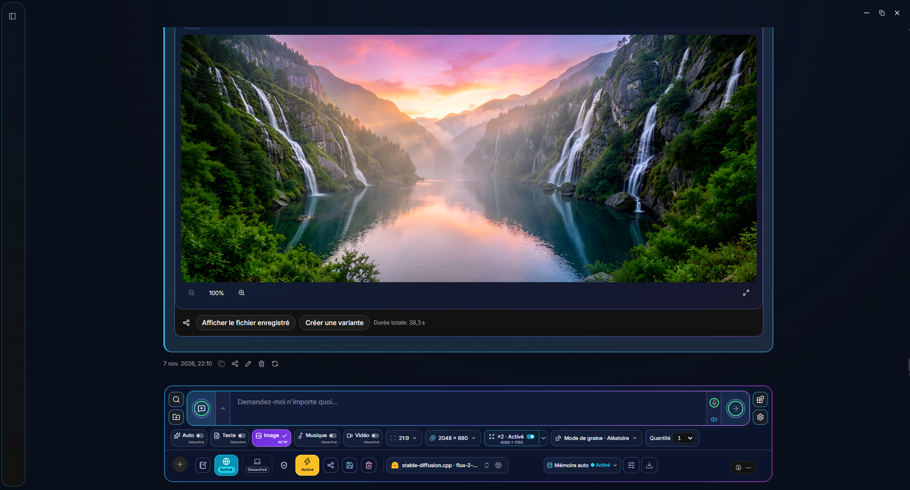

PNG · 1910 × 1028 · 2026-11-07

Microfoonstatus: groen indien beschikbaar, rood indien bezet, grijs indien niet beschikbaar. Herkenning, herstart van het luisteren, focusbehandeling en zichtbaar dictaat zijn gecorrigeerd. Native audiomodelspraak wordt momenteel geïmplementeerd op Windows; andere platforms hebben nog steeds native validatie en geschikte stemondersteuning nodig.

[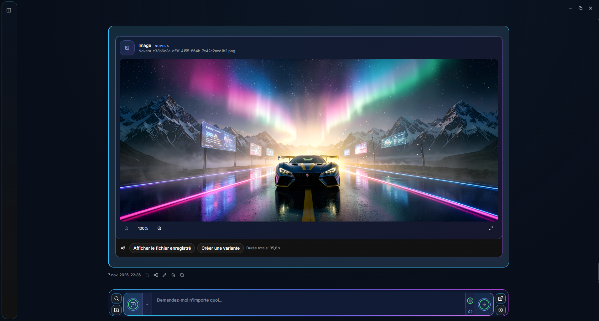](.github/assets/novera-dashboard-collapsed-2026-11-07.png)

Eén paneel, vijf modi: **Automatisch / Tekst / Afbeelding / Muziek / Video**. De bedieningselementen volgen de geselecteerde modus: verhouding, resolutie, duur, cadans, kwaliteit, instrumentaal, songteksten, zaad en kwantiteit. Paneelbreedte en knoppen passen zich aan het venster en vertaalde labels aan.

- **1–10 opeenvolgende generaties**, standaard ingesteld op 1, met onafhankelijke hoeveelheden voor afbeelding, muziek en video. Stop annuleert de actieve taak en de resterende wachtrij.
- **Willekeurige, vaste, +1 en −1 zaden**, vooraf ingestelde of aangepaste verhoudingen en optioneel **Real-ESRGAN ×2/×4** opschalen waarbij de uiteindelijke afmetingen worden weergegeven.
- Het geselecteerde model, automatisch geheugen, bijlagen, instructies, zoeken op internet en tools blijven in dezelfde balk. Tools zijn afhankelijk van de mogelijkheden van het model en de verleende toegang.

## Van eerste lancering tot resultaten

**Onze automatisering verbindt de voorbereiding met de volledige uitvoeringsworkflow.** Novera verwerkt de technische stappen die beschikbaar zijn voor de geselecteerde configuratie, terwijl geavanceerde bedieningselementen toegankelijk blijven.

| Stap | Wat Novera afhandelt |
| --- | --- |
| **1. Begin** | Selecteert een ondersteunde systeemtaal bij de eerste keer opstarten en slaat uw voorkeur op. Presenteert startmodellen en nuttige hardware-informatie. |
| **2. Bereid je voor** | Begeleide installatie biedt tekst, insluitingen, afbeeldingen, muziek, video en opschaling. Het geeft een voorbeeld van componenten, formaten en vrije ruimte weer voordat u het goedkeurt, en volgt vervolgens downloads met voortgang, pauzeren/hervatten en SHA-256-verificatie. |
| **3. Configureer** | Registreert modellen en hun componenten, bereidt de relevante profielen voor en rapporteert de vereiste afhankelijkheden. Het ophalen van de inbedding begint op CPU met een opgeslagen CPU/GPU-keuze. Nieuwe muziekprofielen staan ​​standaard in de instrumentale modus. |
| **4. Begrijp het verzoek** | Routeert herkende creatieverzoeken automatisch naar tekst, afbeeldingen, muziek of video. U kunt ook expliciet de uitvoermodus en een lokaal of cloudmodel selecteren. |
| **5. Uitvoeren** | Automatisch geheugen wacht op actief werk, geeft onnodige modellen vrij en laadt vereiste bronnen opnieuw. Een taakreeks 1–10 wordt op volgorde uitgevoerd en geeft bronnen vrij vóór de volgende taak. Cloudproviders gebruiken het geselecteerde account en de geselecteerde configuratie. |
| **6. Ophalen en hergebruiken** | Slaat media op in Novera-systeemmappen, geeft resultaten en beschikbare timings weer en biedt vervolgens varianten, de bibliotheek, kopiëren, exporteren of systeemdelen. Verzenden naar een andere applicatie blijft uw actie. |

Automatisering omvat geïntegreerde motoren en workflows; het maakt niet elk Hub-model uitvoerbaar. Hardware, geïnstalleerde componenten en toegang tot de provider bepalen wat kan worden uitgevoerd. Mappen, bestandswijzigingen en shell-opdrachten volgen de toegangsverleningen van het gesprek.

[Gebruikershandleiding](docs/USER_GUIDE.md) · [Engines en validatie](docs/SUIVI_MOTEURS.md) · [Ontwikkeling](docs/DEVELOPMENT.md)

Voor 1.0.1 is LFM3-Omni-2B Q4_K_M met de vereiste `mmproj-LFM3-Omni-2B-Q4_K_M.gguf` de standaardaanbeveling op desktop en mobiel; NVIDIA Nemotron-3.5-Bolt-E4B Q4_K_M blijft een alternatief met alleen tekst. De initiële context is 32,768 tokens op desktop en 2,048 op mobiel. Langere contexten gebruiken meer geheugen. Bestaande modelkeuzes en instellingen blijven behouden totdat ze expliciet worden gewijzigd.

## Mogelijkheden in de bron

Onderhouds- en privacyverbeteringen zijn voorbereid voor 1.0.1. Optionele statistieken en foutrapportage maken gebruik van onafhankelijke, expliciete toestemming en gefilterde technische diagnostiek. Vereiste vrijgavecontroles en resterende beveiligingsbevindingen worden afzonderlijk gedocumenteerd. [onderhoudsrunbook](docs/MAINTENANCE.md)

| Gebied | Kenmerken |
| --- | --- |
| **Tekst- en beeldbegrip** | Gesprekken, documentbijlagen, gestreamde antwoorden en lokale of cloudmodellen. Visie is afhankelijk van het model; het begrijpen en genereren van afbeeldingen zijn afzonderlijke mogelijkheden. |
| **Afbeelding** | Genereren van gesprekken, zaden, verhoudingen, resolutie, GGUF/Safetensors-componenten, geconfigureerde Diffusers-mappen en het ondersteunde native NVFP4 CUDA-profiel. |
| **Muziek** | Lokale of cloudgeneratie, duur, kwaliteit, instrumentaal of zang waar ondersteund, gestructureerde teksten en een audiospeler. De opties van aanbieders verschillen. |
| **Video** | Lokale of cloudgeneratie, duur, aantal frames/cadans voor lokale profielen, verhoudingen, resolutie en een videospeler. |
| **Zoeken en hulpmiddelen** | Zoeken op internet, op inbedden gebaseerd ophalen van documenten, MCP, werkruimten en lokale tools volgens modelondersteuning en verleende toegang. |
| **Resultaten en delen** | Mediabibliotheek, varianten, export van antwoorden/gesprekken, documenten en originele media, afdrukken/PDF en platformafhankelijk systeem delen. |
| **Beheer van hulpbronnen** | Automatisch geheugen standaard ingeschakeld, CPU/GPU-instellingen voor ondersteunde componenten en handmatige profielen wanneer de bronnen dit toestaan. |

## AI-modellen die lokaal op uw apparaat draaien

Deze modellen vormen de huidige begeleide configuratie. U kunt andere compatibele modellen importeren of de profielen wijzigen.

| Rol | Modelleer / geconfigureerde componenten |
| --- | --- |
| **Tekst — model van eerste run** | **LFM3-Omni-2B Q4_K_M** · `LFM3-Omni-2B-Q4_K_M.gguf` + `mmproj-LFM3-Omni-2B-Q4_K_M.gguf` |
| **Alternatief met alleen tekst** | **NVIDIA Nemotron-3.5-Bolt-E4B Q4_K_M** · `Nemotron-3.5-Bolt-E4B-Q4_K_M.gguf` |
| **Ophalen van documenten** | **Qwen3-Embedding-0.6B Q8_0**, **CPU**, met een opgeslagen CPU/GPU-keuze. |
| **Afbeelding** | **FLUX.2 Klein 4B Q4_K_M**, **Qwen3-4B Q4_K_M** encoder en officiële FLUX.2 VAE. |
| **Afbeelding — hardwareoptie** | **FLUX.2 Klein 4B NVFP4**, via het oorspronkelijke CUDA-pad wanneer de GPU en de omgeving compatibel zijn. |
| **Muziek** | **ACE-Step 1.5 Turbo 2B Q4_K_M**, `acestep-5Hz-lm-1.7B-Q8_0.gguf` planner, speciale Qwen muziekencoder en VAE. |
| **Video** | **Wan2.1 T2V 1.3B Q4_K_M**, **UMT5-XXL Q4_K_M** encoder en Wan 2.1 VAE. |
| **Opschaling** | Optioneel **Real-ESRGAN ×2 en ×4**, met afhankelijkheidscontroles. |

De muziekencoder Qwen en het ophaalmodel Qwen zijn **verschillende bestanden**, afzonderlijk opgeslagen. Modellicenties blijven die van hun uitgevers.

[Tekstmanifest](web-app/src/constants/text-manifest.json) · [Embeddings](web-app/src/constants/embedding-manifest.json) · [Muziek](web-app/src/constants/music-manifest.json) · [Beeld-/videocomponenten](src-tauri/src/core/creation_bundle.rs)

## Cloudproviders

De catalogus bevat 43 providerprofielen: 42 cloudservices en TabbyAPI voor een lokale server. Modeltoegang en -mogelijkheden zijn afhankelijk van het account, de regio en de ondersteunde API. Alle 104 interfacetalen delen deze catalogus.

| | | |
| --- | --- | --- |
|  [OpenAI](https://platform.openai.com/docs/models) | 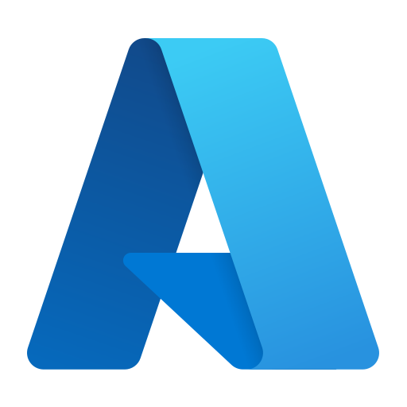 [Microsoft Azure](https://oai.azure.com/deployments) |  [Anthropic](https://platform.claude.com/docs/en/models/overview) |
| 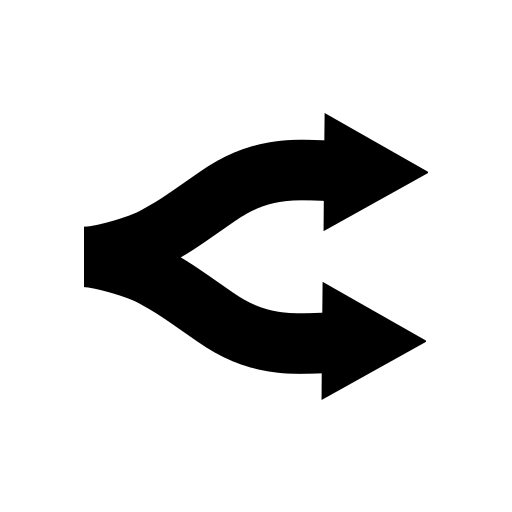 [OpenRouter](https://openrouter.ai/models) | 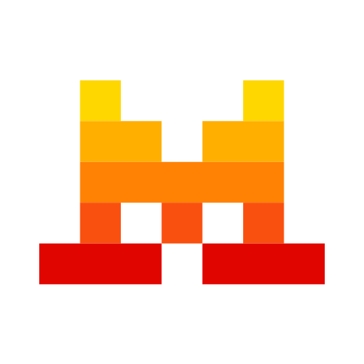 [Mistral](https://docs.mistral.ai/models) |  [Groq](https://console.groq.com/docs/models) |
|  [xAI](https://docs.x.ai/developers/models) | 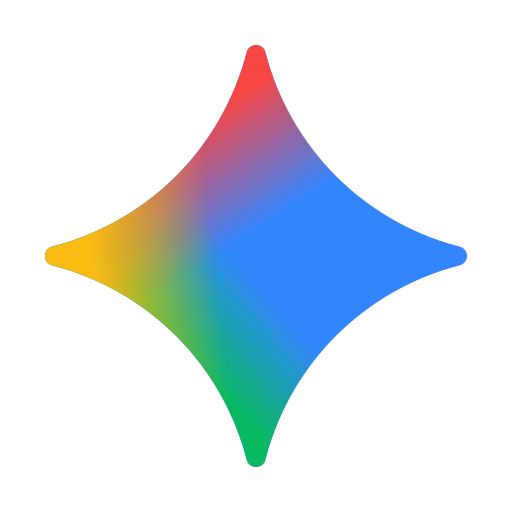 [Google Gemini](https://ai.google.dev/gemini-api/docs/models) |  [MiniMax](https://platform.minimax.io/docs/api-reference/text-openai-api) |
|  [Hugging Face](https://huggingface.co/models?pipeline_tag=text-generation&inference_provider=all) | 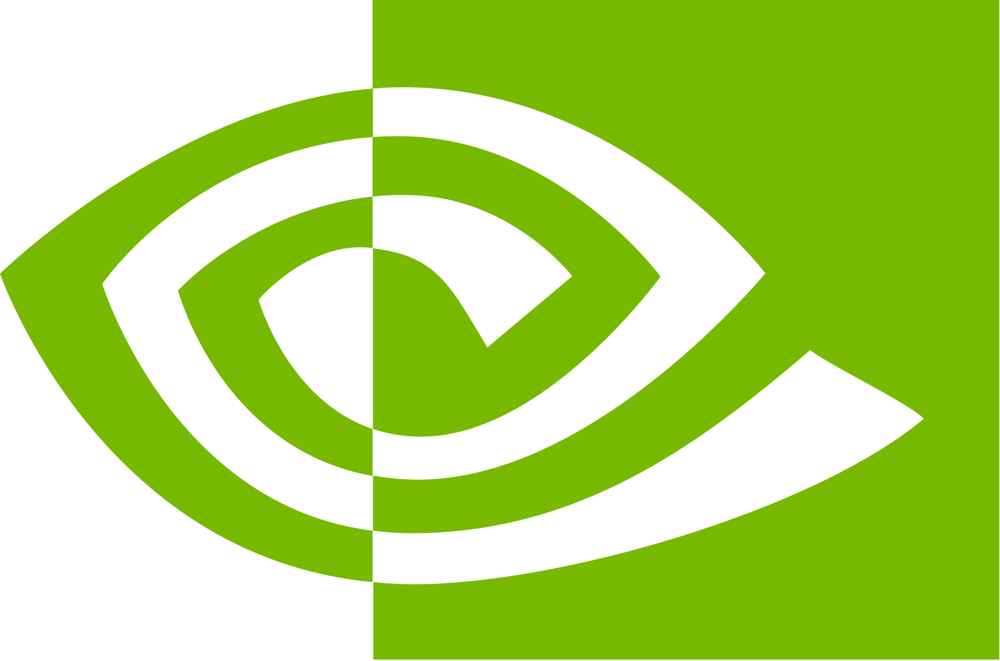 [NVIDIA NIM](https://build.nvidia.com/models) |  [DeepSeek](https://api-docs.deepseek.com/) |
| 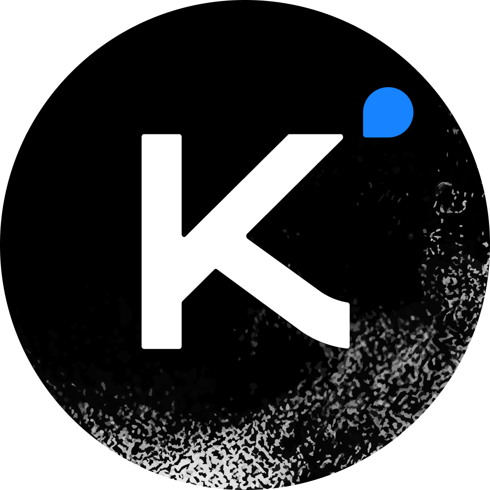 [Kimi · Moonshot AI](https://platform.kimi.ai/docs/models) |  [Alibaba Cloud · Qwen](https://www.alibabacloud.com/help/en/model-studio/models) | 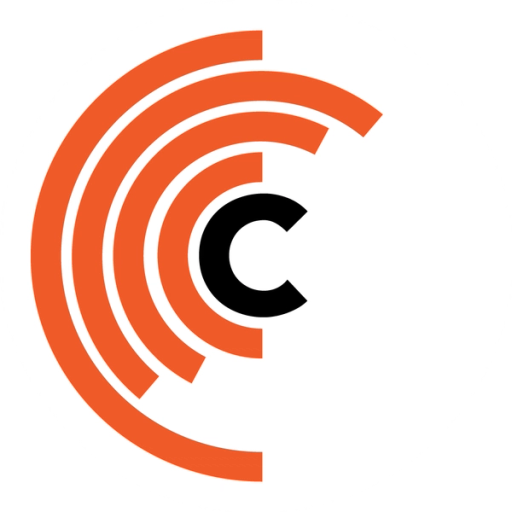 [Cerebras](https://inference-docs.cerebras.ai/models/overview) |
| 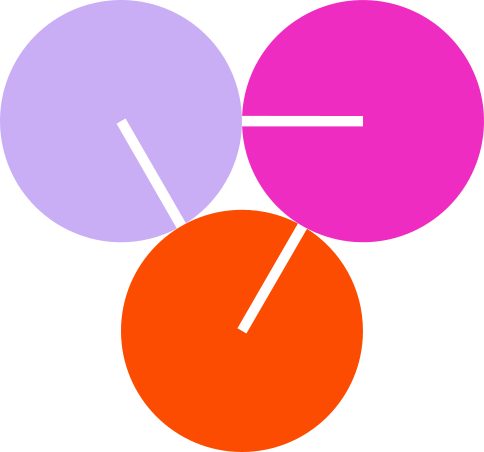 [Together AI](https://docs.together.ai/docs/serverless/models) |  [Fireworks AI](https://docs.fireworks.ai/getting-started/models) | 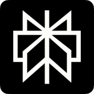 [Perplexity](https://docs.perplexity.ai/docs/agent-api/models) |
|  [Meta AI](https://dev.meta.ai/docs/models) | 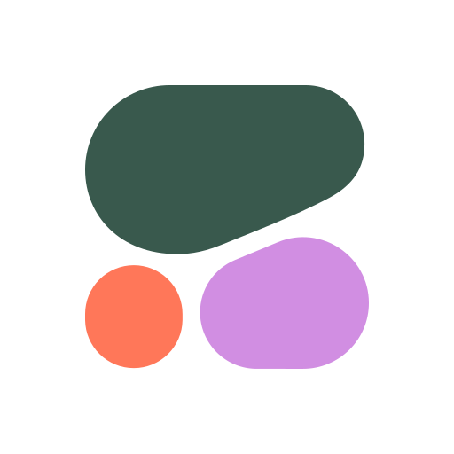 [Cohere](https://docs.cohere.com/docs/models) |  [Z.ai](https://docs.z.ai/guides/llm/glm-5.3) |
|  [AI21 Labs](https://docs.ai21.com/docs/jamba-foundation-models) |  [BytePlus · ByteDance](https://docs.byteplus.com/en/docs/modelark/model-parameter-support) |  [Baidu Qianfan](https://cloud.baidu.com/doc/qianfan/s/rmh4stp0j) |
|  [Tencent TokenHub](https://cloud.tencent.com/document/product/1823/130078) |  [Amazon Bedrock](https://docs.aws.amazon.com/bedrock/latest/userguide/inference-chat-completions.html) |  [IBM watsonx](https://www.ibm.com/docs/en/watsonx/saas?topic=preview-inferencing-gateway-models) |
|  [ElevenLabs](https://elevenlabs.io/docs/api-reference/music/compose) |  [Black Forest Labs](https://docs.bfl.ai/quick_start/generating_images) |  [Stability AI](https://docs.stability.ai/api-reference) |
|  [Recraft](https://www.recraft.ai/docs/api-reference/agents.md) |  [Ideogram](https://developer.ideogram.ai/ideogram-api/api-overview) |  [Adobe Firefly](https://developer.adobe.com/firefly-services/docs/firefly-api/) |
|  [Runway](https://docs.dev.runwayml.com/api/) |  [Luma](https://docs.agents.lumalabs.ai/guides/model/) |  [LTX (Lightricks)](https://docs.ltx.io/models) |
|  [fal](https://fal.ai/docs/documentation/model-apis/inference/queue) |  [Replicate](https://replicate.com/docs/reference/http) |  [Leonardo.Ai](https://docs.leonardo.ai/reference/creategeneration) |
|  [Krea](https://www.krea.ai/docs/developers/krea-3/overview) |  [Vidu](https://platform.vidu.com/models) | 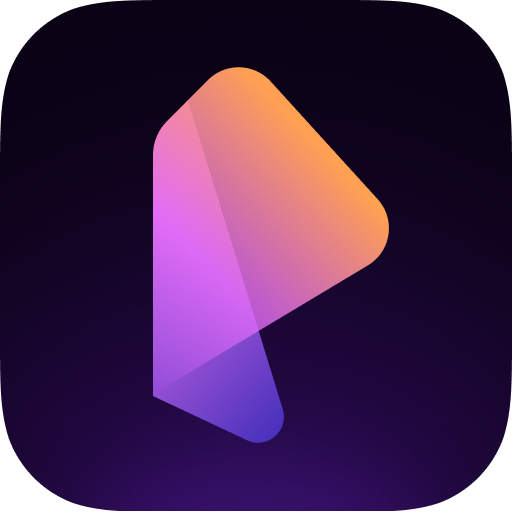 [PixVerse](https://docs.platform.pixverse.ai/changelog-2394996m0) |

### Beeld, muziek en video

De creatiecatalogus bevat 58 voorinstellingen van 20 providers: 30 afbeelding, 24 video en 4 muziekvoorinstellingen. In de onderstaande tabellen staan ​​de exacte modellen en identificaties die door de geïntegreerde adapters worden ondersteund.

| Aanbieder | Uitvoer in Novera | Catalogusmodellen |
| --- | --- | --- |
|  [ElevenLabs](https://elevenlabs.io/docs/api-reference/music/compose) | Muziek | `ElevenMusic v2.5` |
|  [Stability AI](https://docs.stability.ai/api-reference/stable-audio/text-to-audio) | Beeld / Muziek | `Stable Image Ultra` · `Stable Image Core` · `Stable Audio 3` |
|  [fal](https://fal.ai/models/fal-ai/ace-step/api) | Afbeelding / Muziek / Video | `FLUX 3 Video · fal` · `FLUX 3 Image · fal` · `Pika 2.2 · fal` · `Qwen Image 2512 · fal` · `FLUX.2 Max · fal` · `Kling 3 Pro · fal` · `Kling 3 Standard · fal` · `ACE-Step · cloud` |
|  [Replicate](https://replicate.com/stability-ai/stable-audio-2.5/api/schema) | Afbeelding / Muziek / Video | `FLUX 3 Video · Replicate` · `FLUX.2 Max · Replicate` · `Stable Audio 2.5 · Replicate` |
|  [BytePlus · ByteDance](https://docs.byteplus.com/en/docs/ModelArk/image-generation-api) | Afbeelding / video | `Dola Seedream 5 Pro` · `Dreamina Seedance 2.5` |
|  [Adobe Firefly](https://developer.adobe.com/firefly-services/docs/firefly-api/api/) | Afbeelding / video | `Adobe Firefly Image 5` · `Adobe Firefly Video` |
|  [Google Gemini](https://ai.google.dev/gemini-api/docs/omni) | Afbeelding / video | `Gemini Omni 1.2 Flash` · `Gemini Omni 1.1 Flash` · `Gemini Nano Banana 2.1` |
|  [Krea](https://www.krea.ai/docs/developers/krea-3/overview.md) | Afbeelding | `Krea 3` |
|  [Leonardo.Ai](https://docs.leonardo.ai/docs/lucid-origin) | Afbeelding | `Lucid Origin` · `Krea 2 Turbo · Leonardo` · `Ideogram 3 · Leonardo` |
|  [Vidu](https://platform.vidu.com/docs/api-reference/video-models/vidu-q4-preview/image-to-video) | Video | `Vidu Q4 Preview` · `Vidu Q3 Pro` · `Vidu Q3 Turbo` |
|  [OpenAI](https://developers.openai.com/api/docs/guides/image-generation) | Afbeelding | `GPT Image 2.6 Sunburst` · `GPT Image 2.6 Flare` · `GPT Image 2.5 Sunburst` · `GPT Image 2.5 Flare` |
|  [xAI](https://docs.x.ai/developers/model-capabilities/imagine) | Afbeelding / video | `Grok Imagine Image 2.0` · `Grok Imagine Video 1.5` · `Grok Imagine Video 1.5 Lite` |
|  [Black Forest Labs](https://docs.bfl.ai/quick_start/generating_images) | Afbeelding / video | `FLUX 3 Image` · `FLUX 3 Image Klein` · `FLUX 3 Video` · `FLUX.2 [max]` · `FLUX.2 [pro]` · `FLUX.2 [klein] 9B` |
|  [Recraft](https://www.recraft.ai/docs/api-reference/agents.md) | Afbeelding | `Recraft V4.1` · `Recraft V4.1 Flash` · `Recraft V4.1 Pro` |
|  [Ideogram](https://developer.ideogram.ai/ideogram-api/api-overview) | Afbeelding | `Ideogram 4.5` |
|  [Runway](https://docs.dev.runwayml.com/api/) | Video | `Runway Gen-4.5` |
|  [Luma](https://docs.agents.lumalabs.ai/guides/model/) | Afbeelding / video | `Luma Uni-1 Max` · `Luma Uni-1` · `Luma Ray 3.2` |
|  [LTX (Lightricks)](https://docs.ltx.io/models) | Video | `LTX-2.5 Pro` · `LTX-2.5 Fast` |
|  [MiniMax](https://platform.minimax.io/docs/api-reference/video-generation-v2-create) | Afbeelding / video | `MiniMax H3 Max` · `MiniMax H3` · `MiniMax H3 Highspeed` · `MiniMax Image-01` |
|  [PixVerse](https://docs.platform.pixverse.ai/changelog-2394996m0) | Video | `PixVerse V6 Max` · `PixVerse V6` |

<strong>Toon shortlists van tekst- en visiemodellen per aanbieder</strong>

| Aanbieder | Model-ID's aangeboden in de bron |
| --- | --- |
| [OpenAI](https://platform.openai.com/docs/models) | `gpt-6.1-sol` · `gpt-6.1-terra` · `gpt-6-astra` · `gpt-6-luna` · `gpt-6-sol` |
| [Microsoft Azure](https://oai.azure.com/deployments) | Accountspecifieke implementatie of gateway |
| [Anthropic](https://platform.claude.com/docs/en/models/overview) | `claude-sonnet-5-5` · `claude-opus-5-5` · `claude-fable-5-1` · `claude-haiku-5-5` |
| [OpenRouter](https://openrouter.ai/models) | `liquid/lfm-3-1.7b` · `openai/gpt-6.1-terra` · `tencent/hy4` · `moonshotai/kimi-k3.1-pro` · `minimax/minimax-m3.1-flash` · `deepseek/deepseek-v4.1-flash-1017` · `nvidia/nemotron-3.5-super-vl:free` |
| [Mistral](https://docs.mistral.ai/models) | `mistral-large-4` · `zai-glm-5-3-flash` · `mistral-small-2603` · `ministral-3b-2512` |
| [Groq](https://console.groq.com/docs/models) | `qwen/qwen3.8-27b` · `openai/gpt-oss-120b` · `openai/gpt-oss-20b` · `llama-3.3-70b-versatile` · `llama-3.1-8b-instant` |
| [xAI](https://docs.x.ai/developers/models) | `grok-4.7` |
| [Google Gemini](https://ai.google.dev/gemini-api/docs/models) | `gemini-4-argon` · `gemini-3.8-flash` · `gemini-3.6-flash` · `gemini-3.5-flash-lite` |
| [MiniMax](https://platform.minimax.io/docs/api-reference/text-openai-api) | `MiniMax-M3.1-Flash` · `MiniMax-M3` |
| [Hugging Face](https://huggingface.co/models?pipeline_tag=text-generation&inference_provider=all) | `MiniMaxAI/MiniMax-M3.1-Flash` · `zai-org/GLM-5.3-Flash` · `deepseek-ai/DeepSeek-V4.1-Flash-1017` · `Qwen/Qwen3.8-27B` · `moonshotai/Kimi-K3` · `zai-org/GLM-5.3` |
| [NVIDIA NIM](https://build.nvidia.com/models) | `minimaxai/minimax-m3.1-flash` · `deepseek-ai/deepseek-v4.1-flash` · `nvidia/nemotron-3.5-super-vl-120b-a12b` · `nvidia/nemotron-3.5-lightning-30b-a3b` · `z-ai/glm-5.3-flash` |
| [DeepSeek](https://api-docs.deepseek.com/) | `deepseek-flash` · `deepseek-v4-pro` |
| [Kimi · Moonshot AI](https://platform.kimi.ai/docs/models) | `kimi-k3.1-pro` · `kimi-k3.1-pro-highspeed` · `kimi-k3` |
| [Alibaba Cloud · Qwen](https://www.alibabacloud.com/help/en/model-studio/models) | `qwen3.8-max` · `qwen3.7-plus` · `qwen3.8-flash` |
| [Cerebras](https://inference-docs.cerebras.ai/models/overview) | `qwen-3.8-27b` · `gpt-oss-120b` |
| [Together AI](https://docs.together.ai/docs/serverless/models) | `moonshotai/Kimi-K3.1-Pro` · `MiniMaxAI/MiniMax-M3.1-Flash` · `deepseek-ai/DeepSeek-V4.1-Flash-1017` · `moonshotai/Kimi-K3` · `Qwen/Qwen3.8-Flash` · `Qwen/Qwen3.8-2.4T-A95B` |
| [Fireworks AI](https://docs.fireworks.ai/getting-started/models) | `accounts/fireworks/models/kimi-k3p1-pro` · `accounts/fireworks/models/deepseek-v4p1-flash-1017` · `accounts/fireworks/models/kimi-k3` · `accounts/fireworks/models/minimax-m3` |
| [Perplexity](https://docs.perplexity.ai/docs/agent-api/models) | `perplexity/sonar` · `openai/gpt-6.1-sol` · `google/gemini-4-argon` · `perplexity/kimi-k3` |
| [Meta AI](https://dev.meta.ai/docs/models) | `muse-wonder-1.0` · `muse-spark-1.3` |
| [Cohere](https://docs.cohere.com/docs/models) | `command-a-plus-05-2026` |
| [Z.ai](https://docs.z.ai/guides/llm/glm-5.3) | `glm-5.3` · `glm-5.3-flash` · `glm-5.3-flashx` |
| [AI21 Labs](https://docs.ai21.com/docs/jamba-foundation-models) | `jamba-large` · `jamba-mini-2` |
| [BytePlus · ByteDance](https://docs.byteplus.com/en/docs/modelark/model-parameter-support) | `dola-seed-2-1-turbo-260628` |
| [Baidu Qianfan](https://cloud.baidu.com/doc/qianfan/s/rmh4stp0j) | `ernie-5.1` |
| [Tencent TokenHub](https://cloud.tencent.com/document/product/1823/130078) | `hy4` · `hy4-preview` |
| [Amazon Bedrock](https://docs.aws.amazon.com/bedrock/latest/userguide/inference-chat-completions.html) | `openai.gpt-6.1-terra` · `openai.gpt-6.1-sol` |
| [IBM watsonx](https://www.ibm.com/docs/en/watsonx/saas?topic=preview-inferencing-gateway-models) | Accountspecifieke implementatie of gateway |

Voorraad gecontroleerd aan de hand van de bron **29 oktober 2026**. Deze namen beschrijven de Novera-presets en bieden geen gegarandeerde toegang voor elk account. Externe catalogi, regio's, licenties, quota's en facturering blijven providerspecifiek. Compatibele profielen kunnen hun catalogi vernieuwen; Azure en sommige gateways gebruiken accountimplementaties. Cloudcontracten hebben gesimuleerde tests; er is geen betaalde generatie uitgevoerd voor deze showcase-update.

[Mediacatalogus](web-app/src/constants/mediaProviders.ts) · [Tekst-/visiemodellen](web-app/src/constants/cloudModels.ts) · [Cloudconfiguratie](docs/USER_GUIDE.md#cloud) · [Herkomst van het pictogram](docs/DEVELOPMENT.md#logos)

## Hub en compatibele modellen

**GGUF, standaard en gekwantiseerde Safetensors, ONNX en MLX**: verken modellen per taak en kies varianten die compatibel zijn met de engine en uw hardware.

| Familie | Ondersteuning in de bron | Vereisten |
| --- | --- | --- |
| **GGUF** | Tekst genereren via llama.cpp; beeld- en videocomponenten voor ondersteunde profielen. | Architectuur herkend door de gebundelde engine. |
| **GGUF splitsen** | Eén variant per volledige serie, opgetelde grootte, download van alle shards en grootte/SHA-256/headercontroles. | Standaard genummerde bestandsnamen; het downloaden van 500 GB betekent niet dat het model op deze PC past. |
| **Standaard Safetensors** | Volledige mappen via Transformers, causale tekst op CPU of NVIDIA CUDA. | Configuratie, tokenizer en elke vereiste shard. |
| **ONNX Runtime** | Lokale import van numerieke/boolgrafieken en voorbereide GenAI-tekstexports. | Volledige map gevalideerd; taakspecifieke voor-/nabewerking vereist; [instellingen en limieten](onnx-server/README.md). |
| **LoRA / PEFT-adapters** | Importeer een complete basis met zijn aparte lokale adapter in de Safetensors-provider. | Niet-gekwantiseerde causale Transformers-basis, matching-identiteit, tensorcontroles en cumulatieve geheugenschatting; [instellingen en limieten](transformers-server/README.md#local-lora--peft-adapters). |
| **FP8 LLM / ModelOpt** | Native CUDA-uitvoering voor compatibele Llama/Qwen2/Qwen3 per-tensor FP8-exports. | Architectuur-/tensorcontroles en echte kernelsonde; [instellingen en limieten](transformers-server/README.md#modelopt-fp8-and-nvfp4-llms). |
| **NVFP4 LLM / ModelOpt** | Verpakte blok-16 FP4-projecties via native CUDA GEMM's; los van afbeelding NVFP4. | Compatibel Blackwell GPU, ondersteunde afmetingen/export en daadwerkelijke kernelsonde; ongetrainde testmodellen getest op RTX 5070. |
| **AWQ** | 4-bit GEMM-modelcontrolepunten zonder operatiefusie. | NVIDIA CUDA en optionele GPTQModel/Transformers-laders. |
| **GPTQ** | 2/3/4/8-bit configuraties, gptq/gptq_v2 formaten. | NVIDIA CUDA, GPTQModel en Optimum; echte uitvoering getest op 4-bits. |
| **bitsandbytes** | 4-bit NF4/FP4 of 8-bit INT8. | NVIDIA CUDA en optionele afhankelijkheden; echte NF4- en INT8-tests. |
| **EXL3** | Volledige gekwantiseerde Safetensors-modelmappen geladen via ExLlamaV3; daadwerkelijke generatie met CUDA werd getest. | NVIDIA GPU, aparte Python 3.12-omgeving en compatibele architectuur; geen terugval CPU. |
| **EXL2** | Speciale ExLlamaV2-lader; streaming, annuleren en verwijderen getest op GPU. | Selecteer expliciet de CUDA Attention-backend voor de geteste softwareconfiguratie; een compleet modelcheckpoint en voldoende vrije VRAM zijn vereist. |
| **MLX** | Compatibele modellen op Apple Silicon. | MLX-motor en ondersteund platform. |

De hub wordt nu vastgezet **LFM3-1.7B** als LiquidAI-aanbeveling voor compatibele configuraties, met varianten Q4_K_M, Q6_K en Q8_0. Het model dat voor de eerste keer wordt uitgevoerd, blijft het model dat wordt vermeld in de bovenstaande begeleide configuratie.

Filter downloadgewichten van **onder 1 GB tot 500 GB en hoger** en sorteer vervolgens op hardwaregeschiktheid, grootte, recentheid of downloads. Resultaten worden geleidelijk geladen; filters zijn van toepassing op opgehaalde modellen en hun standaardvariant. Geheugenadvies maakt gebruik van beschikbare RAM/VRAM-, context- en begeleidende componenten, zonder gedeeld GPU-geheugen dubbel te tellen.

AWQ 4-bit, GPTQ 4-bit, NF4 en INT8 genereerden elk tekst op een RTX 5070 Laptop met behulp van kleine, ongetrainde modellen die offline waren gemaakt. Dit valideert het laden en de uitvoering, niet de kwaliteit of prestaties van elk model. **Deze toevoegingen staan ​​in de broncode: opnieuw opbouwen en compatibele afhankelijkheden zijn vereist; deze README-update upgradet geen geïnstalleerd binair bestand.**

**Gemeten op de RTX 5070 Laptop:** Qwen2.5-0.5B-Instruct, context 2,048, prompt 272-tokens, 128 gegenereerde tokens, vijf opgewarmde runs: mediaan-decodering **GGUF Q4_K_M 402.7 tokens/s · EXL3 4 bpw 312.5 · EXL2 4 bpw 146.9**. Hier werd geen snelheidsvoordeel ten opzichte van de GGUF aangetoond. Kwantisering/kalibratie verschilt, en EXL3 faalde bij één eenvoudige rekentest; deze resultaten zijn geen algemene snelheids- of kwaliteitsranglijst. [Volledige metingen en limieten](deliverables/exllama-2026-10-30/validation.md).

**TabbyAPI** is een optionele, afzonderlijk beheerde, OpenAI-compatibele serververbinding, die standaard is uitgeschakeld. Geauthenticeerde EXL3-modeldetectie en streaming zijn getest. De beheerde lokale ExLlama-route blijft verschillend. [ExLlama-installatie en TabbyAPI-verbinding](transformers-server/README.md#exl3-first-exl2-second--nvidia-execution).

De standaard, aan hardware aangepaste sortering geeft de voorkeur aan nieuwere releases binnen dezelfde compatibiliteits- en beschikbare geheugenlaag. Geïnstalleerde modellen worden niet automatisch vervangen.

[Gekwantiseerde Safetensors-installatie](transformers-server/README.md#quantized-safetensors--source-integration-29-october-2026) · [Formaten, prioriteiten en validatie](docs/SUIVI_MOTEURS.md)

De bijgewerkte broncode voegt **optionele beheerde componenten in Configuraties voor Windows x64** toe: privé Python-omgevingen, vastgezette CPU/CUDA-profielen, schattingen en bevestiging vóór downloads, verificatie, reparatie en verwijdering. Aangepaste interpreterpaden blijven onder geavanceerde opties. Native GGUF-motoren behouden hun bestaande componenten; mobiel en cloud downloaden desktop Python/PyTorch niet. Drie afzonderlijke CPU/export-profielen zijn getest met synthetische testgegevens; De beheerder rapporteert succesvol desktopgebruik op 1 november 2026; GPU-profielen en schone PC-installatie hebben nog steeds afzonderlijke, gedetailleerde validatie nodig. [Profielen en testlimieten](docs/REPRISE_COMPOSANTS_GERES_80_LANGUES.md). Het inbedden van de stapel in de EXE wordt uitgesteld.

## 104-interfacetalen en varianten

**Alle 104-catalogi omvatten de huidige 2,435 Engelse sleutels** in 15-naamruimten, inclusief menu's, configuraties, instellingen, help en mediabediening. Meervoudsvormen en interfacerichting volgen de geselecteerde taal. Antwoord- en stemtalen zijn afzonderlijk afhankelijk van het model.

Deze technische dekking garandeert geen taalkundige kwaliteit: **Native review en regionale aanpassing blijven noodzakelijk**. Bekijk native labels en bekende limieten in de [taalgids](docs/LANGUAGES.md) en [auditrapport](deliverables/interface-audit-2026-10-29/RAPPORT.md).

## Mensen helpen, in elke sector

Naast school en onderwijs is het onze ambitie om mensen te helpen leren, problemen op te lossen en nuttige projecten over de hele wereld te creëren en te ontwikkelen. Novera heeft tot doel de huidige AI-ontwikkelingen gemakkelijker te begrijpen en te gebruiken, in alle talen, ervaringsniveaus en beschikbare hardware.

| Sectoren die we willen helpen ontwikkelen | Voorbeelden van nuttige bijdragen |
| --- | --- |
| Scholen, onderwijs en levenslang leren | Concepten uitleggen, leermateriaal aanpassen en leraren, leerlingen en gezinnen ondersteunen. |
| Onderzoek, wetenschap en ruimtevaart | Literatuur verkennen, methoden uitleggen, gegevens analyseren en kennis delen. |
| Gezondheidszorg, zorg en sociale ondersteuning | Maak informatie begrijpelijker en ondersteun onderzoek en professionele workflows. |
| Landbouw, voedsel en plattelandsgemeenschappen | Deel praktische kennis, ondersteun de planning en ontwikkel lokaal nuttige hulpmiddelen. |
| Milieu, klimaat, water en biodiversiteit | Bewijsmateriaal uitleggen, observatie ondersteunen en gemeenschappen helpen bij het plannen van projecten. |
| Energie, industrie, bouw en ambachten | Ondersteunende documentatie, ontwerp, onderhoud, technisch leren en procesverbetering. |
| Bedrijven, handel, financiën en werkgelegenheid | Helpen bij het organiseren van werk, het begrijpen van informatie, het ontwikkelen van projecten en het leren van professionele vaardigheden. |
| Openbare diensten, recht en burgerparticipatie | Maak documenten en procedures gemakkelijker te begrijpen en informatie gemakkelijker toegankelijk. |
| Computers, cyberbeveiliging, robotica en telecommunicatie | Help software ontwikkelen, systemen begrijpen en nuttige tools bouwen. |
| Kunst, cultuur, media, talen en erfgoed | Ondersteuning van schrijven, vertalen, afbeeldingen, video, creatieve projecten en culturele uitwisseling. |
| Transport, logistiek, toerisme, sport en gemeenschapsleven | Hulp bij planning, communicatie, leren en lokale initiatieven. |
| Toegankelijkheid, humanitair werk en het dagelijks leven | Verklein taal- en kennisbarrières en ondersteun mensen met praktische hulp. |

Dit zijn aanwijzingen voor bijdrage en ontwikkeling, geen claim dat elke sectorspecifieke applicatie al opgeleverd of gevalideerd is. We willen eenvoudige richtlijnen voor dagelijks gebruik, duidelijke geavanceerde opties wanneer dat nodig is, transparante hardware- en cloudvereisten en samenwerking met de mensen die elk vakgebied en de lokale context kennen.

## Projectstatus

**Novera 1.0.1 is beschikbaar voor Windows, Linux, macOS en Android.** De schermafbeelding toont een Windows-applicatie die lokaal is samengesteld door de beheerder. Bronwijzigingen, gerichte tests en hardwarevalidatie worden afzonderlijk gedocumenteerd; dit valideert niet elk model, platform of cloudaccount.

Handmatige GitHub Actions-builds zijn ingeschakeld voor alle elf distributievarianten. Volg de [resultaten opbouwen en kandidaatdownloads verifiëren](docs/CI_DISTRIBUTIONS.md); beschikbaarheid wordt voor elk platform afzonderlijk vastgelegd. Kandidaten onderscheiden zich van ondertekende productiereleases. Distributievereisten worden beschreven in de [officieel releasebeleid](OFFICIAL_RELEASES.md) en [releasepagina](https://github.com/TRON-ABS/Novera/releases). Bestaande kandidaten waarvoor de updater is uitgeschakeld, blijven intern. Publieke releases vereisen een geconfigureerd en geverifieerd updatemechanisme; [Controles van desktophandtekeningen en overige opstartvereisten zijn gedocumenteerd](docs/LAUNCH_STATUS.md).

## Documentatie en bijdragen

- [Gedetailleerde gebruikershandleiding](docs/USER_GUIDE.md), [Gouden regels voor product- en gebruikersinformatie (Frans)](docs/REGLES_D_OR.md), [modellen en motoren](docs/SUIVI_MOTEURS.md).
- [Ontwikkeling](docs/DEVELOPMENT.md), [handleiding voor bouwen en vrijgeven](docs/BUILD_AND_RELEASE.md), [toekomstige versies en voorbereiding van updates](docs/FUTURES_VERSIONS.md).
- [Projectdashboard](TABLEAU_DE_BORD_NOVERA.md), [routekaart](ROADMAP.md), [wijzigingslogboek](docs/CHANGELOG.md).
- [Bijdragen](CONTRIBUTING.md): code, tests, native review in alle 104-talen en echte workflowfeedback.

## Identiteit en licentie

Novera wordt onderhouden door **TRON-ABS** in [deze opslagplaats](https://github.com/TRON-ABS/Novera). Zie de [identiteitsbeleid](BRANDING.md) en [officieel releasebeleid](OFFICIAL_RELEASES.md).

Novera bouwt voort op [Jan](https://github.com/janhq/jan), gemaakt door Menlo Research en zijn bijdragers. Originele toeschrijvingen en toeschrijvingen van derden en de [Apache 2.0-licentie](LICENSE) blijven behouden. Jan-downloads zijn geen Novera-releases.

## Ondersteuning Novera

Als onafhankelijk onderzoeker weet ik hoe een gebrek aan financiering het lastig kan maken om onderzoek te doen.

Als u deel wilt uitmaken van het Novera-avontuur, kunt u mijn onderzoek en de ontwikkeling van het project ondersteunen met een vrijwillige bitcoinbijdrage.

Iedereen bedankt voor jullie steun, bijdragen, feedback en aanmoediging. Elk gebaar telt in dit avontuur!

**Bitcoin (BTC) — Bitcoin-netwerk**

Ontvangstadres: `17TXpB1aBj5DxjwEfM3K44zyqhixRzY78i`

Om een bijdrage te leveren, scant u deze QR-code met uw portemonnee of kopieert u het bovenstaande adres. Selecteer **Bitcoin (BTC), op het Bitcoin-netwerk** en kies vervolgens het gewenste bedrag.

---

  
Aan iedereen die zijn reis begint met Novera: moge uw nieuwsgierigheid nieuwe deuren openen, uw ideeën tot leven komen en elke creatie u een stukje verder brengen.

  
<strong>TRON-ABS</strong>

  
Dhr. Sachet Jean-Marc — Onafhankelijk onderzoeker — Frankrijk

  
<em>De kunst van de mens met AI</em>

  
Bedankt aan iedereen die bijdraagt aan een betere wereld. Door hun ontdekkingen, werk, wederzijdse steun en de kennis die ze doorgeven, hebben ze ons geholpen te bereiken waar we nu zijn.

  
Wij wensen hen het allerbeste voor de toekomst, samen met iedereen die deze geest van delen en anderen vooruit helpen met zich meedraagt.

Ontwikkelingstool: 🧠 Codex — GPT-6.1 Sol

