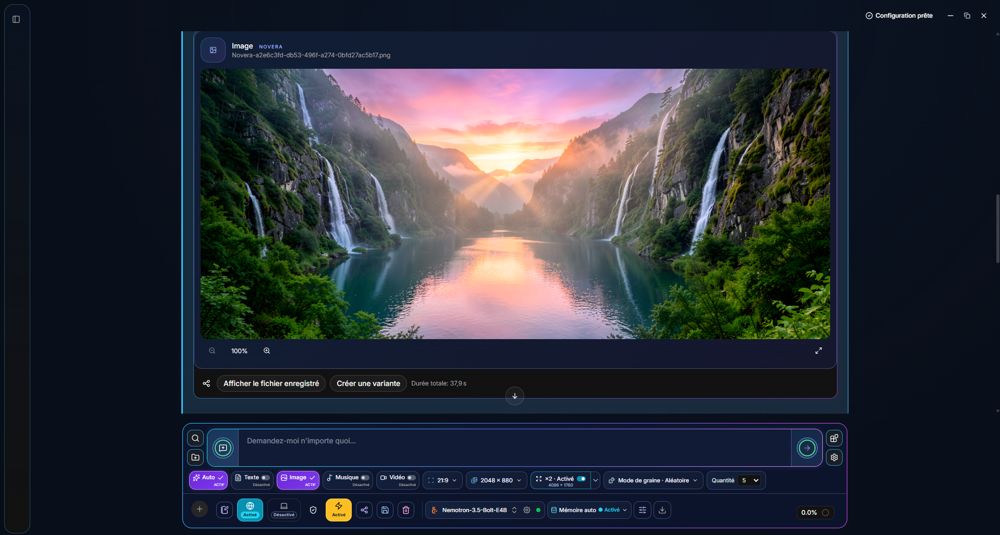

<a href="README.md">English</a> · <a href="README.fr.md">Français</a> · <a href="README.es.md">Español</a> · <a href="README.de.md">Deutsch</a> · <a href="README.it.md">Italiano</a> · <a href="README.pt-BR.md">Português (Brasil)</a> · <a href="README.ru.md">Русский</a> · <a href="README.zh-CN.md">简体中文</a> · <a href="README.ja.md">日本語</a> · <a href="README.ar.md">العربية</a> · <a href="README.hi.md">हिंदी</a> · <a href="README.bn.md">বাংলা</a> · <a href="README.ur.md">اردو</a> · <a href="README.mr.md">मराठी</a> · <a href="README.te.md">తెలుగు</a> · <a href="README.ta.md">தமிழ்</a> · <a href="README.sw.md">Kiswahili</a> · <a href="README.ha.md">Hausa</a> · <a href="README.tl.md">Tagalog</a> · <a href="README.fa-IR.md">فارسی (ایران)</a> · <a href="README.am.md">አማርኛ</a> · <a href="README.th.md">ไทย</a> · <a href="README.jv.md">Basa Jawa</a> · <a href="README.id.md">Bahasa Indonesia</a> · <a href="README.pl.md">Polski</a> · <a href="README.vn.md">Tiếng Việt</a> · <a href="README.zh-TW.md">繁體中文</a> · <a href="README.cs.md">Čeština</a> · <a href="README.ko.md">한국어</a> · <a href="README.ca.md">Català</a> · <a href="README.gu.md">ગુજરાતી</a> · <a href="README.kn.md">ಕನ್ನಡ</a> · <a href="README.yo.md">Yorùbá</a> · <a href="README.my.md">မြန်မာ</a> · <a href="README.ln.md">Lingála</a> · <a href="README.or.md">ଓଡ଼ିଆ</a> · <a href="README.uk.md">Українська</a> · <a href="README.ml.md">മലയാളം</a> · <a href="README.pa.md">ਪੰਜਾਬੀ (ਗੁਰਮੁਖੀ)</a> · <a href="README.nl.md">Nederlands</a> · <a href="README.pcm.md">Naijíriá Píjin</a> · <a href="README.arz.md">مصري</a> · <a href="README.pnb.md">پنجابی (شاہ مکھی)</a> · <a href="README.pt-PT.md">Português (Portugal)</a> · <a href="README.yue.md">粵語</a> · <a href="README.wuu.md">吴语（上海话）</a> · <a href="README.apc.md">عربي شامي</a> · <a href="README.apd.md">عربي سوداني</a> · <a href="README.bho.md">भोजपुरी</a> · <a href="README.cjy.md">晋语</a> · <a href="README.nan.md">閩南語</a> · <a href="README.arq.md">دارجة جزائرية</a> · <a href="README.hak.md">客家話</a> · <a href="README.ary.md">الدارجة المغربية</a> · <a href="README.hsn.md">湘语</a> · <a href="README.sd.md">سنڌي</a> · <a href="README.su.md">Basa Sunda</a> · <a href="README.ig.md">Ìgbò</a> · <a href="README.prs.md">دری</a> · <a href="README.ne.md">नेपाली</a> · <a href="README.ms.md">Bahasa Melayu</a> · <a href="README.uzn.md">O‘zbekcha (shimoliy)</a> · <a href="README.zu.md">isiZulu</a> · <a href="README.aec.md">عربي صعيدي</a> · <a href="README.pbu.md">پښتو (شمالي)</a> · <a href="README.gaz.md">Oromoo (Giddugaleessa-Lixaa)</a> · <a href="README.skr.md">سرائیکی</a> · <a href="README.so.md">Soomaali</a> · <a href="README.ro.md">Română</a> · <a href="README.as.md">অসমীয়া</a> · <a href="README.ceb.md">Sinugbuanon</a> · <a href="README.kk.md">Қазақша</a> · <a href="README.si.md">සිංහල</a> · <a href="README.xh.md">isiXhosa</a> · <a href="README.km.md">ខ្មែរ</a> · <a href="README.af.md">Afrikaans</a> · <a href="README.mai.md">मैथिली</a> · <a href="README.wo.md">Wolof</a> · <a href="README.kmr.md">Kurmancî</a> · <a href="README.rw.md">Ikinyarwanda</a>

  
  
<strong>You talk wetin you wan do. Novera go prepare wetin e need, do the work and arrange the results.</strong>

  
Independent AI assistant by TRON-ABS, from first launch till result: text, images, music and video for one conversation.

  
<strong>Fit for Windows, Linux, macOS and Android</strong> · 80 interface languages · 42 cloud providers · 49 media presets · Apache 2.0

  
<a href="#from-first-launch-to-results">Automation</a> · <a href="#one-dashboard-for-every-creation">Dashboard</a> · <a href="#local-models-in-use">AI models wey dey run for your own device</a> · <a href="#hub-and-compatible-models">Hub and compatible models</a> · <a href="#cloud-providers">Cloud</a> · <a href="README.fr.md">Français</a> · <a href="CONTRIBUTING.md">Help out</a>

  
Official contact: <a href="mailto:contact.novera.tronabs@gmail.com" dir="ltr">contact.novera.tronabs@gmail.com</a>

  
Official Novera social profiles: <a href="https://www.facebook.com/profile.php?id=61596114515071">Facebook</a> · <a href="https://www.instagram.com/noveratronabs/">Instagram</a> · <a href="https://www.tiktok.com/@tronabs0">TikTok</a> · <a href="https://www.youtube.com/@noveratronabs">YouTube</a> · <a href="https://x.com/noveratronabs">X</a> · <a href="https://bsky.app/profile/noveratronabs.bsky.social">Bluesky</a>

  
Share your creations, models, settings, questions, feedback, and ideas.

> Dis na assisted written regional adaptation of the English README dated 2026-11-03. Native speakers no certify am. Linked documents go keep their original language.

---

## Availability — 2026-11-03

**Novera 1.0.0 dey for Windows, Linux, macOS and Android.** [Windows x64 / Linux x64](https://github.com/TRON-ABS/Novera/releases/tag/v1.0.0) · [Windows ARM64](https://github.com/TRON-ABS/Novera/releases/tag/v1.0.0-windows-arm64). Desktop packages, both CLI archives, signatures and update manifests na public and verified.

| Platform | Availability |
| --- | --- |
| Windows x64 | Public NSIS installer, signed updater; native installation and replacement don verify. |
| Linux x64 | Public AppImage, signed updater; native installation and replacement don verify. |
| Windows x64 / Linux x64 CLI | [Novera CLI](https://github.com/TRON-ABS/Novera/releases/tag/v1.0.0-cli-novera): `novera.exe` / `novera`, with special signed update channel. |
| Windows ARM64 | [Public NSIS installer](https://github.com/TRON-ABS/Novera/releases/tag/v1.0.0-windows-arm64), native CPU text engine; installation, replacement and public-channel checks don verify. |
| Android ARM64 | [Public signed APK 1.0.0](https://github.com/TRON-ABS/Novera/releases/tag/v1.0.0-android-1000012), Android 7+, default batch 512. The maintainer confirm build 1000012 work for him phone. Clean package no conversation, models or personal API keys. [Proof and limits](docs/RELEASE_ANDROID_1.0.0.md). |
| macOS Intel / Apple Silicon | [Official 1.0.0 DMG release](https://github.com/TRON-ABS/Novera/releases/tag/v1.0.0-macos), macOS 13+ Intel / 14+ Apple Silicon; Novera-signed updates. No Apple notarized; automated checks pass separately on both architectures, visual checks hold. [Installation and proof](docs/RELEASE_MACOS_1.0.0.md). |
| iOS | Internal simulator build; Apple signing/provisioning need before iPhone install. [Follow-up](docs/REPRISE_MACOS_IOS.md). |
| Windows x64 portable | [Signed ZIP archive](https://github.com/TRON-ABS/Novera/releases/tag/v1.0.0-windows-portable); data stay for Data, signed Program replacement don verify. |
| Web, MSI, Debian | Hosted Web client and other formats remain internal; Pages presentation site don available. |

For Mac, open DMG and copy Novera inside Applications. If first launch don block, allow Novera in **System Settings → Privacy & Security → Open Anyway**. [Apple instructions](https://support.apple.com/guide/mac-help/mh40616/mac).

Updater signatures no be Windows Authenticode or Apple notarization. Manual current-version checks pass for public channel; transition between two public versions still be next-release test. [Proof and limits](docs/LAUNCH_STATUS.md).

For Android, modern phone with plenty memory be recommended for local models; use an API provider for less powerful devices. For web search, context of at least **16K tokens (16,384)** be recommended, consistently for all versions.

**Windows x64 portable 1.0.0 don available.** Discussions, settings and models we download dey inside the portable folder under `Data`. Extract the complete archive and start `Novera.exe`. Close Novera before move the folder or eject USB storage. [Portable guide and limitations](docs/WINDOWS_PORTABLE.md).

## One dashboard for every creation

Novera grow with you. Your examples and settings fit help other users find good setup. Share questions, issues and ideas for our [Facebook page](https://www.facebook.com/profile.php?id=61596114515071) or by [email](mailto:contact.novera.tronabs@gmail.com). If e possible, give your Novera version, device and local/API model. Remove personal info and never share API keys or passwords.

*Real Windows application screenshot wey maintainer send for 1 November 2026, wey him talk say application dey work well. E show generated landscape, its saved-file controls and the unified creation dashboard; dis no be mockup.*

One panel, five modes: **Auto / Text / Picture / Music / Video**. Controls go follow the mode we select: ratio, resolution, duration, cadence, quality, instrumental, lyrics, seed and quantity. Panel width and buttons go fit the window and translated labels.

- **1–10 sequential generations**, defaulting to 1, with independent quantities for image, music and video. Stop cancel the active task and the remaining queue.
- **Random, fixed, +1 and −1 seeds**, preset or custom ratios and optional **Real-ESRGAN ×2/×4** upscaling with final dimensions displayed.
- The selected model, automatic memory, attachments, instructions, web search and tools stay for same bar. Tools depend on model capabilities and access wey give.

## From first launch to results

**Our automation connect preparation to the complete execution workflow.** Novera handle the technical steps wey dey for selected configuration, while keep advanced controls accessible.

| Step | Wetin Novera handle |
| --- | --- |
| **1. Start** | E go select supported system language for first time you run am and save your choice. E go show starting models and useful hardware info. |
| **2. Prepare** | Guided installation give text, embeddings, image, music, video and upscaling. E go show components, sizes and free space before you approve, then e go track downloads with progress, pause/resume and SHA-256 verification. |
| **3. Configure** | E go register models and dem components, prepare relevant profiles and report needed dependencies. Retrieval embeddings go start for CPU with saved CPU/GPU choice. New music profiles default to instrumental mode. |
| **4. Understand the request** | E go auto route recognized creation requests to text, image, music or video. You fit also select output mode and local or cloud model clearly. |
| **5. Execute** | Automatic memory wait for active work, release models we no need and reload required resources. A 1–10 job series run in order and release resources before next job. Cloud providers use the selected account and configuration. |
| **6. Retrieve and reuse** | E go save media for Novera system folders, show results and available timings, then e go offer variants, the library, copying, exports or system sharing. Sending to another application still your action. |

Automation cover integrated engines and workflows; e no make every Hub model fit run. Hardware, installed components and provider access decide wetin fit run. Folders, file changes and shell commands follow conversation's access grants.

[User guide](docs/USER_GUIDE.md) · [Engines and validation](docs/SUIVI_MOTEURS.md) · [Development](docs/DEVELOPMENT.md)

For the updated sources, **Configurations adapt am recommendations to mobile and constrained hardware**: LFM3-1.7B Q4, or LFM3-Omni-2B Q4 with its projector when reported memory and engine requirements don land. Local generation wey no fit come out na hidden or blocked; configured cloud image, music and video still dey available. Interface guidance dey reuse the 80 language catalogs. These estimates still need device testing and a rebuild to reach installed applications.

## Capabilities for inside

Optional maintenance diagnostics now separate builds and instrument handled failures as well as JavaScript exceptions, with separate consent and filtered technical fields. An hourly production email alert don set up for the maintainer. Private source maps and alert details follow the [maintenance runbook](docs/MAINTENANCE.md); test email receipt don confirm, while authenticated symbol upload and testing for next binary still be release checks.

| Area | Features |
| --- | --- |
| **How model dey understand text and pictures** | Conversation, document attachments, streamed replies and local or cloud models. Vision depend on the model; understanding and generating images na separate capabilities. |
| **Image** | In-chat generation, seeds, ratios, resolution, GGUF/Safetensors components, configured Diffusers folders and the supported native NVFP4 CUDA profile. |
| **Music** | Local or cloud generation, duration, quality, instrumental or vocals where supported, structured lyrics and an audio player. Provider options dey different. |
| **Video** | Local or cloud generation, duration, frame count/cadence for local profiles, ratios, resolution and video player |
| **Search and tools** | Web search, embedding-based document retrieval, MCP, workspaces and local tools based on model support and granted access. |
| **Results and sharing** | Media library, variants, response/conversation exports, documents and original media, printing/PDF and system sharing wey depend on platform. |
| **Resource management** | Automatic memory dey on by default, CPU/GPU settings for supported components and manual profiles when resources fit. |

## AI models wey dey run for your own device

These models form the current guided configuration. You fit import other compatible models or change the profiles.

| Role | Model / configured components |
| --- | --- |
| **Text — first-run model** | **Nemotron-3.5-Bolt-E4B**, file `Nemotron-3.5-Bolt-E4B-Q4_K_M.gguf`. |
| **Document retrieval** | **Qwen3-Embedding-0.6B Q8_0**, **CPU by default**, with a saved CPU/GPU choice. |
| **Image** | **FLUX.2 Klein 4B Q4_K_M**, **Qwen3-4B Q4_K_M** encoder and official FLUX.2 VAE. |
| **Image — hardware option** | **FLUX.2 Klein 4B NVFP4**, through the native CUDA path when GPU and environment compatible. |
| **Music** | **ACE-Step 1.5 Turbo 2B Q4_K_M**, `acestep-5Hz-lm-1.7B-Q8_0.gguf` planner, dedicated Qwen music encoder and VAE. |
| **Video** | **Wan2.1 T2V 1.3B Q4_K_M**, **UMT5-XXL Q4_K_M** encoder and Wan 2.1 VAE. |
| **Upscaling** | Optional **Real-ESRGAN ×2 and ×4**, with dependency checks. |

The Qwen music encoder and the Qwen retrieval model na **different files**, stored separate. Model licenses still be those of dem publishers.

[Text manifest](web-app/src/constants/text-manifest.json) · [Embeddings](web-app/src/constants/embedding-manifest.json) · [Music](web-app/src/constants/music-manifest.json) · [Image/video components](src-tauri/src/core/creation_bundle.rs)

## Cloud providers

**42 provider profiles** don integrate. **ElevenLabs** now dey showcase with the music routes from Stability AI, fal and Replicate.

| | | |
| --- | --- | --- |
|  [OpenAI](https://platform.openai.com/docs/models) |  [Microsoft Azure](https://oai.azure.com/deployments) |  [Anthropic](https://platform.claude.com/docs/en/models/overview) |
|  [OpenRouter](https://openrouter.ai/models) |  [Mistral](https://docs.mistral.ai/models) |  [Groq](https://console.groq.com/docs/models) |
|  [xAI](https://docs.x.ai/developers/models) |  [Google Gemini](https://ai.google.dev/gemini-api/docs/models) |  [MiniMax](https://platform.minimax.io/docs/api-reference/text-openai-api) |
|  [Hugging Face](https://huggingface.co/models?pipeline_tag=text-generation&inference_provider=all) |  [NVIDIA NIM](https://build.nvidia.com/models) |  [DeepSeek](https://api-docs.deepseek.com/) |
|  [Kimi · Moonshot AI](https://platform.kimi.ai/docs/models) |  [Alibaba Cloud · Qwen](https://www.alibabacloud.com/help/en/model-studio/models) |  [Cerebras](https://inference-docs.cerebras.ai/models/overview) |
|  [Together AI](https://docs.together.ai/docs/serverless/models) |  [Fireworks AI](https://docs.fireworks.ai/getting-started/models) |  [Perplexity](https://docs.perplexity.ai/docs/agent-api/models) |
|  [Meta AI](https://dev.meta.ai/docs/models) |  [Cohere](https://docs.cohere.com/docs/models) |  [Z.ai](https://docs.z.ai/guides/llm/glm-5.3) |
|  [AI21 Labs](https://docs.ai21.com/docs/jamba-foundation-models) |  [BytePlus · ByteDance](https://docs.byteplus.com/en/docs/modelark/model-parameter-support) |  [Baidu Qianfan](https://cloud.baidu.com/doc/qianfan/s/rmh4stp0j) |
|  [Tencent TokenHub](https://cloud.tencent.com/document/product/1823/130078) |  [Amazon Bedrock](https://docs.aws.amazon.com/bedrock/latest/userguide/inference-chat-completions.html) |  [IBM watsonx](https://www.ibm.com/docs/en/watsonx/saas?topic=preview-inferencing-gateway-models) |
|  [ElevenLabs](https://elevenlabs.io/docs/api-reference/music/compose) |  [Black Forest Labs](https://docs.bfl.ai/quick_start/generating_images) |  [Stability AI](https://docs.stability.ai/api-reference) |
|  [Recraft](https://www.recraft.ai/docs/api-reference/agents.md) |  [Ideogram](https://developer.ideogram.ai/ideogram-api/api-overview) |  [Adobe Firefly](https://developer.adobe.com/firefly-services/docs/firefly-api/) |
|  [Runway](https://docs.dev.runwayml.com/api/) |  [Luma](https://docs.agents.lumalabs.ai/guides/model/) |  [LTX (Lightricks)](https://docs.ltx.io/models) |
|  [fal](https://fal.ai/docs/documentation/model-apis/inference/queue) |  [Replicate](https://replicate.com/docs/reference/http) |  [Leonardo.Ai](https://docs.leonardo.ai/reference/creategeneration) |
|  [Krea](https://www.krea.ai/docs/developers/krea-3/overview) |  [Vidu](https://platform.vidu.com/docs/model-map) |  [PixVerse](https://docs.platform.pixverse.ai/changelog-2394996m0) |

### Image, music and video

**20 providers show generation routes**, with **49 presets: 25 image, 20 video and 4 music**. Music routes na **ElevenMusic v2.5**, **Stable Audio 3**, **ACE-Step through fal** and **Stable Audio 2.5 through Replicate**.

| Provider | Outputs for Novera | Catalog models |
| --- | --- | --- |
|  [ElevenLabs](https://elevenlabs.io/docs/api-reference/music/compose) | Music | `ElevenMusic v2.5` |
|  [Stability AI](https://docs.stability.ai/api-reference/stable-audio/text-to-audio) | Image / Music | `Stable Audio 3` · `Stable Image Ultra` · `Stable Image Core` |
|  [fal](https://fal.ai/models/fal-ai/ace-step/api) | Image / Music / Video | `ACE-Step · cloud` · `Pika 2.2 · fal` · `Qwen Image 2512 · fal` · `FLUX.2 Max · fal` · `Kling 3 Pro · fal` · `Kling 3 Standard · fal` |
|  [Replicate](https://replicate.com/stability-ai/stable-audio-2.5/api/schema) | Image / Music | `Stable Audio 2.5 · Replicate` · `FLUX.2 Max · Replicate` |
|  [BytePlus · ByteDance](https://docs.byteplus.com/en/docs/ModelArk/image-generation-api) | Image / Video | `Dola Seedream 5 Pro` · `Dreamina Seedance 2.5` |
|  [Adobe Firefly](https://developer.adobe.com/firefly-services/docs/firefly-api/api/) | Image / Video | `Adobe Firefly Image 5` · `Adobe Firefly Video` |
|  [Google Gemini](https://ai.google.dev/gemini-api/docs/omni) | Image / Video | `Gemini Omni 1.1 Flash` · `Gemini Nano Banana 2.1` |
|  [Krea](https://www.krea.ai/docs/developers/krea-3/overview.md) | Image | `Krea 3` |
|  [Leonardo.Ai](https://docs.leonardo.ai/docs/lucid-origin) | Image | `Lucid Origin` · `Krea 2 Turbo · Leonardo` · `Ideogram 3 · Leonardo` |
|  [Vidu](https://platform.vidu.com/docs/api-reference/video-models/vidu-q4-preview/image-to-video) | Video | `Vidu Q4 Preview` · `Vidu Q3 Pro` · `Vidu Q3 Turbo` |
|  [OpenAI](https://developers.openai.com/api/docs/guides/image-generation) | Image | `GPT Image 2.5 Sunburst` · `GPT Image 2.5 Flare` |
|  [xAI](https://docs.x.ai/developers/model-capabilities/imagine) | Image / Video | `Grok Imagine Image 2.0` · `Grok Imagine Video 1.5` · `Grok Imagine Video 1.5 Lite` |
|  [Black Forest Labs](https://docs.bfl.ai/quick_start/generating_images) | Image | `FLUX.2 [max]` · `FLUX.2 [pro]` · `FLUX.2 [klein] 9B` |
|  [Recraft](https://www.recraft.ai/docs/api-reference/agents.md) | Image | `Recraft V4.1` · `Recraft V4.1 Flash` · `Recraft V4.1 Pro` |
|  [Ideogram](https://developer.ideogram.ai/ideogram-api/api-overview) | Image | `Ideogram 4.5` |
|  [Runway](https://docs.dev.runwayml.com/api/) | Video | `Runway Gen-4.5` |
|  [Luma](https://docs.agents.lumalabs.ai/guides/model/) | Image / Video | `Luma Uni-1 Max` · `Luma Uni-1` · `Luma Ray 3.2` |
|  [LTX (Lightricks)](https://docs.ltx.io/models) | Video | `LTX-2.5 Pro` · `LTX-2.5 Fast` |
|  [MiniMax](https://platform.minimax.io/docs/api-reference/video-generation-v2-create) | Image / Video | `MiniMax H3 Max` · `MiniMax H3` · `MiniMax H3 Highspeed` · `MiniMax Image-01` |
|  [PixVerse](https://docs.platform.pixverse.ai/changelog-2394996m0) | Video | `PixVerse V6 Max` · `PixVerse V6` |

<strong>Show text and vision model shortlists according to provider</strong>

| Provider | Model IDs wey source give |
| --- | --- |
| [OpenAI](https://platform.openai.com/docs/models) | `gpt-6.1-sol` · `gpt-6-astra` · `gpt-6-luna` · `gpt-6-sol` |
| [Microsoft Azure](https://oai.azure.com/deployments) | Deployment or gateway specific to account |
| [Anthropic](https://platform.claude.com/docs/en/models/overview) | `claude-sonnet-5-5` · `claude-opus-5-5` · `claude-fable-5-1` · `claude-haiku-5-5` |
| [OpenRouter](https://openrouter.ai/models) | `moonshotai/kimi-k3.1-pro` · `minimax/minimax-m3.1-flash` · `deepseek/deepseek-v4.1-flash-1017` · `nvidia/nemotron-3.5-super-vl:free` |
| [Mistral](https://docs.mistral.ai/models) | `mistral-large-4` · `mistral-medium-3-5` · `mistral-small-2603` · `ministral-3b-2512` |
| [Groq](https://console.groq.com/docs/models) | `openai/gpt-oss-120b` · `openai/gpt-oss-20b` · `llama-3.3-70b-versatile` · `llama-3.1-8b-instant` |
| [xAI](https://docs.x.ai/developers/models) | `grok-4.7` |
| [Google Gemini](https://ai.google.dev/gemini-api/docs/models) | `gemini-4-argon` · `gemini-3.8-flash` · `gemini-3.6-flash` · `gemini-3.5-flash-lite` |
| [MiniMax](https://platform.minimax.io/docs/api-reference/text-openai-api) | `MiniMax-M3.1-Flash` · `MiniMax-M3` |
| [Hugging Face](https://huggingface.co/models?pipeline_tag=text-generation&inference_provider=all) | `deepseek-ai/DeepSeek-V4.1-Flash-1017` · `Qwen/Qwen3.8-27B` · `moonshotai/Kimi-K3` · `zai-org/GLM-5.3` |
| [NVIDIA NIM](https://build.nvidia.com/models) | `minimaxai/minimax-m3.1-flash` · `deepseek-ai/deepseek-v4.1-flash` · `nvidia/nemotron-3.5-super-vl-120b-a12b` · `nvidia/nemotron-3.5-lightning-30b-a3b` · `z-ai/glm-5.3` |
| [DeepSeek](https://api-docs.deepseek.com/) | `deepseek-flash` · `deepseek-v4-pro` |
| [Kimi · Moonshot AI](https://platform.kimi.ai/docs/models) | `kimi-k3.1-pro` · `kimi-k3.1-pro-highspeed` · `kimi-k3` |
| [Alibaba Cloud · Qwen](https://www.alibabacloud.com/help/en/model-studio/models) | `qwen3.8-max` · `qwen3.7-plus` · `qwen3.8-flash` |
| [Cerebras](https://inference-docs.cerebras.ai/models/overview) | `qwen-3.8-27b` · `gpt-oss-120b` |
| [Together AI](https://docs.together.ai/docs/serverless/models) | `deepseek-ai/DeepSeek-V4.1-Flash-1017` · `moonshotai/Kimi-K3` · `Qwen/Qwen3.8-Flash` · `Qwen/Qwen3.8-2.4T-A95B` |
| [Fireworks AI](https://docs.fireworks.ai/getting-started/models) | `accounts/fireworks/models/deepseek-v4p1-flash-1017` · `accounts/fireworks/models/kimi-k3` · `accounts/fireworks/models/minimax-m3` |
| [Perplexity](https://docs.perplexity.ai/docs/agent-api/models) | `perplexity/sonar` · `openai/gpt-6.1-sol` · `google/gemini-4-argon` · `perplexity/kimi-k3` |
| [Meta AI](https://dev.meta.ai/docs/models) | `muse-wonder-1.0` · `muse-spark-1.3` |
| [Cohere](https://docs.cohere.com/docs/models) | `command-a-plus-05-2026` |
| [Z.ai](https://docs.z.ai/guides/llm/glm-5.3) | `glm-5.3` · `glm-5.3-flash` · `glm-5.3-flashx` |
| [AI21 Labs](https://docs.ai21.com/docs/jamba-foundation-models) | `jamba-large` · `jamba-mini-2` |
| [BytePlus · ByteDance](https://docs.byteplus.com/en/docs/modelark/model-parameter-support) | `dola-seed-2-1-turbo-260628` |
| [Baidu Qianfan](https://cloud.baidu.com/doc/qianfan/s/rmh4stp0j) | `ernie-5.1` |
| [Tencent TokenHub](https://cloud.tencent.com/document/product/1823/130078) | `hy4-preview` |
| [Amazon Bedrock](https://docs.aws.amazon.com/bedrock/latest/userguide/inference-chat-completions.html) | `openai.gpt-6.1-sol` |
| [IBM watsonx](https://www.ibm.com/docs/en/watsonx/saas?topic=preview-inferencing-gateway-models) | Deployment or gateway specific to account |

Inventory check against source on **29 October 2026**. These names dey describe Novera presets, no guarantee access for every account. Remote catalogs, regions, licenses, quotas and billing still provider-specific. Compatible profiles fit refresh dem catalogs; Azure and some gateways use account deployments. Cloud contracts get simulated tests; no paid generation don happen for this showcase update.

[Media catalog](web-app/src/constants/mediaProviders.ts) · [Text/vision models](web-app/src/constants/cloudModels.ts) · [Cloud setup](docs/USER_GUIDE.md#cloud) · [Icon origin](docs/DEVELOPMENT.md#logos)

## Hub and compatible models

**GGUF, standard and quantized Safetensors, ONNX, and MLX**: check models by task and pick variants wey fit the engine and your hardware.

| Family | Support for the source | Requirements |
| --- | --- | --- |
| **GGUF** | Text generation through llama.cpp; image and video components for profiles we support. | Architecture wey the bundled engine recognize. |
| **Split GGUF** | One variant for complete series, summed size, all-shard download and size/SHA-256/header checks. | Standard numbered filenames; downloading 500 GB no mean the model fit this PC. |
| **Standard Safetensors** | Complete folders through Transformers, causal text for CPU or NVIDIA CUDA. | Configuration, tokenizer and every shard wey need. |
| **ONNX Runtime** | You fit import numeric/bool graphs and prepared GenAI text exports from your device. | Validated complete folder; preprocessing/postprocessing wey fit the task na necessary; [setup and limits](onnx-server/README.md). |
| **LoRA / PEFT adapters** | Import complete base with its separate local adapter for the Safetensors provider. | Unquantized causal Transformers base, match identity, tensor checks and total memory estimate; [setup and limits](transformers-server/README.md#local-lora--peft-adapters). |
| **FP8 LLM / ModelOpt** | Native CUDA execution for compatible dense Llama/Qwen2/Qwen3 per-tensor FP8 exports. | Architecture/tensor checks and real kernel probe; [setup and limits](transformers-server/README.md#modelopt-fp8-and-nvfp4-llms). |
| **NVFP4 LLM / ModelOpt** | Packed block-16 FP4 projections pass through native CUDA GEMMs; different from image NVFP4. | Blackwell GPU fit, supported dimensions/export and real kernel probe; test models wey dem never train, wey dem test for RTX 5070. |
| **AWQ** | 4-bit GEMM model checkpoints without operation fusion. | Explicit NVIDIA CUDA attention for the tested stack; complete checkpoint and free GPTQModel/Transformers needed. |
| **GPTQ** | 2/3/4/8-bit configurations, gptq/gptq_v2 formats. | NVIDIA CUDA, GPTQModel and Optimum; real run test for 4 bits. |
| **bitsandbytes** | 4-bit NF4/FP4 or 8-bit INT8. | NVIDIA CUDA and optional dependencies; real NF4 and INT8 tests. |
| **EXL3** | Complete quantized Safetensors model folders don load through ExLlamaV3; real generation with CUDA don test. | NVIDIA GPU, Python 3.12 environment need separate and architecture wey fit work; no CPU fallback. |
| **EXL2** | Unfused ExLlamaV2-bit GPU. checkpoints. | CUDA attention must be clearly pick am for the software stack wey dem test; complete model checkpoint and available VRAM na wetin we need. |
| **MLX** | 0: Models we fit use for Apple Silicon. | MLX engine and platform wey e support. |

The Hub don pin **LFM3-1.7B** as e LiquidAI recommendation for compatible configurations, with Q4_K_M, Q6_K and Q8_0 variants. The first-run model still be the one wey dey list for guided configuration above.

Filter download weights from **under 1 GB to 500 GB and above**, then sort by hardware fit, size, recency or downloads. Results go load step by step; filters apply to models wey fetch and their default variant. Memory advice use available RAM/VRAM, context and companion components, no double-count shared GPU memory.

AWQ 4-bit, GPTQ 4-bit, NF4 and INT8 each generate text on an RTX 5070 Laptop using tiny untrained models wey create offline. Dis validate loading and execution, no the quality or performance of every model. **These additions dey for source: rebuilding and compatible dependencies na required; dis README update no upgrade installed binary.**

**Measured for RTX 5070 Laptop:** For Qwen2.5-0.5B-Instruct, context na 2,048, prompt get 272 tokens, and model generate 128 tokens; after warm-up, we run am five times: median decode **GGUF Q4_K_M 402.7 tokens/s · EXL3 4 bpw 312.5 · EXL2 4 bpw 146.9**. No speed benefit over GGUF don show here. Quantization/calibration different, and EXL3 fail one simple arithmetic test; these results no be general speed or quality ranking. [Full measurements and limits](deliverables/exllama-2026-10-30/validation.md).

**TabbyAPI** is an optional, separately managed OpenAI-compatible server connection, disabled by default. Authenticated EXL3 model discovery and streaming don test. The managed local ExLlama route remain different. [ExLlama setup and TabbyAPI connection](transformers-server/README.md#exl3-first-exl2-second--nvidia-execution).

The default hardware-adapted sort favor newer releases inside same compatibility and available-memory tier. Installed models no replace automatically.

[Quantized Safetensors setup](transformers-server/README.md#quantized-safetensors--source-integration-29-october-2026) · [Formats, priorities and validation](docs/SUIVI_MOTEURS.md)

The updated sources add **optional managed components for Configurations for Windows x64**: private Python environments, pinned CPU/CUDA profiles, estimates and confirmation before downloads, verification, repair and removal. Custom interpreter paths stay for advanced options. Native GGUF engines keep dem existing components; mobile and cloud no download desktop Python/PyTorch. Three private CPU/export profiles don exercise with synthetic test data; The maintainer report successful desktop use for 1 November 2026; GPU profiles and clean-PC installation still need separate, detailed validation. [Profiles and test limits](docs/REPRISE_COMPOSANTS_GERES_80_LANGUES.md). Embedding the stack for EXE don be postpone.

## 80 interface languages and variants

**All 80 catalogs cover current 2,429 English keys** across 15 namespaces, including menus, configurations, settings, help and media controls. Plural forms and interface direction follow the language we select. Response and voice languages depend separate for the model.

Dis technical coverage no certify linguistic quality: **native review and regional adaptation still necessary**. See native labels and known limits for the [language guide](docs/LANGUAGES.md) and [audit report](deliverables/interface-audit-2026-10-29/RAPPORT.md).

## Helping people, for every sector

Beyond school and education, our ambition na to help people learn, solve problems, create and develop useful projects worldwide. Novera aim to make current AI advances easy to understand and use, across languages, levels of experience and available hardware.

| Sectors we wan help develop | Examples of useful contributions |
| --- | --- |
| Schools, education and lifelong learning | Explain concepts, adapt learning materials, and support teachers, students, and families. |
| Research, science and space | Check books, explain how, look at data and share knowhow. |
| Health, care and social help | Make information easy to grasp and support research and work flow for pros. |
| Farming, food and village people | Share real knowhow, help plan and build tools wey useful for where we dey. |
| Environment, weather, water and different kinds of life | Explain proof, help see things and help communities plan projects. |
| Power, factory work, building and handiwork | Help with papers, design, upkeep, tech learning and make process better. |
| Business, trade, money matters and jobs | Help arrange work, understand info, develop projects and learn pro skills. |
| Government services, law and community involvement | Make papers and ways easy to understand and info easy to reach. |
| Computer work, cyber safety, robots and phone talk | Help build software, understand systems and make useful tools. |
| Arts, culture, media, languages and history | Help with writing, translating, pictures, video, creative things and sharing culture. |
| Transport, logistics, tourism, sport and community life | Help for planning, communication, learning and local initiatives. |
| Accessibility, humanitarian work and everyday life | 0: Reduce language and knowledge wahala and help people with practical support. |

Dis na directions for contribution and development, no be say every sector-specific application don deliver or validate. We wan simple guidance for everyday use, clear advanced options when need, transparent hardware and cloud requirements, and collaboration with people wey know each field and local context.

## Project status

**Novera 1.0.0 dey for Windows, Linux, macOS and Android.** The screenshot show Windows application compile locally by maintainer. Source changes, targeted tests and hardware validation dey documented separately; dis no validate every model, platform or cloud account.

Manual GitHub Actions builds don enable for all eleven distribution variants. Follow the [build results and verified candidate downloads](docs/CI_DISTRIBUTIONS.md); availability don record separately for each platform. Candidates different from signed production releases. Distribution requirements dey describe for the [official release policy](OFFICIAL_RELEASES.md) and [releases page](https://github.com/TRON-ABS/Novera/releases). Existing updater-disabled candidates remain internal. Public releases need configured and verified update mechanism; [desktop signature checks and remaining launch requirements don documented](docs/LAUNCH_STATUS.md).

## Documentation and contributions

- [Detailed user guide](docs/USER_GUIDE.md), [product and user-information golden rules (French)](docs/REGLES_D_OR.md), [models and engines](docs/SUIVI_MOTEURS.md).
- [Development](docs/DEVELOPMENT.md), [guide for build and release](docs/BUILD_AND_RELEASE.md), [future versions and how to prepare for update](docs/FUTURES_VERSIONS.md).
- [Project dashboard](TABLEAU_DE_BORD_NOVERA.md), [roadmap](ROADMAP.md), [changelog](docs/CHANGELOG.md).
- [Contributing](CONTRIBUTING.md): code, tests, native review for 80 languages and real workflow feedback.

## Identity and license

Novera dey maintain by **TRON-ABS** for [this repository](https://github.com/TRON-ABS/Novera). See the [identity policy](BRANDING.md) and [official release policy](OFFICIAL_RELEASES.md).

Novera build on [Jan](https://github.com/janhq/jan), wey Menlo Research and its contributors create. Original and third-party attributions and the [Apache 2.0 license](LICENSE) dey remain. Jan downloads no be Novera releases.

## Support Novera

As independent researcher, I know say no funding fit make research hard.

If you wan be part of the Novera adventure, you fit support my research and project development with voluntary bitcoin contribution.

Thank you to everybody for your support, contributions, feedback and encouragement. Every small thing count for this adventure!

**Bitcoin (BTC) — Bitcoin network**

Receiving address: `17TXpB1aBj5DxjwEfM3K44zyqhixRzY78i`

If you wan contribute, scan dis QR code with your wallet or copy the address above. Select **Bitcoin (BTC), on the Bitcoin network**, then choose any amount you want.

---

  
To everybody wey start journey with Novera: may your curiosity open new doors, your ideas come to life and every creation take you small step further.

  
<strong>TRON-ABS</strong>

  
Mr Sachet Jean-Marc — Independent researcher — France

  
<em>The art of Human with AI</em>

  
Thank you to everybody wey contribute to better world. Through dem discoveries, work, mutual support and knowledge dem pass on, dem help us reach where we be today.

  
We wish dem the best for future, along with everybody wey carry this spirit of sharing and helping others move forward.

Development tool: 🧠 Codex — GPT-6.1 Sol

