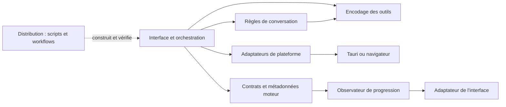

# Architecture modulaire de Novera

Mise à jour : **24 octobre 2026**. La restructuration est maintenant compilée dans le nouveau binaire local 1.0.0. La version précédente est sauvegardée ; aucune publication distante.

## Les six responsabilités

| Partie | Règles ou code isolé | Points d’intégration existants |
| --- | --- | --- |
| Interface | [Politique des langues](../web-app/src/modules/interface/languages.ts) | Écrans dans `components/`, `containers/`, `routes/` ; [adaptateur des statistiques moteur](../web-app/src/adapters/interface/engine-progress.ts) |
| Conversations | [Messages](../web-app/src/modules/conversations/messages.ts), [branches](../web-app/src/modules/conversations/branching.ts), [budget et réduction du contexte](../web-app/src/modules/conversations/context.ts), [nettoyage des titres](../web-app/src/modules/conversations/titles.ts), [exports](../web-app/src/modules/conversations/export.ts) | Stores de sessions et sauvegarde dans `hooks/`, backend `src-tauri/src/core/threads/` ; exécution des résumés dans l’orchestration existante |
| Moteurs IA | [Contrats](../web-app/src/modules/engines/contracts.ts), [métadonnées et événements de progression](../web-app/src/modules/engines/stream-metadata.ts) | [ModelFactory](../web-app/src/lib/model-factory.ts), extensions llama.cpp/MLX, plugins Rust |
| Outils et agents | [Encodage des images de résultats MCP](../web-app/src/modules/tools/tool-images.ts) | Agents et MCP déjà dans `src-tauri/src/core/agent/`, `src-tauri/src/core/mcp/` et plugins d’outils |
| Adaptations par plateforme | [Préférences du navigateur](../web-app/src/modules/platform/browser-language.ts), [lecture de la locale native](../web-app/src/modules/platform/system-locale.ts) | Services Tauri/mobile/web, capacités et configurations Windows/Linux/Android existantes |
| Distribution | [Contrôle des flux de mise à jour](../scripts/distribution/check-update-feeds.mjs), exécuté hors du runtime de l’application | [Packaging portable Windows](windows-portable.md) dans `scripts/distribution/` et point d’entrée compatible dans `scripts/` ; workflows manuels préparés, signature et distribution publique à valider |

La [carte lisible par les outils](../architecture/modules.json) décrit les six parties, leurs chemins et les dépendances autorisées des modules extraits.

## Sens des dépendances



L’observateur est une fonction fournie par l’appelant : le module moteur n’importe pas l’adaptateur d’interface. Les types SDK utilisés uniquement pour les contrats ne déclenchent pas de chargement runtime dans ces modules.

## Changements concrets

- Les fonctions de conversation déplacées sont conservées avec leur comportement : conversion de messages, choix des branches, estimation et réduction de contexte. Elles n’importent pas React, Zustand, les modèles exécutables ou les API système.
- La génération d’un résumé ou d’un titre reste dans l’orchestration, qui appelle les règles pures et le moteur. Elle n’est pas confondue avec l’estimation ou le nettoyage du texte.
- Le calcul des métadonnées moteur envoie des événements à un observateur. L’adaptateur d’interface les dirige vers la bonne conversation et ne met à jour les indicateurs globaux que pour le flux sélectionné. Un autre consommateur peut utiliser l’extracteur sans initialiser un store UI.
- La lecture de la langue système appartient à la plateforme ; la correspondance aux 36 langues disponibles appartient à l’interface. La sauvegarde et la priorité du dernier choix utilisateur restent dans les réglages.
- L’encodage des images d’outils est indépendant des écrans et des clients natifs.
- Le script de distribution garde son point d’entrée historique et son mode hors réseau. Les fixtures Jan héritées testent un contrat de flux ; elles ne créent pas un flux Novera et n’activent aucune mise à jour.

## Compatibilité et migration

Les anciens chemins `web-app/src/lib/messages.ts`, `message-branching.ts`, `tool-image-sentinel.ts` et `systemLanguage.ts` restent des points d’entrée de compatibilité. Le fichier `context-manager.ts` réexporte les règles pures et conserve l’orchestration du résumé. `thread-title-summarizer.ts` réexporte le nettoyage du titre.

`scripts/check-update-feeds.mjs` reste utilisable par les workflows existants ; son implémentation est maintenant sous `scripts/distribution/`. Les imports existants et les noms techniques externes restent compatibles. Aucun schéma de préférences ou de conversations n’est modifié par cette restructuration.

Pour un nouveau développement, importer les règles depuis leur module et réserver les façades historiques aux consommateurs non migrés. Une logique pure reçoit ses données en paramètres ; les accès à l’OS, à un store UI ou à un service restent dans un adaptateur ou dans l’orchestration.

## Contrôle automatique des frontières

```text
yarn check:architecture
yarn test:architecture
```

- Le contrôle lit les imports TypeScript/JavaScript, réexports et imports dynamiques des chemins `strictRoots` de la carte.
- Il applique les dépendances intermodules déclarées, distingue imports de types et imports exécutables et refuse l’accès direct aux globals navigateur depuis les règles pures.
- Les sept tests du contrôleur comprennent des exemples interdits : React/store/IPC dans un moteur, sortie du module par chemin relatif et dépendance inverse outils → conversations.
- Il vérifie aussi que les chemins documentés dans la carte existent.

**Périmètre précis :** les règles strictes portent actuellement sur les 12 fichiers des modules extraits et de l’outil de distribution. `sourceRoots` décrit les couches d’intégration existantes ; le contrôleur ne certifie pas que tout l’ancien code y est déjà découplé. Les tests et les adaptateurs ne sont pas inclus dans ces règles pures. Les accès indirects via une bibliothèque autorisée ne sont pas un audit de sécurité complet.

## Travail restant, à effectuer progressivement

- Séparer la configuration et les erreurs utilisateur encore lues directement par `ModelFactory` ; les recevoir par des contrats explicites avant d’étendre les règles strictes.
- Réduire les responsabilités du transport de chat et des grandes routes, en extrayant des contrôleurs testés pour sessions, persistance et outils.
- Clarifier la composition des services par plateforme en s’appuyant sur les interfaces du `ServiceHub`, sans supprimer les adaptateurs déjà fonctionnels.
- Étendre la migration aux autres outils, documents et politiques d’agents lorsque des cas de modification le justifient.
- Adapter séparément la distribution portable, la signature et les workflows Novera. Cette extraction du contrôleur de flux ne résout pas la contribution portable/CI #9302.
- Valider les capacités réelles Android avant d’annoncer la parité avec Windows ; voir [A_FAIRE.md](../A_FAIRE.md).

Aucune dépendance de production n’a été ajoutée ni retirée. Aucun gain de vitesse, de taille du binaire ou de consommation n’est revendiqué sans mesure. Les besoins d’allègement des dépendances restent un audit séparé.

## Sauvegarde et validation

Une copie horodatée complète du dossier `deliverables/Novera-Desktop-local-1.0.0` a été réalisée avant les modifications. Les 32 fichiers ont été comparés par SHA-256, pour 1 086 921 999 octets. L’original n’a été ni supprimé ni remplacé.

Les chemins exacts, les empreintes et les résultats de validation sont conservés dans les preuves locales de cette tâche. Les commandes et le bilan final figurent aussi dans le [tableau de bord](../TABLEAU_DE_BORD_NOVERA.md) et le journal `PR.md`. Ces preuves ne sont pas automatiquement publiées avec les sources.

### Bilan de cette restructuration

- 4 941 tests web réussis, 2 ignorés (397 fichiers réussis, 1 ignoré).
- 444 tests ciblés avaient également réussi ; ils se recouvrent avec la suite complète.
- 7 tests du contrôle d’architecture réussis ; 12 fichiers stricts vérifiés dans les six domaines, sans violation.
- Contrôle TypeScript sans émission réussi.
- Contrôle hérité des fixtures de flux de mise à jour réussi, en mode hors réseau uniquement.
- Aucune dépendance ajoutée, aucune compilation de l’exécutable et aucune publication.

Sauvegarde locale : `deliverables/Novera-Desktop-local-1.0.0-sauvegarde-2026-10-24_02-14-10`. Les empreintes sont dans les preuves locales ; elles ne sont pas un livrable public.

Les [commandes de discussion](CONVERSATION_CONTROLS.md) utilisent maintenant une sérialisation pure du module Conversations et un adaptateur de fichiers/impression dans `web-app/src/adapters/platform/`. Cet adaptateur fait partie de l’intégration plateforme, hors des règles strictes des modules purs.

La distribution Windows portable adaptée de la contribution #9302 est intégrée localement : packager PowerShell dans Distribution, tests Windows et workflows manuels Novera sans secrets ni release. L’analyse stricte JS/TS ne certifie pas les scripts PowerShell ; leurs tests et leur parseur assurent leur validation propre.
