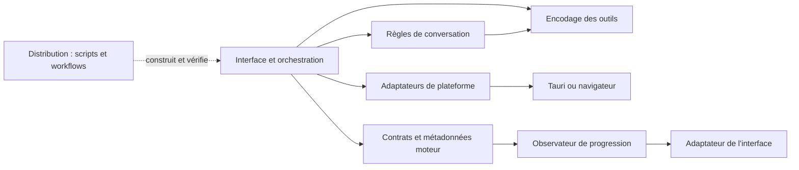

# Novera — développement

## Fiches musicales et suspension de la modale de partage — 28 octobre 2026

`modules/engines/music-prompt.ts` reconnaît des fiches structurées : première ligne titre, en-tête paroles/style ou section canonique, au moins deux sections reconnues et quatre lignes de paroles. Le parser retire les clôtures Markdown, sépare les descriptions du texte chanté et extrait un BPM valide, sans accès aux magasins ni mutation des profils. `resolveOutputMode` l'emploie après les commandes explicites ; les adaptateurs musicaux locaux/cloud réutilisent le résultat. Les cas sans titre, le format exact Titre/À coller dans Paroles et les demandes explicites d'analyse sont couverts par les tests.

`ShareButton` démonte la modale avec `flushSync`, laisse son nettoyage de focus s'exécuter, puis appelle le système. La réussite ne réouvre pas la modale sous le volet Windows. En cas d'échec, une garde restaure la préparation existante sans recharger/réinitialiser la sélection. Les tests contrôlent l'absence du dialogue et de `pointer-events: none` au moment de l'appel et après son retour, ainsi que la récupération après erreur. Le symptôme précisé par le mainteneur concerne la fermeture du volet de partage ; aucune modification du shutdown applicatif n'a été faite. Le cache natif contient bien le fichier préparé et n'a pas été effacé.

Validation ciblée : 379 tests / huit fichiers, TypeScript/ESLint, architecture (zéro violation, sept tests), 80 catalogues de 1 769 clés. Le diagnostic natif à fichier fictif rend la main ; aucun envoi réel ni nouvelle compilation de Novera. Le correctif du focus dans le produit reste à vérifier au prochain build.

## Préparation WinRT hors interface — 28 octobre 2026

Dans `core/sharing.rs`, `prepare_windows_share` attend avec une limite de 15 s un worker qui résout le fichier dans un appartement MTA. `prepare_windows_storage_item` rend un `AgileReference<IStorageItem>` ; le scope COM est équilibré et les chemins verbatim/UNC sont convertis pour StorageFile. Le callback principal `native_sheet` ne résout plus de fichier par attente synchrone : il crée le DataTransferManager lié à HWND, installe DataRequested puis ouvre la fenêtre. [Microsoft déconseille `join()` sur un thread UI](https://github.com/microsoft/windows-rs/blob/master/docs/crates/windows-future.md#consuming-an-operation), dont la pompe de messages doit continuer.

Les tests Windows isolés utilisent de vrais fichiers de test TXT/PNG/MP3/MP4 et résolvent leur référence depuis un nouvel appartement après sortie du worker initial ; un fichier absent échoue avant tout dispatch UI. Le test React vérifie que l'échec natif rend de nouveau disponibles le bouton système, la copie de fichier et la fermeture. Ces contrôles ne remplacent pas un essai du panneau système dans une application recompilée.

## Partage de fichiers sans présentation et fenêtre desktop — 28 octobre 2026

`ShareButton` utilise un aperçu média simple au lieu de `MediaPlayer`. Un rendu avec un seul média choisit son URL et le format original, même si son message contient une légende ; les discussions complètes conservent le choix HTML. Le repli sur un média absent de l'historique dérive son MIME du type et de l'extension, notamment audio/mpeg pour MP3. `shareEntries` extrait désormais `input_audio` et répare l'ancienne enveloppe de référence ; le transport original reste un fichier/référence, sans capture du DOM. `systemShare` joint seulement le fichier, sans duplication du texte dans le paquet natif. Les HTML explicitement demandés conservent des lecteurs standards et utilisent `audio` pour la musique.

Les trois configurations desktop démarrent maximisées avec minima 640 × 480. Aucun changement des commandes de partage Windows/WinRT ni de la géométrie mobile pour ce lot. Validation : 87 tests web ciblés avec `TAURI_ENV_PLATFORM=windows`, TypeScript/ESLint ciblé, architecture et JSON des configurations. Tests de contrat uniquement pour le système ; aucun envoi réel ni compilation de Novera.

## Lecteurs et références audio persistantes — 28 octobre 2026

`components/MediaPlayer.tsx` centralise la présentation Novera des images, de l'audio et de la vidéo, sans bibliothèque ni décodeur supplémentaire. Le moteur média reste HTMLMediaElement ; les commandes visibles sont React/CSS. L'état suit les événements natifs, les rejets de `play()` sont traités, la recherche attend une durée finie, le changement de source réinitialise le composant et sa fermeture arrête sa lecture. Le coordinateur `services/app/media-playback.ts` conserve l'exclusivité par capture de `play`. Plein écran par détection des fonctions standard/Safari, puis agrandissement interne avec Escape et gestion du focus. Les aperçus de création, pièces jointes, partage et Cowork utilisent ce composant.

La saisie de durée conserve un brouillon indépendant pour autoriser vide et valeurs intermédiaires ; un changement manuel désactive Auto. Les limites musicales sont centralisées dans `modules/engines/music.ts`, vérifiées à l'envoi local/cloud et dans le validateur Rust local. Aucun plafonnement silencieux à 240 s ; le local est maintenant 10–600 s.

Le défaut de reprise venait de `convertThreadMessageToUIMessage` : le contenu `input_audio.data` pouvait être une référence musicale durable, mais était toujours préfixé comme base64. La restauration reconnaît désormais les noms de création MP3/WAV valides, y compris une ancienne enveloppe erronée, sans dépendance entre domaines conversations et moteurs. Les deux chemins de sauvegarde sont testés sur trois cycles JSON ; les pièces jointes audio base64 existantes restent couvertes par les régressions.

Validation : 410 tests web / 16 fichiers, 19 tests Rust isolés, TypeScript, ESLint ciblé, sept tests d'architecture, zéro violation et 80 × 1 768 clés. Une prévisualisation locale de développement est préparée dans `.build` ; elle ne valide pas les cinq systèmes, leurs codecs ni un vrai redémarrage de binaire. Pas de compilation applicative ni publication.

## Musique cloud et reprise VAE — sources locales du 27 octobre 2026

Le catalogue ajoute un profil ElevenLabs et quatre présélections musicales (ElevenMusic v2.5, Stable Audio 3, ACE-Step fal, Stable Audio 2.5 Replicate), sans MiniMax musical. La modalité de sortie est `audio`, la tâche native `music` ; le nombre de profils passe à 42 et celui des présélections média à 49. Les sélections `selections[scope].music` sont distinctes du profil local et des choix image/vidéo. Le sélecteur reprend les icônes des fournisseurs, avec le symbole ElevenLabs téléchargé depuis sa page officielle de marque. Les libellés existants sont réutilisés dans les 80 locales.

`music-cloud-stream.ts` prépare le handle de sauvegarde, suit l'annulation jusque pendant la préparation, puis libère le handle après annulation effective. Les appels cloud ne prennent pas de bail local et ne déchargent aucun modèle local. `cloud.ts` utilise les contrats officiels : clé `xi-api-key` et audio binaire ElevenLabs ; multipart asynchrone et réponses 202 Stability ; files fal/Replicate et résultat audio. Téléchargement binaire borné à 128 Mio, origines de suivi authentifié contrôlées, aucune clé dans l'URL ni dans le payload de sauvegarde. La sauvegarde native reconnaît WAV/MP3 et utilise le dossier Musique système. Aucun passage par les complétions de chat ni repli payant vers un autre fournisseur.

Les contrôles reflètent les contrats : durée Replicate plafonnée à 190 s, graine non utilisée avec le prompt ElevenMusic, format imposé lorsque le fournisseur n'expose pas notre choix local, paroles structurées seulement pour ElevenLabs/fal. Les autres fournisseurs reçoivent une demande instrumentale sans champ de paroles ignoré. Les paramètres locaux sont préservés. Sélection et installation de profil ne remplacent pas un mode Auto actif ; les choix manuels explicites restent respectés.

Dans `creation_music.rs`, la synthèse GPU reçoit des tuiles VAE 256/32. Après le cas précis `device not ready` au décodage VAE, un placement Auto permet une reprise CPU unique depuis les codes déjà produits, avec même graine/durée. Le planificateur ne redémarre pas ; DiT et VAE sont recalculés. L'annulation et les périphériques explicitement choisis empêchent ce repli. La progression et le sidecar signalent la reprise CPU.

Validation : **172 tests web dans 13 fichiers**, **19 tests Rust isolés**, TypeScript, architecture et 80 × 1 762 clés sans erreur. Deux essais réels des CLI : 30 s et 180 s, WAV 48 kHz stéréo 24 bits, décodage CUDA réussi ; [mesures et sources](SUIVI_MOTEURS.md#musique-cloud-et-vae-cuda--candidat-du-27-octobre-2026). Aucun appel cloud payant, aucune écoute certifiée, aucune nouvelle application compilée ni publication. Le déclenchement réel de la reprise après une panne GPU n'a pas été forcé.

## Routage Auto multilingue et indicateur effectif — 27 octobre 2026

`resolveOutputMode` distingue la sortie demandée de son sujet : une bande originale pour un film est musicale. `creation-intent.ts` utilise un vocabulaire public local pour les 80 locales, borné aux commandes de création, avec cibles textuelles, frontières Unicode et cas de noms suivis d'attributs. Les commandes explicites traduites fonctionnent indépendamment de la langue d'interface. Les variantes arabes/chinoises et persanes réutilisent les formes écrites communes déjà employées dans les catalogues ; l'exhaustivité dialectale et la relecture native restent ouvertes. Aucun classifieur distant, appel payant ou chargement supplémentaire de modèle n'est ajouté. Les exemples de contrat ne constituent pas une évaluation de compréhension linguistique générale.

`previewOutputMode` suit le brouillon, puis la dernière sortie soumise. Le transport écrit `resolvedModes[scope]` avant chargement ; cet état reste transitoire et propre à chaque discussion. Auto et le bouton effectif sont allumés ensemble sans changer `modes[scope]`. Le travail actif garde son indicateur malgré un nouveau brouillon. Le modèle texte suit celui de la discussion, les profils média leurs banques propres ; le sélecteur affiche l'icône correspondante et le nom avec direction automatique, dans une zone annoncée aux lecteurs d'écran.

La durée musicale est bornée **30–240 s**, pas de 1 s et raccourcis de 30 s. Les paramètres anciens sont normalisés à la lecture. Les unités longues publiques générées depuis Intl et les chiffres usuels des écritures prises en charge permettent d'extraire une durée explicite au début d'une demande sans confondre l'année du film avec des secondes. La durée est réservée pour le travail sans modifier le préréglage ; hors plage explicite, échec avant appel au moteur. Le validateur Rust applique les mêmes bornes. Sauvegarde dans `dirs::audio_dir()/Novera musique`, sans chemin personnel préconfiguré.

Validation des dernières versions de chaque fichier : **390 tests web dans 14 fichiers**, **17 tests Rust isolés**, TypeScript sans émission, sept tests d'architecture et zéro violation, 80 × 1 762 clés sans erreur structurelle. Les 182 tests du vocabulaire comprennent les 80 exemples musicaux et les 80 groupes de commandes traduites. Le double de test du magasin des discussions inclut désormais sa table `threads`, nécessaire au modèle compact propre à la discussion. Diagnostics ignorés : `.build/auto-routing-2026-10-27/`. Aucun nouveau build de l'application ni rendu musical réel.

## Création musicale et installation globale — sources locales du 27 octobre 2026

Le domaine pur expose `music` entre `image` et `video`. `modules/engines/music.ts` porte paramètres et bornes ; `useMusicCreation` conserve une banque et des profils propres, avec chemins vides initialement. `MusicControls` présente réglages rapides et détaillés. `services/creation/music-stream.ts` réserve une seule graine, utilise le bail mémoire commun, suit/annule le travail natif et ne publie un lecteur audio qu'après succès. Les modes Auto, Texte, Image et Vidéo gardent leurs transports ; Musique n'ajoute pas de catégorie d'instructions.

`creation_music.rs`, inclus depuis `creation.rs`, valide les quatre architectures GGUF, le dossier commun et le premier encodeur alphabétique réellement utilisé par ACE-Step. Le processus `ace-lm --models … --request music.json` termine avant `ace-synth --models … --request music0.json`. `seed` et `lm_seed` sont figés ensemble, ainsi que modèle, paramètres et lots unitaires entre les étapes. Exécution directe sans shell, annulation native, progression issue des journaux bornés. Les WAV sont contrôlés (RIFF, canaux, fréquence, profondeur, durée) et publiés dans le dossier Musique système ; les MP3 ont un contrôle d'en-tête, sans prétention à un décodage complet. Les fichiers privés ne figurent dans aucun manifeste.

Le manifeste musical fixe empreintes, tailles et licences. `creation_bundle.rs` combine Image/Musique/Vidéo en 20 fichiers uniques ; le Qwen image sert aussi au texte par enregistrement local par référence. `services/creation/setup.ts` transforme le manifeste vérifié en profils séparés, configure le modèle texte et les sélections du contexte d'origine. Le registre d'application automatique persiste demande, contexte et erreur détaillée ; un échec ne déclenche pas de répétitions silencieuses. Il ne force pas le mode de sortie ni l'ouverture d'une fenêtre. La confirmation précède tout téléchargement et toute application automatique.

Le plan calcule les octets restants et 256 Mio de réserve sur le volume cible, recontrôle au départ et pendant les reprises ; collisions et fichiers existants sont préservés. `creation_video_runtime_check` sonde Python/imageio-ffmpeg avec délai borné avant le pack global ; absence de dépendance bloque la confirmation au lieu d'annoncer une configuration prête. Les packs automatiques incluant les binaires musicaux sont Windows ; les imports personnalisés sur d'autres desktops restent à valider.

Référence de poids et moteurs téléchargeables : **14 878 787 127 octets**, périmètre, versions et méthode de comparaison dans [SUIVI_MOTEURS](SUIVI_MOTEURS.md#référence-texte-image-musique-vidéo--1488-go--27-octobre-2026). Validation : 154 tests web réussis et un scénario non-Windows ignoré, 17 tests Rust isolés, TypeScript, frontières sans violation, sept tests d'architecture et 80 × 1 762 clés. CLI inspectées et version vérifiée ; aucun poids musical téléchargé ni rendu musical complet validé. Aucune compilation applicative ni publication de ce lot.

## Phases et progression vidéo — correction locale du 27 octobre 2026

`video_worker.run_cpp_clip` lit stdout/stderr du moteur en continu avec `os.read`, sans attendre la fin du processus ni un bloc complet de 4 Ko. Les sorties brutes restent dans le journal de diagnostic ; les objets JSON venant du moteur ne sont jamais considérés comme des événements du worker. `CppProgress` reconnaît les marqueurs natifs de génération et les compteurs d’étapes `s/it`/`it/s`, y compris les retours chariot et codes ANSI. Les compteurs de chargement en MB/s ou GB/s, les lignes de prompt et les compteurs régressifs sont ignorés.

La génération passe à `generating` au marqueur `generate_video`, puis suit les étapes réelles (90 % du travail du clip pour l’échantillonnage, 10 % pour le décodage). La progression pondérée par les images retenues de chaque clip reste plafonnée à 98 % ; `finalizing` couvre fermeture/contrôle du MP4 à 98–99 %, `done` atteint 100 % après publication exclusive. Ce sont des unités de travail, pas une estimation linéaire du temps. Diffusers remplace le callback local du clip par un callback cumulatif par étape. Le libellé de finalisation est présent dans les 80 locales ; base courante 1 746 clés.

Validation : 43 tests web ciblés dans deux fichiers, 17 tests Python, TypeScript et contrôle des locales sans erreur. Essai réel du worker Wan en petite résolution : événements `generating` à 29/58/88/98 % reçus avant la sortie du processus, `finalizing` puis `done` après export. Le rendu de 1 seconde / 128 × 64 / trois étapes sert à vérifier les événements en direct, pas la qualité ou la vitesse du modèle. Sources Rust embarquant le worker contrôlées avec le harnais isolé ; application complète et UI recompilée non validées. Aucun commit/push ni nouveau binaire Novera.

## Page de configuration et vidéo GGUF — sources locales du 27 octobre 2026

`CreationControls` expose une page unique avec `TextSetupPanel` et deux panneaux média. Les panneaux partagent les composants de présentation mais utilisent des banques distinctes : `settings` pour l’image et `videoSettings` pour la vidéo. `videoSettingsFor` préserve les anciens dossiers/paramètres vidéo, sans hériter des fichiers image. Les profils importés et les installations prêtes respectent cette séparation. Le texte réutilise le diagnostic et le téléchargement du Hub ainsi que l’import GGUF existant. Les libellés initiaux réutilisent les traductions présentes ; les deux ajouts de durée vidéo portent ensuite la base courante à 1 745 clés dans les 80 locales.

Le manifeste `video-gguf` fixe trois fichiers communautaires/repackagés avec révision, taille et SHA-256. L’installateur garde la confirmation, les fichiers temporaires, la reprise et la vérification natives. Un journal relu ne peut fournir ses propres URL : les références sont reconstruites à partir du manifeste livré. Aucune valeur de modèle par défaut ne contient de chemin personnel.

Le backend vidéo `sdcpp` utilise `vid_gen`, `--t5xxl`, `--video-frames`, `--fps` et le décalage Wan 3.0. Il valide les nombres d’images 4n+1 et refuse une image d’entrée pour ce parcours T2V. Le diagnostic du 27 octobre a reproduit la sortie AVI du moteur embarqué malgré le nom `.webm` ; l’ancienne validation EBML rejetait donc une génération terminée. `video_worker.py` reçoit les arguments construits par `cpp_command`, demande un AVI temporaire et encode un MP4 H.264 via `imageio-ffmpeg`, avant publication exclusive. Aucun remplacement du moteur C++ ni du binaire Novera. LTX-Video 2B et le NVFP4 vidéo ne sont pas annoncés comme pris en charge. Le NVFP4 image conserve sa voie existante.

`duration_seconds` accepte 1..3600 ; défaut 5 secondes, 81 images par clip maximum conseillé à 16 FPS. Le worker réserve au plus un clip par appel du modèle et encode les images au fil de l’eau ; il retire les images d’alignement excédentaires pour atteindre exactement `durée × FPS`. Les clips successifs utilisent `graine initiale + index` modulo 2³². Les pipelines Diffusers réutilisent leur modèle chargé, avec le même export borné ; la continuité entre clips n’est pas garantie. Windows place le worker et ses descendants dans un Job Object avec arrêt à la fermeture ; Unix lance les workers vidéo dans leur propre groupe de processus. Les sorties partielles ne sont jamais publiées comme créations terminées. Le démarrage vérifie l’encodeur avant un calcul coûteux.

`reserveCreationSeed` réserve la graine une seule fois pour les reprises occupées, dans la bonne banque/profil. Le champ historique `lastImageSeed` reste compatible et est propre à chaque banque, y compris Vidéo. Les deux interfaces exposent les quatre modes et la réutilisation ; défaut aléatoire. `VideoDurationControl` précède le format, conserve le choix 1 seconde..1 heure avec 5 secondes par défaut ; le bouton de conseil retrouve l’icône à curseurs. Deux nouvelles traductions portent la base courante à 1 745 clés dans les 80 locales.

Les flux cessent d’émettre le texte `creation-model`, en local et en cloud. `MessageItem` masque uniquement les anciens pieds natifs isolés associés à un vrai résultat de création, sans modifier l’historique ni les autres textes. Les informations de modèle restent dans les sélections et métadonnées internes.

Validation du correctif vidéo/graines/durée : 145 tests web / 13 fichiers, 15 tests Python (AVI vers MP4, assemblage exact, erreurs, conservation d’un résultat existant, arrêt du processus enfant et pipeline simulé), 13 tests Rust du harnais isolé compilant les modules réels, types frontend, sept tests d’architecture et 80 × 1 745 clés sans erreur. Le harnais remplace les services d’application non utilisés ; ce n’est pas une validation de l’application complète. Un vrai rendu Wan Q4, 512 × 224, 20 étapes, 81 images calculées puis 80 encodées, donne un MP4 H.264 de 5,00 secondes en 124,8 secondes sur le matériel du mainteneur. Poids déjà installés utilisés sans nouveau téléchargement. Une heure, l’arrêt Unix et le rendu visuel après recompilation ne sont pas validés. Compilation Novera et publication suspendues.

## Projets sur dossier et consentement natif — 27 octobre 2026

`WorkspaceProjects` rattache le dossier uniquement après confirmation de `FolderAccessDialog`. `useCoworkSessions.folderAccess` sauvegarde `read`, `ask` ou `allow` ; l’absence du champ dans un ancien profil signifie `read`. Les dossiers sont conservés même sans message. Le garde Cowork autorise les projets explicitement configurés dans le canal stable, sans activer globalement les fonctionnalités de préversion.

`nativeToolAccess` protège les deux points d’invocation de `agentTools` : exécution et démarrage de moniteur. Les appels parents/enfants partagent le propriétaire de session. `useNativeAccess` contient une file de décisions, des accords temporaires par conversation/type et un compteur d’annulation. Le compteur est vérifié autour des attentes et juste avant l’appel natif : arrêt, changement de dossier ou suppression ne doivent pas réactiver une ancienne demande. Le drapeau effectif `projectWritable` exige à la fois la demande du client et l’accès choisi. La protection de chemins et le confinement restent dans le plugin natif existant.

Les accords MCP n’accordent jamais le shell natif. Refus sélectionné initialement, Échap/fermeture = refus ; chaque nouvelle demande réinitialise ce focus. Les moniteurs d’un dossier en mode `ask` restent en lecture seule. Réinitialiser retire les accords futurs ; cela ne remplace pas l’arrêt des commandes déjà exécutées. Aucun moteur, format de média ni contrat Rust supplémentaire pour le bouton compact images/cadence vidéo.

Validation locale : **768 tests web réussis dans 51 fichiers** (dernier état de chaque fichier), TypeScript sans émission, sept tests d’architecture et contrôle des **80 locales × 1 742 clés** sans erreur. Contrôle visuel complet dans une application recompilée encore à réaliser : le navigateur intégré ne joint pas le serveur local. Aucun nouveau binaire, aucune validation CI ni nouveau rendu vidéo.

## Partage local et dimensions média — 26 octobre 2026

Les règles de sélection de la branche et du contenu appartiennent à `modules/conversations/share.ts`, le calcul des dimensions à `modules/engines/media-size.ts`. `services/sharing/` produit les documents et archives ; `ShareButton` orchestre un instantané, la sélection et l’aperçu avant action. Les archives ZIP sont bornées et refusent traversée et doublons. Le rendu Markdown échappe le HTML brut, conserve du MathML, puis les convertisseurs produisent les structures OOXML/ODF/EPUB. L’export historique par disquette reste disponible, avec son propre schéma JSON ; le nouveau JSON de partage utilise `novera-share`, version 1.

`core/sharing.rs` borne les lectures/conversions, résout uniquement les références de création possédées, et prépare les fichiers dans le cache privé. Windows utilise DataTransferManager pour son volet système, réactivé à la demande du mainteneur après reproduction du problème hors Novera. La copie de fichier conserve le parcours CF_HDROP Unicode matérialisé dans un worker. macOS utilise NSSharingServicePicker ; Linux les portails Email et le presse-papiers GTK. Le plugin interne `tauri-plugin-novera-share` fournit Android ACTION_SEND/FileProvider et iOS UIActivityViewController. Ces adaptateurs ne créent aucun lien public. Les fichiers originaux sont copiés, jamais réencodés par l’action Original. Les formats d’image utilisent la dépendance optionnelle `image`, AVIF compris ; elle doit rester dans les fonctions de l’application, pas de la CLI.

Vérification locale de ce lot : 145 tests web / 14 fichiers, trois tests Rust isolés utilisant le fichier source exact, TypeScript, Vite, contrôle natif Windows, architecture et dictionnaires. Les archives ont aussi été vérifiées par Python zipfile/XML et le DOCX par python-docx. Les onze fichiers image ont été relus avec Pillow ; l’HTML multilingue et son impression PDF ont été rendus dans Chromium isolé. Les sorties bureautiques ne sont pas certifiées par Word/LibreOffice ; les parcours système doivent être essayés dans une application recompilée et sur chaque OS cible. Voir le [guide de partage](USER_GUIDE.md#partage-des-résultats-et-ratios--sources-du-26-octobre-2026).

## Propriété de la mémoire des moteurs — 26 octobre 2026

La [file pure](../web-app/src/modules/engines/memory-gate.ts) appartient au domaine Moteurs IA. L’[adaptateur de cycle de vie](../web-app/src/services/creation/memory.ts) relie les préférences, les flux et les API de moteurs ; les composants d’interface affichent le choix et l’attente. Les baux couvrent l’inférence locale, les chargements réentrants et les auxiliaires RAG/routage ; les tâches manuelles sont suivies pour qu’un retour en Automatique ne les préempte pas. Le [contrôle natif](../src-tauri/src/core/creation_policy.rs) valide les demandes de concurrence, et le nettoyage du média distingue processus terminé et sortie effectivement livrée. Aucun domaine supplémentaire ni dépendance native n’est ajouté.

Référence des sources au **25 octobre 2026**. L’état de validation courant est centralisé dans [le tableau de bord](../TABLEAU_DE_BORD_NOVERA.md) ; le travail restant dans [la feuille de route](../ROADMAP.md).

[Architecture](#architecture) · [Moteur](#engine) · [Compatibilité](#compatibility) · [Dépendances](#dependencies) · [Logos](#logos) · [Contrôles](#checks)

<a id="architecture"></a>

## Architecture et frontières

### Les six responsabilités

| Partie | Règles ou code isolé | Points d’intégration existants |
| --- | --- | --- |
| Interface | [Politique des langues](../web-app/src/modules/interface/languages.ts) | Écrans dans `components/`, `containers/`, `routes/` ; [adaptateur des statistiques moteur](../web-app/src/adapters/interface/engine-progress.ts) |
| Conversations | [Messages](../web-app/src/modules/conversations/messages.ts), [branches](../web-app/src/modules/conversations/branching.ts), [budget et réduction du contexte](../web-app/src/modules/conversations/context.ts), [nettoyage des titres](../web-app/src/modules/conversations/titles.ts), [exports](../web-app/src/modules/conversations/export.ts) | Stores de sessions et sauvegarde dans `hooks/`, backend `src-tauri/src/core/threads/` ; exécution des résumés dans l’orchestration existante |
| Moteurs IA | [Contrats](../web-app/src/modules/engines/contracts.ts), [métadonnées et événements de progression](../web-app/src/modules/engines/stream-metadata.ts) | [ModelFactory](../web-app/src/lib/model-factory.ts), extensions llama.cpp/MLX, plugins Rust |
| Outils et agents | [Encodage des images de résultats MCP](../web-app/src/modules/tools/tool-images.ts) | Agents et MCP déjà dans `src-tauri/src/core/agent/`, `src-tauri/src/core/mcp/` et plugins d’outils |
| Adaptations par plateforme | [Préférences du navigateur](../web-app/src/modules/platform/browser-language.ts), [lecture de la locale native](../web-app/src/modules/platform/system-locale.ts) | Services Tauri/mobile/web, capacités et configurations Windows/Linux/Android existantes |
| Distribution | [Contrôle des flux de mise à jour](../scripts/distribution/check-update-feeds.mjs), exécuté hors du runtime de l’application | [Packaging portable Windows](BUILD_AND_RELEASE.md#portable) dans `scripts/distribution/` et point d’entrée compatible dans `scripts/` ; workflows manuels préparés, signature et distribution publique à valider |

La [carte lisible par les outils](../architecture/modules.json) décrit les six parties, leurs chemins et les dépendances autorisées des modules extraits.

### Sens des dépendances



L’observateur est une fonction fournie par l’appelant : le module moteur n’importe pas l’adaptateur d’interface. Les types SDK utilisés uniquement pour les contrats ne déclenchent pas de chargement runtime dans ces modules.

### Changements concrets

- Les fonctions de conversation déplacées sont conservées avec leur comportement : conversion de messages, choix des branches, estimation et réduction de contexte. Elles n’importent pas React, Zustand, les modèles exécutables ou les API système.
- La génération d’un résumé ou d’un titre reste dans l’orchestration, qui appelle les règles pures et le moteur. Elle n’est pas confondue avec l’estimation ou le nettoyage du texte.
- Le calcul des métadonnées moteur envoie des événements à un observateur. L’adaptateur d’interface les dirige vers la bonne conversation et ne met à jour les indicateurs globaux que pour le flux sélectionné. Un autre consommateur peut utiliser l’extracteur sans initialiser un store UI.
- La lecture de la langue système appartient à la plateforme ; la correspondance aux 80 langues disponibles appartient à l’interface. La sauvegarde et la priorité du dernier choix utilisateur restent dans les réglages.
- L’encodage des images d’outils est indépendant des écrans et des clients natifs.
- Le script de distribution garde son point d’entrée historique et son mode hors réseau. Les fixtures Jan héritées testent un contrat de flux ; elles ne créent pas un flux Novera et n’activent aucune mise à jour.

### Compatibilité et migration

Les anciens chemins `web-app/src/lib/messages.ts`, `message-branching.ts`, `tool-image-sentinel.ts` et `systemLanguage.ts` restent des points d’entrée de compatibilité. Le fichier `context-manager.ts` réexporte les règles pures et conserve l’orchestration du résumé. `thread-title-summarizer.ts` réexporte le nettoyage du titre.

`scripts/check-update-feeds.mjs` reste utilisable par les workflows existants ; son implémentation est maintenant sous `scripts/distribution/`. Les imports existants et les noms techniques externes restent compatibles. Aucun schéma de préférences ou de conversations n’est modifié par cette restructuration.

Pour un nouveau développement, importer les règles depuis leur module et réserver les façades historiques aux consommateurs non migrés. Une logique pure reçoit ses données en paramètres ; les accès à l’OS, à un store UI ou à un service restent dans un adaptateur ou dans l’orchestration.

### Contrôle automatique des frontières

```text
yarn check:architecture
yarn test:architecture
```

- Le contrôle lit les imports TypeScript/JavaScript, réexports et imports dynamiques des chemins `strictRoots` de la carte.
- Il applique les dépendances intermodules déclarées, distingue imports de types et imports exécutables et refuse l’accès direct aux globals navigateur depuis les règles pures.
- Les sept tests du contrôleur comprennent des exemples interdits : React/store/IPC dans un moteur, sortie du module par chemin relatif et dépendance inverse outils → conversations.
- Il vérifie aussi que les chemins documentés dans la carte existent.

**Périmètre précis :** les règles strictes portent actuellement sur les 13 fichiers des modules extraits et de l’outil de distribution. `sourceRoots` décrit les couches d’intégration existantes ; le contrôleur ne certifie pas que tout l’ancien code y est déjà découplé. Les tests et les adaptateurs ne sont pas inclus dans ces règles pures. Les accès indirects via une bibliothèque autorisée ne sont pas un audit de sécurité complet.

<a id="engine"></a>

## Moteur local

Le parcours local de création réutilise le transport et les parties fichier du fil : règles de mode/références dans `modules/engines/creation.ts`, adaptation native dans `services/creation/stream.ts`, contrôles et aperçus côté interface. `core/creation.rs` possède les jobs, les processus et la résolution des fichiers des dossiers système ; `media-server/worker.py` exécute Diffusers hors réseau. La persistance conserve les références média, y compris vidéo, sans réencoder une URL locale en faux base64. Les fichiers de galerie sont exclus du protocole des moteurs texte. Les réglages/modes utilisent le stockage backend ; la progression reste volatile. Les modèles et environnements restent externes au dépôt. [Installation et limites](../media-server/README.md). Aucun build ni push pour ce lot.

Le [suivi des moteurs CPU/GPU](SUIVI_MOTEURS.md) décrit l’ajout local Safetensors/Transformers du 26 octobre 2026, Python 3.15.1, les versions PyTorch CPU/CUDA et les validations réelles. La publication de ces sources a été autorisée par le mainteneur le 26 octobre 2026 ; elle ne publie aucun environnement ou binaire.

Le Hub sépare les règles pures (`modules/engines/hub-catalog.ts`, `hub-advisor.ts`), la découverte réseau (`services/models/hubCategories.ts`) et les adaptateurs UI/matériels (`HubHardwareDiagnostic`, `HubAdvisor`). Le catalogue de catégories utilise des métadonnées publiques, un cache de dix minutes et au maximum six requêtes de huit résultats par page ; les curseurs restent limités à l’API modèles Hugging Face. Les conseils se calculent localement, sans envoi des relevés matériels. Les points de téléchargement du Hub passent par la revue ; le badge partage son diagnostic. Un observateur du bas de la liste virtualisée, rattaché au conteneur défilant du Hub, charge les pages à moins de 400 px du bas. Chaque curseur ne déclenche qu’une demande ; chargement, erreur et fin des résultats suspendent l’observation. Les observateurs périmés sont ignorés lors du changement de catégorie. `useHubProgressiveOrder` conserve les lignes déjà affichées et ajoute les nouvelles en bas ; le changement de tri ou de filtre réinitialise cet ordre. La découverte de nouvelles tâches ne les rend pas exécutables. Voir le suivi des moteurs pour les tests et limites.

La source de version est `src-tauri/plugins/tauri-plugin-llamacpp/build.rs` : moteur **0.7.0**, llama.cpp **b11823**, commit `5c19a5a7560024bb19745b4ae04a75613d4b9aa3`. Une version déclarée n’atteste pas qu’un exécutable existant a été reconstruit.

La recommandation et le compagnon DSpark sont définis dans `web-app/src/lib/noveraRecommendedModel.ts`. Le modèle desktop reste LFM2.5-2.6B Q6_K ; DSpark ajoute un brouillon Q8_0 au chemin d’import existant (`specDraftPath`, type `dspark`, mode `draft-dspark`). La recommandation Android 1.2B est distincte. Les contrôles de mémoire et capacités ne remplacent pas des mesures matérielles.

Les optimisations M01–M04 héritées restent distinctes : résidence bornée des conversations/cache KV avec repli disque, chargement hors du verrou global, profil batch/microbatch mesuré volontaire avec repli manuel et spéculation n-gramme facultative pour texte répétitif. Elles conservent leurs gardes de compatibilité ; ne pas généraliser les gains historiques ni les additionner. [Conditions et mesures historiques](CHANGELOG.md#engine-history).

<a id="compatibility"></a>

## Noms internes et compatibilité

Les sources et leurs consommateurs utilisent désormais les noms Novera pour
les composants propres au projet.

| Ancien nom | Nom actuel |
| --- | --- |
| `jan-llama-worker` | `novera-llama-worker` |
| `jan_llama_shim.cpp` / `.h` | `novera_llama_shim.cpp` / `.h` |
| Fonctions C `jan_llama_*` | Fonctions C `novera_llama_*` |
| `useLatestJanModel` | `useLatestNoveraModel` |
| `useJanModelPromptDismissed` | `useNoveraModelPromptDismissed` |
| `useJanBrowserExtension` | `useNoveraBrowserExtension` |
| `JanBrowserExtensionDialog` | `NoveraBrowserExtensionDialog` |

Les manifestes Cargo/Tauri, imports et mocks, scripts de construction,
signature, paquet portable, installation Windows et workflows concernés
suivent ces noms. Le worker Android est désormais préparé sous le nom
`libnovera_llama_worker.so`. Les 17 fonctions de la frontière Rust/C++
utilisent le même préfixe et le même nom d’archive de shim.

### Compatibilité et identité des tiers

Les valeurs des clés de stockage persistent : le module Novera retrouve
notamment `jan-model-prompt-dismissed`. La recommandation reste celle de Novera.
Les variables de construction `JAN_ENGINE_*` et `JAN_LLAMA_CPP_*` existantes
restent compatibles ; cette modification ne migre pas toutes les anciennes API.

L’installateur Windows gère les deux noms du worker dans le répertoire de
l’installation : arrêt et libération avant remplacement, restauration si
l’installation abandonne, retrait de l’ancien worker après réussite.
Le même traitement est prévu à la désinstallation. Ce contrôle ne vise pas
les processus tiers installés ailleurs.

`getProviderLogo('novera')` utilise le logo Novera existant.
`getProviderLogo('jan')` garde le logo du fournisseur tiers Jan. Le vrai flux
de modèles Jan conserve son API `fetchLatestJanModel`. Le module navigateur
Novera conserve le nom `Jan Browser MCP`, sa commande de connexion et le lien
vers son extension Chrome existante : ce sont des identifiants de compatibilité
avec un composant tiers, pas une nouvelle extension Novera.
Les licences, auteurs historiques et attributions sont conservés.

<a id="dependencies"></a>

## Dépendances : sources de vérité

Consulter les manifestes et verrous versionnés, plutôt qu’une copie de plusieurs milliers de lignes qui vieillit séparément :

| Ensemble | Source de vérité |
| --- | --- |
| JavaScript/TypeScript et workspaces | [package.json](../package.json), [yarn.lock](../yarn.lock), manifestes de `web-app`, `core`, `extensions` et `packages` |
| Rust, CLI et plugins | [Cargo.toml](../src-tauri/Cargo.toml), [Cargo.lock](../src-tauri/Cargo.lock), manifestes des crates et [rust-toolchain.toml](../rust-toolchain.toml) |
| Android | [toolchain.json](../scripts/android/toolchain.json), scripts/modèles associés ; [construction](BUILD_AND_RELEASE.md#android) |
| Swift/MLX | [Package.swift](../mlx-server/Package.swift) et fichiers de résolution versionnés |
| Python/SDK | Manifestes et verrous des SDK dans `adk/python` |
| Moteurs, auxiliaires et ressources téléchargées | Scripts `download-lib.mjs`, `download-bin.mjs`, manifestes de ressources et empreintes des livrables |

Une contrainte de manifeste n’est pas nécessairement la version résolue du verrou. Les paquets internes ne sont pas des dépendances externes supplémentaires. Pour un audit de livraison, relever version/révision, source, empreinte, licence, notices et contenu réellement embarqué ; inclure modèles et médias. Ne pas modifier un verrou ou retirer un paquet sur la seule base de son nom historique. Aucun gain de taille ou de mémoire n’est revendiqué sans mesure.

L’ancien inventaire statique, qui incluait le site Jan désormais retiré, reste consultable dans [l’état précédant cette consolidation](https://github.com/TRON-ABS/Novera/blob/0765c3b1766ccb52905f876ef149e55e260c4b50/docs/DEPENDENCIES.md). Il n’est plus un inventaire courant.

<a id="logos"></a>

## Logos des fournisseurs : provenance

Ajout du **25 octobre 2026** : les sept nouveaux fournisseurs possèdent une image officielle locale, raccordée au composant existant `ProvidersAvatar` par `getProviderLogo` dans `web-app/src/lib/utils.ts`. Aucun chargement distant de logo n’est nécessaire à l’utilisation de Novera.

Les fichiers sont repris sans modification de leurs octets depuis les sites officiels, leurs CDN ou leur kit de marque. Together AI utilise le symbole SVG extrait du kit officiel, plus lisible en petite taille que son icône de site avec marges. Les marques restent la propriété de leurs titulaires ; leur présence identifie les fournisseurs configurables et ne constitue pas une affiliation.

### Provenance des fichiers

| Fournisseur | Fichier dans `web-app/public/images/model-provider/` | Page officielle | Image ou archive officielle |
| --- | --- | --- | --- |
| DeepSeek | `deepseek.ico` | [Source](https://www.deepseek.com/) | [Fichier](https://www.deepseek.com/favicon.ico) |
| Kimi / Moonshot AI | `moonshot.png` | [Source](https://moonshotai.github.io/Branding-Guide/) | [Fichier](https://moonshotai.github.io/Branding-Guide/scenarios/03-icon-without-kimi/kimi-icon-round.png) |
| Alibaba Cloud | `alibaba.png` | [Source](https://www.alibabacloud.com/en?_p_lc=7) | [Fichier](https://img.alicdn.com/tfs/TB1ugg7M9zqK1RjSZPxXXc4tVXa-32-32.png) |
| Cerebras | `cerebras.png` | [Source](https://www.cerebras.ai/company/press-kit) | [Fichier](https://cdn.sanity.io/images/e4qjo92p/production/e7a55ae5ab7e2c4fdfd4e66a51f628d1f2f44207-967x967.png?w=512&h=512&fit=max&auto=format) |
| Together AI | `together.svg` | [Source](https://www.together.ai/brand) | [Fichier](https://cdn.prod.website-files.com/69654e88dce9154b5f1206dd/69a6dad66e8b98c718262888_together-ai-logo-suite.zip) |
| Fireworks AI | `fireworks.svg` | [Source](https://fireworks.ai/) | [Fichier](https://fireworks.ai/icon.svg?26fd47f5c5eddcac) |
| Perplexity | `perplexity.png` | [Source](https://docs.perplexity.ai/docs/getting-started/overview) | [Fichier](https://docs.perplexity.ai/mintlify-assets/_mintlify/favicons/perplexity/rSPP83rcZL_iw-xo/_generated/favicon/android-chrome-192x192.png) |

Le membre Together AI conservé est `Together AI Logo Suite/Primary File/TogetherAI_Favicon.svg`.
Les conditions de marque restent celles des titulaires, notamment les [conditions Kimi](https://www.kimi.ai/policies/logo-usage-terms).

### Contrôles et maintenance

Vérification des sept fichiers, de leur correspondance avec les identifiants fournisseurs et de leurs empreintes SHA-256. SVG contrôlés sans scripts ni références à des ressources externes. Les 60 tests existants des utilitaires réussissent. Aperçu visuel local contrôlé à 18 et 40 pixels, sur fonds clair et sombre : les 28 occurrences des images sont décodées correctement. Le parcours complet dans un exécutable recompilé reste à vérifier ; ces logos sont publiés dans les sources ; le contrôle d’un nouvel exécutable reste distinct.

Pour remplacer ou ajouter un logo : retrouver une source officielle, conserver le symbole et les couleurs de la marque, vérifier le format et le rendu à petite taille dans les deux thèmes, actualiser la correspondance et cette provenance. Les noms de marques ne sont pas traduits ; aucun nouveau texte d’interface n’est ajouté ici.

#### Empreintes SHA-256

- `deepseek.ico` : `30a4420e6e4dcb17fd7de560c5004346c2bc8cd971d2d5f5ee15326603e51321`
- `moonshot.png` : `242ec4882a113fa27b7757af4bcc157273aeb86b92fe17cd81b23f3041c33d1b`
- `alibaba.png` : `8c48d7a8bea9ba2b13734166259712dbaccf4ca633223bbc03619921f2f2c405`
- `cerebras.png` : `820ee5e5acfbb89fc3ca5044c59acc417fea89cf19dd74ae9a289c11e2f05e4c`
- `together.svg` : `edf757b7bc10f86da65ba32ee2d02193cf952414aeb7bbbb69daaf9c2c927f80`
- `fireworks.svg` : `d88cab178a47518c6739e33b68bc4ab3670533268e64906aafa6f2c252b1ce03`
- `perplexity.png` : `97d8e57726298a7af87446aa79888562d8cbeb16757c2b10eaf90499cec8c9c3`

<a id="checks"></a>

## Contrôles de développement

Choisir les tests correspondant au changement et documenter leurs résultats réels. Pour les textes visibles, exécuter `python scripts/check-novera-locales.py` et maintenir [l’inventaire](LANGUAGES.md). Les scripts d’architecture ci-dessus vérifient uniquement leur périmètre déclaré. Les tests unitaires et un contrôle TypeScript sans émission ne remplacent ni compilation native ni essai utilisateur.

Pour les discussions : règles pures dans `web-app/src/modules/conversations`, fichiers/impression dans `web-app/src/adapters/platform/conversation-files.ts`, interface dans `ConversationActions.tsx`, `SamplerPopover.tsx` et `ChatInput.tsx` sous `web-app/src/containers`. Maintenir les frontières et leurs tests lors d’une extraction.

Documenter chaque information dans son guide de référence ; mettre les validations historiques dans [CHANGELOG.md](CHANGELOG.md), les tâches dans [ROADMAP.md](../ROADMAP.md) et la revue courante dans [PR.md](../PR.md). Garder les journaux bruts sous `.build`, hors publication.

### Vitrine GitHub à chaque synchronisation

À chaque mise à jour du dépôt, appliquer la règle de [NOVERA.md](../NOVERA.md) et vérifier aussi la vitrine publique. Le champ **À propos** et son site associé sont des réglages GitHub indépendants : un commit du README ne les modifie pas. Contrôler la description, les README anglais/français rendus, les langues, fournisseurs, catégories et moteurs annoncés, les liens/images, les sujets et les versions publiques. Préserver les licences, marques et attributions. Confirmer les changements en ligne après publication et signaler toute limite d’accès ou de rendu ; ne pas présenter une source testée localement comme un binaire public. Ce contrôle ne compile rien et laisse GitHub Actions désactivé.

### Ajout du 26 octobre 2026

Huit nouvelles icônes officielles sont copiées sans modification ; Cohere réutilise son SVG existant. Les images identifient leurs titulaires et ne constituent pas une affiliation. Tous les fichiers restent embarqués ; aucune requête distante de logo à l’utilisation.

| Fichier | Source officielle | SHA-256 |
| --- | --- | --- |
| `meta.ico` | [Fichier officiel](https://dev.meta.ai/favicon.ico?favicon.0__pei86aoyzg.ico) | `778876a7aae08af4cad55ffebe07e9ec1f2b04507c54cc823a15d236b0aad1fe` |
| `zai.svg` | [Fichier officiel](https://z-cdn.chatglm.cn/z-ai/static/logo.svg) | `07a45e8e35b0b631ed2c68cd1cb041f9721b1ceeb0bd0e34f1459b0304a741c7` |
| `ai21.png` | [Fichier officiel](https://docs.ai21.com/mintlify-assets/_mintlify/favicons/ai21-demo/zc4uXZjknsciGHPW/_generated/favicon/android-chrome-192x192.png) | `349794b81593fa1f650dfdda3487140539d8ad506f6d2fa682c92cb7e737ce9f` |
| `byteplus.png` | [Fichier officiel](https://sf-bpcms.bytepluscdn.com/obj/byteplus-public-aiso/portal/assets/favicon.png) | `64fc512a00a7e955b1fc678cc72485aaba3af7a7fa5d915aaccd79daa8474b76` |
| `baidu.ico` | [Fichier officiel](https://bce.bdstatic.com/img/favicon.ico) | `38cc162afabad330b02199760aabfa6242310ccd7353e26eb0846b0c4769ccbf` |
| `tencent.ico` | [Fichier officiel](https://cloudcache.tencent-cloud.com/qcloud/favicon.ico) | `5171df10b79863d76d591705e52b93b4c5295e64d874e41fca5ecac351f5f45e` |
| `bedrock.png` | [Fichier officiel](https://a0.awsstatic.com/libra-css/images/site/touch-icon-ipad-144-smile.png) | `f80d3ec6c5b2adee55267ecfcf2fc4131aa8551a546b7a1971b5e465c05c2403` |
| `watsonx.png` | [Fichier officiel](https://www.ibm.com/content/dam/adobe-cms/default-images/icon-192x192.png) | `9f48c5b9877d2badf2ec7b3ad2167bed9936ebde67dbd2e1755b51429e8f7a87` |

Vérification visuelle locale : neuf icônes à 18 et 40 pixels sur fonds clair et sombre, 36/36 images décodées. Les nouveaux SVG ont été contrôlés sans script ni ressource distante. Aucun exécutable reconstruit pour cet ajout. Les tests du catalogue utilisent des réponses simulées ; aucune authentification ou génération payante auprès de ces neuf services n’a été validée.

Les six modèles locaux du Hub et leurs fiches utilisent désormais les icônes officielles Liquid AI et Qwen, avec fond blanc pour le contraste. L’éditeur est identifié par le champ `developer`, sans déduire une marque d’un nom de fichier arbitraire. Les modèles d’éditeurs inconnus gardent leur affichage sans faux logo.

| Fichier local | Site officiel | Source du fichier | SHA-256 |
| --- | --- | --- | --- |
| `liquidai.png` | [Site](https://www.liquid.ai/) | [Fichier](https://www.liquid.ai/icon1.png?icon1.1ngy61cnfba9o.png) | `e3316af4ec01ef14a7cc2a6b32ce1be82647b3aad3d1f94a8f35469c8ac18c81` |
| `qwen.png` | [Site](https://qwen.ai/) | [Fichier](https://img.alicdn.com/imgextra/i4/O1CN01OXv3EM1FN8t9W4P79_!!6000000000474-2-tps-80-80.png) | `cd9390bc4209c319121d111f3a1f535b3c7dd909b8f860d41acc9744138d58df` |

Contrôle complémentaire : les 27 fournisseurs cloud et les six modèles locaux disposent tous d’une icône locale ; aperçu complet clair/sombre, 66/66 images décodées. Les 70 noms natifs sont visibles dans un aperçu distinct et testés dans le sélecteur réel.

### Catalogue Hugging Face direct — 26 octobre 2026

`services/models/huggingfaceCatalog.ts` interroge `https://huggingface.co/api/models` : listes GGUF textuelles, multimodales et récentes, plus requêtes LiquidAI/Qwen pour les éditeurs connus ; une liste MLX supplémentaire est réservée à la plateforme compatible. Le catalogue Jan distant, sa recommandation inutilisée et les deux constantes Vite associées sont retirés. Les six présélections et leurs révisions restent inchangées.

Pagination via les liens `rel="next"`, uniquement sur le domaine et le chemin API Hugging Face attendus. Cache mémoire de dix minutes, partage des requêtes en cours, trois chargements de métadonnées de fichiers en parallèle au maximum ; pas de relance automatique après HTTP 429. Les listes publiques n’utilisent ni compte ni jeton. Le flux direct par identifiant conserve son chemin existant pour les modèles à accès restreint. Pas de téléchargement de poids à la découverte.

La priorité d’éditeur repose sur une liste explicite d’organisations, sans déduire une identité d’un nom de modèle. Pour une présélection convertie, le propriétaire réel du dépôt GGUF reste pris en compte : les deux Qwen3.5 Unsloth ne deviennent pas des dépôts Qwen officiels. Le classement matériel garde en premier l’estimation de compatibilité mémoire. Les tâches incompatibles, dépôts de brouillons seuls et GGUF multiparties seuls sont exclus de la découverte ; les capacités du moteur restent à vérifier pour un modèle donné.

Le store conserve les pages déjà chargées en cas de panne, déduplique les lots et expose un bouton d’essai manuel traduit. La migration invalide uniquement le cache régénérable de l’ancien catalogue ; modèles, profils et conversations ne changent pas. Aucun nouveau texte d’interface à traduire : les contrôles réutilisent les clés présentes dans les 70 locales.

Sources du contrat : [API Hub officielle](https://huggingface.co/docs/hub/api), [client officiel list_models](https://huggingface.co/docs/huggingface_hub/package_reference/hf_api#huggingface_hub.HfApi.list_models). Essai réel public Windows le 26 octobre : **44 dépôts**, tailles présentes pour les 44, **49 requêtes de métadonnées**, page suivante disponible ; aucun poids téléchargé. Ce relevé de lot ne représente pas le nombre total de modèles compatibles. MLX et erreurs réseau sont couverts par des tests simulés, sans validation native Mac pour ce lot.

### Logos visibles sur la page du dépôt — 26 octobre 2026

Les README français et anglais affichent les 27 fournisseurs prédéfinis, avec noms, liens officiels et icônes embarquées. Les SVG et PNG existants sont réutilisés. Quatre ICO sont décodés en PNG RGBA pour la documentation GitHub, sans redessiner ni changer les pixels du logo ; les originaux de l’application restent inchangés. Les marques et attributions précédentes s’appliquent également à ces dérivés.

| PNG pour GitHub | ICO source | SHA-256 du PNG |
| --- | --- | --- |
| `.github/assets/providers/deepseek.png` | `web-app/public/images/model-provider/deepseek.ico` | `cba0168e484cf74016847e09aff47c839f4198000a52f19e76f44a73dafe24e4` |
| `.github/assets/providers/meta.png` | `web-app/public/images/model-provider/meta.ico` | `9798cf7f10eee9085b0a7b4b52e3c5555da7d784d37a8d7eec099c9d51ac6805` |
| `.github/assets/providers/baidu.png` | `web-app/public/images/model-provider/baidu.ico` | `d8197d537f0dd996eeeac08d8a3e6e3953fe54d4e958d6e268f7fc53668b0278` |
| `.github/assets/providers/tencent.png` | `web-app/public/images/model-provider/tencent.ico` | `dde5822eb6a66a6f7a4e466ea1ca35341a5b0f2239d7a75898bacf22a275585a` |

### Adaptateurs cloud de création — sources locales du 26 octobre 2026

`modules/engines/model-modalities.ts` classe les entrées et sorties sans réseau. `constants/mediaProviders.ts` porte les identifiants, contrats et sources officiels datés ; `services/creation/cloud.ts` construit les demandes et suit les tâches via le transport HTTP existant. Le transport conversationnel sauvegarde le résultat par `core/creation_cloud.rs` avant d’émettre une référence `novera-creation:`. Ne pas router un modèle de génération dans `ModelFactory` comme un modèle texte. Ne pas déplacer les clés entre régions ni essayer automatiquement une deuxième création payante. Voir [le suivi et ses limites](SUIVI_MOTEURS.md#création-cloud-dans-la-discussion--26-octobre-2026).

Les 14 icônes ajoutées proviennent des sites officiels : favicon ou icône d’application, décodée en PNG RGBA sans redessin ni modification de marque. Les URL CDN ci-dessous ont été extraites de ces pages officielles. Les marques appartiennent à leurs ayants droit ; leur présence ne signifie ni partenariat ni certification. Provenance et SHA-256 :

| Icône embarquée | Source officielle | SHA-256 |
| --- | --- | --- |
| `web-app/public/images/model-provider/bfl.png` | [source](https://bfl.ai/apple-icon.png?f3e2842f59013de0) | `68b922273cf6c8aa416b3ec73a9327420d0614eed56dd9e4669a4925967e3f9d` |
| `web-app/public/images/model-provider/stability.png` | [source](https://images.squarespace-cdn.com/content/v1/6213c340453c3f502425776e/804f0e8b-0028-4262-a8b0-b9f1c5de72c0/favicon.ico?format=100w) | `d0daad20f55cc0b885f7cff3f7db7da0ba0966f107ff3d1637db87028228d32f` |
| `web-app/public/images/model-provider/recraft.png` | [source](https://framerusercontent.com/images/id5ZjKRfENkLEfAMrnKLKJfqfE.png) | `4a999103d08e13ca331e1adce9ca418e559c6ef07e3279837e337f616b92038c` |
| `web-app/public/images/model-provider/ideogram.png` | [source](https://ideogram.ai/assets/favicon.png) | `261b7592476c881a735d11b7734466ad564d03d2a1f76978d7ab5a09b3af54a3` |
| `web-app/public/images/model-provider/adobe-firefly.png` | [source](https://firefly.adobe.com/releases/400a25bc5cf6153acdfa05e57a0f51d5f143b9c8/assets/fi_touch_icon_180-BmBtoxt-.png) | `4ab9db73c3c0312285eea07a5567c6e1584bad7e1b5d74db0a93269cef5dd637` |
| `web-app/public/images/model-provider/runway.png` | [source](https://runway.com/icon.png?icon.35ps9bmugbe1e.png) | `ab06df81d16a85c74c730eb48d309ff326776c2d8ac9ec32837a0c64fa977864` |
| `web-app/public/images/model-provider/luma.png` | [source](https://lumalabs.ai/favicons/favicon-white.ico) | `f7bf00e1457f96816996881ad58d65e9e56ed1ec33424dcd473d78ad722dd051` |
| `web-app/public/images/model-provider/ltx.png` | [source](https://cdn.prod.website-files.com/68872d15af29880764eac4aa/6982091f71fd2f946ca88f53_ltx-favicon-256x256.png) | `2e70243a736247c6ad67488d52b5b0309f9ab5b7b17cca893c392d0c237dfe09` |
| `web-app/public/images/model-provider/fal.png` | [source](https://cdn.prod.website-files.com/6a72ef21c470312422dea9b3/6adae13a20c465c182f9d1d5_fal-icon-favicon.png) | `25275f0bbbd5d91166afb0ce96c4b7338bfc20b435f53f174974f57588dc4142` |
| `web-app/public/images/model-provider/replicate.png` | [source](https://static.replicateassets.com/fe/44974001ab91965fb9ed929edd36e0055fd18d07/favicon-CKiqAkf2.png) | `8acd48fd11fcfcfa9fd85cf7ff5f7961c24d876861e89f43616497acf62cef90` |
| `web-app/public/images/model-provider/leonardo.png` | [source](https://docs.leonardo.ai/apple-touch-icon.png?v=cb7842410124) | `55e30489e4f0c30598bd14e12eecd1c5f019bb98c037abec6f160b04ae5bcd1c` |
| `web-app/public/images/model-provider/krea.png` | [source](https://www.krea.ai/favicon/favicon-32.png) | `d32b2f1c1994961e88c5fa67d840ab1bde59f202533518050867264964b1dacb` |
| `web-app/public/images/model-provider/vidu.png` | [source](https://www.vidu.com/apple-touch-icon.png) | `b74e5fb124e676e77b70a44d75a381da2a2ff908b8ab5d72b8b73eb532e18f2d` |
| `web-app/public/images/model-provider/pixverse.png` | [source](https://cdn.pixverse.ai/media/pixverse/favicon.png) | `77e8e165b1ea31f0c9eefe06a720e091384e44391a34c33a1b1c410f39f0cc7e` |

### Native GGUF image backend

`core/creation.rs` accepts the optional `sdcpp` backend for image jobs, validates required local files and runs `sd-cli` via structured argv with no shell. The diffusion GGUF, Qwen3 GGUF encoder and VAE have separate fields. The native child is directly owned so Stop/shutdown do not leave a Python-owned grandchild running. Completed PNG and metadata use the same exclusive publish helper as cloud saving. CLI text is not parsed as trusted JSON. The Diffusers Python worker remains the default and video path. Model roles use bounded GGUF metadata, never names alone. See [engine tracking](SUIVI_MOTEURS.md#images-gguf-et-encodeur-qwen3-gguf--26-octobre-2026) for pinned runtime provenance and the observed ComfyUI NVFP4 incompatibility. No vendored binary or new dependency is added to the application package.

### Mixed GGUF/Safetensors and Comfy NVFP4 bridge

`media-server/nvfp4_compat.py` implements a bounded, read-only-source conversion from the documented Comfy NVFP4 layout to a versioned SHA-256 content cache. Math/layout reference: [Comfy-Org format specification](https://github.com/Comfy-Org/comfy-quants/blob/main/docs/formats/nvfp4.md); interoperability was checked against the installed comfy-kitchen eager implementation, whose source retains its Comfy Org Apache-2.0 and PyTorch-AO/BSD notices. Novera does not redistribute those installed modules or import ComfyUI for conversion. The independent bridge uses existing PyTorch and safetensors dependencies.

Native `creation.rs` sequences an owned converter child and an owned sd-cli child, validates returned cache paths, preserves source paths plus prepared-model metadata, and never accepts CLI text as trusted JSON progress. The diffusion-only Q8_0 runtime rule avoids unnecessarily requantizing the GGUF encoder or VAE. Compatibility cache preparation can run without CUDA; it does not implement native Blackwell FP4 tensor-core inference. The existing exclusive output publication and text/creation boundaries remain in place. Real runtime images succeeded, while native application compilation and graphical end-to-end operation remain explicitly pending. See [engine evidence](SUIVI_MOTEURS.md#formats-mixtes-ggufsafetensors-et-compatibilité-nvfp4--26-octobre-2026).

### Native NVFP4 and creation timing — local sources, 2026-10-26

`creation.rs` embeds the offline native worker and BFL configuration, validates component roles, and starts the same owned/cancellable Python process. `nvfp4_cuda.py` maps Comfy packed weights into native FP4 Linear modules, including QKV block-scale slicing, and uses PyTorch scaled GEMMs. It refuses incompatible devices/layouts rather than silently dequantizing diffusion weights. The separate compatibility bridge remains unchanged in purpose. Optional versions are pinned in `media-server/requirements-nvfp4.txt`.

`encoder_device` is independent of `device` for native FP4 and C++; generic Diffusers retains whole-pipeline placement. Creation file parts persist monotonic total timing under `providerMetadata.novera`; local workers can add generation-only seconds. GeneratedCreation validates numbers and formats durations using the active locale. Native/cloud sidecars record runtime timing without credentials. Hub FP4 advice uses numeric compute capability and a per-GPU memory threshold, retains unknown states and runtime checks, and does not turn an incomplete media download into a ready chat model.

[Measured scope and commands](SUIVI_MOTEURS.md#nvfp4-cuda-natif-placement-et-durées--26-octobre-2026). No Rust/application build, CI, publication or new-binary GUI validation in this lot.
