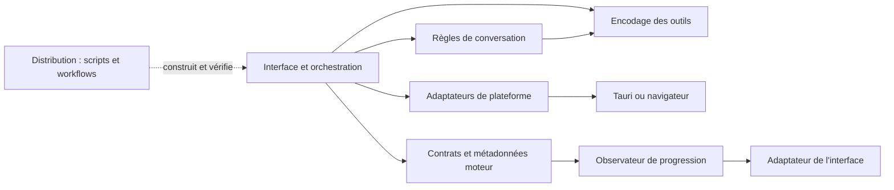

# Novera — développement

Référence des sources au **25 octobre 2026**. L’état de validation courant est centralisé dans [le tableau de bord](../TABLEAU_DE_BORD_NOVERA.md) ; le travail restant dans [la feuille de route](../ROADMAP.md).

[Architecture](#architecture) · [Moteur](#engine) · [Compatibilité](#compatibility) · [Dépendances](#dependencies) · [Logos](#logos) · [Contrôles](#checks)

<a id="architecture"></a>

## Architecture et frontières

### Les six responsabilités

| Partie | Règles ou code isolé | Points d’intégration existants |
| --- | --- | --- |
| Interface | [Politique des langues](../web-app/src/modules/interface/languages.ts) | Écrans dans `components/`, `containers/`, `routes/` ; [adaptateur des statistiques moteur](../web-app/src/adapters/interface/engine-progress.ts) |
| Conversations | [Messages](../web-app/src/modules/conversations/messages.ts), [branches](../web-app/src/modules/conversations/branching.ts), [budget et réduction du contexte](../web-app/src/modules/conversations/context.ts), [nettoyage des titres](../web-app/src/modules/conversations/titles.ts), [exports](../web-app/src/modules/conversations/export.ts) | Stores de sessions et sauvegarde dans `hooks/`, backend `src-tauri/src/core/threads/` ; exécution des résumés dans l’orchestration existante |
| Moteurs IA | [Contrats](../web-app/src/modules/engines/contracts.ts), [métadonnées et événements de progression](../web-app/src/modules/engines/stream-metadata.ts) | [ModelFactory](../web-app/src/lib/model-factory.ts), extensions llama.cpp/MLX, plugins Rust |
| Outils et agents | [Encodage des images de résultats MCP](../web-app/src/modules/tools/tool-images.ts) | Agents et MCP déjà dans `src-tauri/src/core/agent/`, `src-tauri/src/core/mcp/` et plugins d’outils |
| Adaptations par plateforme | [Préférences du navigateur](../web-app/src/modules/platform/browser-language.ts), [lecture de la locale native](../web-app/src/modules/platform/system-locale.ts) | Services Tauri/mobile/web, capacités et configurations Windows/Linux/Android existantes |
| Distribution | [Contrôle des flux de mise à jour](../scripts/distribution/check-update-feeds.mjs), exécuté hors du runtime de l’application | [Packaging portable Windows](BUILD_AND_RELEASE.md#portable) dans `scripts/distribution/` et point d’entrée compatible dans `scripts/` ; workflows manuels préparés, signature et distribution publique à valider |

La [carte lisible par les outils](../architecture/modules.json) décrit les six parties, leurs chemins et les dépendances autorisées des modules extraits.

### Sens des dépendances



L’observateur est une fonction fournie par l’appelant : le module moteur n’importe pas l’adaptateur d’interface. Les types SDK utilisés uniquement pour les contrats ne déclenchent pas de chargement runtime dans ces modules.

### Changements concrets

- Les fonctions de conversation déplacées sont conservées avec leur comportement : conversion de messages, choix des branches, estimation et réduction de contexte. Elles n’importent pas React, Zustand, les modèles exécutables ou les API système.
- La génération d’un résumé ou d’un titre reste dans l’orchestration, qui appelle les règles pures et le moteur. Elle n’est pas confondue avec l’estimation ou le nettoyage du texte.
- Le calcul des métadonnées moteur envoie des événements à un observateur. L’adaptateur d’interface les dirige vers la bonne conversation et ne met à jour les indicateurs globaux que pour le flux sélectionné. Un autre consommateur peut utiliser l’extracteur sans initialiser un store UI.
- La lecture de la langue système appartient à la plateforme ; la correspondance aux 60 langues disponibles appartient à l’interface. La sauvegarde et la priorité du dernier choix utilisateur restent dans les réglages.
- L’encodage des images d’outils est indépendant des écrans et des clients natifs.
- Le script de distribution garde son point d’entrée historique et son mode hors réseau. Les fixtures Jan héritées testent un contrat de flux ; elles ne créent pas un flux Novera et n’activent aucune mise à jour.

### Compatibilité et migration

Les anciens chemins `web-app/src/lib/messages.ts`, `message-branching.ts`, `tool-image-sentinel.ts` et `systemLanguage.ts` restent des points d’entrée de compatibilité. Le fichier `context-manager.ts` réexporte les règles pures et conserve l’orchestration du résumé. `thread-title-summarizer.ts` réexporte le nettoyage du titre.

`scripts/check-update-feeds.mjs` reste utilisable par les workflows existants ; son implémentation est maintenant sous `scripts/distribution/`. Les imports existants et les noms techniques externes restent compatibles. Aucun schéma de préférences ou de conversations n’est modifié par cette restructuration.

Pour un nouveau développement, importer les règles depuis leur module et réserver les façades historiques aux consommateurs non migrés. Une logique pure reçoit ses données en paramètres ; les accès à l’OS, à un store UI ou à un service restent dans un adaptateur ou dans l’orchestration.

### Contrôle automatique des frontières

```text
yarn check:architecture
yarn test:architecture
```

- Le contrôle lit les imports TypeScript/JavaScript, réexports et imports dynamiques des chemins `strictRoots` de la carte.
- Il applique les dépendances intermodules déclarées, distingue imports de types et imports exécutables et refuse l’accès direct aux globals navigateur depuis les règles pures.
- Les sept tests du contrôleur comprennent des exemples interdits : React/store/IPC dans un moteur, sortie du module par chemin relatif et dépendance inverse outils → conversations.
- Il vérifie aussi que les chemins documentés dans la carte existent.

**Périmètre précis :** les règles strictes portent actuellement sur les 13 fichiers des modules extraits et de l’outil de distribution. `sourceRoots` décrit les couches d’intégration existantes ; le contrôleur ne certifie pas que tout l’ancien code y est déjà découplé. Les tests et les adaptateurs ne sont pas inclus dans ces règles pures. Les accès indirects via une bibliothèque autorisée ne sont pas un audit de sécurité complet.

<a id="engine"></a>

## Moteur local

La source de version est `src-tauri/plugins/tauri-plugin-llamacpp/build.rs` : moteur **0.7.0**, llama.cpp **b11823**, commit `5c19a5a7560024bb19745b4ae04a75613d4b9aa3`. Une version déclarée n’atteste pas qu’un exécutable existant a été reconstruit.

La recommandation et le compagnon DSpark sont définis dans `web-app/src/lib/noveraRecommendedModel.ts`. Le modèle desktop reste LFM2.5-2.6B Q6_K ; DSpark ajoute un brouillon Q8_0 au chemin d’import existant (`specDraftPath`, type `dspark`, mode `draft-dspark`). La recommandation Android 1.2B est distincte. Les contrôles de mémoire et capacités ne remplacent pas des mesures matérielles.

Les optimisations M01–M04 héritées restent distinctes : résidence bornée des conversations/cache KV avec repli disque, chargement hors du verrou global, profil batch/microbatch mesuré volontaire avec repli manuel et spéculation n-gramme facultative pour texte répétitif. Elles conservent leurs gardes de compatibilité ; ne pas généraliser les gains historiques ni les additionner. [Conditions et mesures historiques](CHANGELOG.md#engine-history).

<a id="compatibility"></a>

## Noms internes et compatibilité

Les sources et leurs consommateurs utilisent désormais les noms Novera pour
les composants propres au projet.

| Ancien nom | Nom actuel |
| --- | --- |
| `jan-llama-worker` | `novera-llama-worker` |
| `jan_llama_shim.cpp` / `.h` | `novera_llama_shim.cpp` / `.h` |
| Fonctions C `jan_llama_*` | Fonctions C `novera_llama_*` |
| `useLatestJanModel` | `useLatestNoveraModel` |
| `useJanModelPromptDismissed` | `useNoveraModelPromptDismissed` |
| `useJanBrowserExtension` | `useNoveraBrowserExtension` |
| `JanBrowserExtensionDialog` | `NoveraBrowserExtensionDialog` |

Les manifestes Cargo/Tauri, imports et mocks, scripts de construction,
signature, paquet portable, installation Windows et workflows concernés
suivent ces noms. Le worker Android est désormais préparé sous le nom
`libnovera_llama_worker.so`. Les 17 fonctions de la frontière Rust/C++
utilisent le même préfixe et le même nom d’archive de shim.

### Compatibilité et identité des tiers

Les valeurs des clés de stockage persistent : le module Novera retrouve
notamment `jan-model-prompt-dismissed`. La recommandation reste celle de Novera.
Les variables de construction `JAN_ENGINE_*` et `JAN_LLAMA_CPP_*` existantes
restent compatibles ; cette modification ne migre pas toutes les anciennes API.

L’installateur Windows gère les deux noms du worker dans le répertoire de
l’installation : arrêt et libération avant remplacement, restauration si
l’installation abandonne, retrait de l’ancien worker après réussite.
Le même traitement est prévu à la désinstallation. Ce contrôle ne vise pas
les processus tiers installés ailleurs.

`getProviderLogo('novera')` utilise le logo Novera existant.
`getProviderLogo('jan')` garde le logo du fournisseur tiers Jan. Le vrai flux
de modèles Jan conserve son API `fetchLatestJanModel`. Le module navigateur
Novera conserve le nom `Jan Browser MCP`, sa commande de connexion et le lien
vers son extension Chrome existante : ce sont des identifiants de compatibilité
avec un composant tiers, pas une nouvelle extension Novera.
Les licences, auteurs historiques et attributions sont conservés.

<a id="dependencies"></a>

## Dépendances : sources de vérité

Consulter les manifestes et verrous versionnés, plutôt qu’une copie de plusieurs milliers de lignes qui vieillit séparément :

| Ensemble | Source de vérité |
| --- | --- |
| JavaScript/TypeScript et workspaces | [package.json](../package.json), [yarn.lock](../yarn.lock), manifestes de `web-app`, `core`, `extensions` et `packages` |
| Rust, CLI et plugins | [Cargo.toml](../src-tauri/Cargo.toml), [Cargo.lock](../src-tauri/Cargo.lock), manifestes des crates et [rust-toolchain.toml](../rust-toolchain.toml) |
| Android | [toolchain.json](../scripts/android/toolchain.json), scripts/modèles associés ; [construction](BUILD_AND_RELEASE.md#android) |
| Swift/MLX | [Package.swift](../mlx-server/Package.swift) et fichiers de résolution versionnés |
| Python/SDK | Manifestes et verrous des SDK dans `adk/python` |
| Moteurs, auxiliaires et ressources téléchargées | Scripts `download-lib.mjs`, `download-bin.mjs`, manifestes de ressources et empreintes des livrables |

Une contrainte de manifeste n’est pas nécessairement la version résolue du verrou. Les paquets internes ne sont pas des dépendances externes supplémentaires. Pour un audit de livraison, relever version/révision, source, empreinte, licence, notices et contenu réellement embarqué ; inclure modèles et médias. Ne pas modifier un verrou ou retirer un paquet sur la seule base de son nom historique. Aucun gain de taille ou de mémoire n’est revendiqué sans mesure.

L’ancien inventaire statique, qui incluait le site Jan désormais retiré, reste consultable dans [l’état précédant cette consolidation](https://github.com/TRON-ABS/Novera/blob/0765c3b1766ccb52905f876ef149e55e260c4b50/docs/DEPENDENCIES.md). Il n’est plus un inventaire courant.

<a id="logos"></a>

## Logos des fournisseurs : provenance

Ajout du **25 octobre 2026** : les sept nouveaux fournisseurs possèdent une image officielle locale, raccordée au composant existant `ProvidersAvatar` par `getProviderLogo` dans `web-app/src/lib/utils.ts`. Aucun chargement distant de logo n’est nécessaire à l’utilisation de Novera.

Les fichiers sont repris sans modification de leurs octets depuis les sites officiels, leurs CDN ou leur kit de marque. Together AI utilise le symbole SVG extrait du kit officiel, plus lisible en petite taille que son icône de site avec marges. Les marques restent la propriété de leurs titulaires ; leur présence identifie les fournisseurs configurables et ne constitue pas une affiliation.

### Provenance des fichiers

| Fournisseur | Fichier dans `web-app/public/images/model-provider/` | Page officielle | Image ou archive officielle |
| --- | --- | --- | --- |
| DeepSeek | `deepseek.ico` | [Source](https://www.deepseek.com/) | [Fichier](https://www.deepseek.com/favicon.ico) |
| Kimi / Moonshot AI | `moonshot.png` | [Source](https://moonshotai.github.io/Branding-Guide/) | [Fichier](https://moonshotai.github.io/Branding-Guide/scenarios/03-icon-without-kimi/kimi-icon-round.png) |
| Alibaba Cloud | `alibaba.png` | [Source](https://www.alibabacloud.com/en?_p_lc=7) | [Fichier](https://img.alicdn.com/tfs/TB1ugg7M9zqK1RjSZPxXXc4tVXa-32-32.png) |
| Cerebras | `cerebras.png` | [Source](https://www.cerebras.ai/company/press-kit) | [Fichier](https://cdn.sanity.io/images/e4qjo92p/production/e7a55ae5ab7e2c4fdfd4e66a51f628d1f2f44207-967x967.png?w=512&h=512&fit=max&auto=format) |
| Together AI | `together.svg` | [Source](https://www.together.ai/brand) | [Fichier](https://cdn.prod.website-files.com/69654e88dce9154b5f1206dd/69a6dad66e8b98c718262888_together-ai-logo-suite.zip) |
| Fireworks AI | `fireworks.svg` | [Source](https://fireworks.ai/) | [Fichier](https://fireworks.ai/icon.svg?26fd47f5c5eddcac) |
| Perplexity | `perplexity.png` | [Source](https://docs.perplexity.ai/docs/getting-started/overview) | [Fichier](https://docs.perplexity.ai/mintlify-assets/_mintlify/favicons/perplexity/rSPP83rcZL_iw-xo/_generated/favicon/android-chrome-192x192.png) |

Le membre Together AI conservé est `Together AI Logo Suite/Primary File/TogetherAI_Favicon.svg`.
Les conditions de marque restent celles des titulaires, notamment les [conditions Kimi](https://www.kimi.ai/policies/logo-usage-terms).

### Contrôles et maintenance

Vérification des sept fichiers, de leur correspondance avec les identifiants fournisseurs et de leurs empreintes SHA-256. SVG contrôlés sans scripts ni références à des ressources externes. Les 60 tests existants des utilitaires réussissent. Aperçu visuel local contrôlé à 18 et 40 pixels, sur fonds clair et sombre : les 28 occurrences des images sont décodées correctement. Le parcours complet dans un exécutable recompilé reste à vérifier ; ces logos sont publiés dans les sources ; le contrôle d’un nouvel exécutable reste distinct.

Pour remplacer ou ajouter un logo : retrouver une source officielle, conserver le symbole et les couleurs de la marque, vérifier le format et le rendu à petite taille dans les deux thèmes, actualiser la correspondance et cette provenance. Les noms de marques ne sont pas traduits ; aucun nouveau texte d’interface n’est ajouté ici.

#### Empreintes SHA-256

- `deepseek.ico` : `30a4420e6e4dcb17fd7de560c5004346c2bc8cd971d2d5f5ee15326603e51321`
- `moonshot.png` : `242ec4882a113fa27b7757af4bcc157273aeb86b92fe17cd81b23f3041c33d1b`
- `alibaba.png` : `8c48d7a8bea9ba2b13734166259712dbaccf4ca633223bbc03619921f2f2c405`
- `cerebras.png` : `820ee5e5acfbb89fc3ca5044c59acc417fea89cf19dd74ae9a289c11e2f05e4c`
- `together.svg` : `edf757b7bc10f86da65ba32ee2d02193cf952414aeb7bbbb69daaf9c2c927f80`
- `fireworks.svg` : `d88cab178a47518c6739e33b68bc4ab3670533268e64906aafa6f2c252b1ce03`
- `perplexity.png` : `97d8e57726298a7af87446aa79888562d8cbeb16757c2b10eaf90499cec8c9c3`

<a id="checks"></a>

## Contrôles de développement

Choisir les tests correspondant au changement et documenter leurs résultats réels. Pour les textes visibles, exécuter `python scripts/check-novera-locales.py` et maintenir [l’inventaire](LANGUAGES.md). Les scripts d’architecture ci-dessus vérifient uniquement leur périmètre déclaré. Les tests unitaires et un contrôle TypeScript sans émission ne remplacent ni compilation native ni essai utilisateur.

Pour les discussions : règles pures dans `web-app/src/modules/conversations`, fichiers/impression dans `web-app/src/adapters/platform/conversation-files.ts`, interface dans `ConversationActions.tsx`, `SamplerPopover.tsx` et `ChatInput.tsx` sous `web-app/src/containers`. Maintenir les frontières et leurs tests lors d’une extraction.

Documenter chaque information dans son guide de référence ; mettre les validations historiques dans [CHANGELOG.md](CHANGELOG.md), les tâches dans [ROADMAP.md](../ROADMAP.md) et la revue courante dans [PR.md](../PR.md). Garder les journaux bruts sous `.build`, hors publication.
