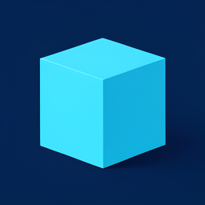

# Novera Web local image test

Generated inside Novera Web on November 7, 2026, using the actual Desktop FLUX.2 Klein 4B Q4_K_M, Qwen3 Q4 encoder and FLUX.2 VAE files. This is a Novera creation, not a public supplier sample. The PNG was saved in the conversation, retained after browser reload and downloaded through Novera's own control. No paid API was used.

The corrected WebGPU VAE path completed this small 256 × 256, four-step image in **32.7 seconds as displayed by Novera**. Normalization still falls back to the CPU. The PNG survived a browser reload and was downloaded from the conversation. See `provenance-webgpu.json` for the output hash and conditions.

The earlier `cyan-cube.png` and `provenance.json` retain the CPU VAE baseline, which took 3 min 54 s. These measurements do not establish performance at larger resolutions, parity with Desktop settings, or local music/video readiness.
